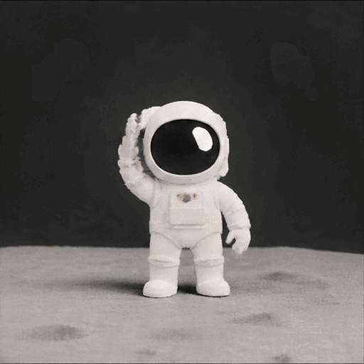

# GIF CINEMA

**A film pipeline built on ChatGPT GIFs.**

Generate animated GIF shots with OpenAI GPT Image 2.6, inspect first/last frames, and assemble silent scenes into MP4.

> Status: native GPT GIF generation is verified. Version 0.5 adds resumable script-to-film assembly. Character identity and seamless motion across independently generated scenes still require visual acceptance.

## Install the agent skill

The [GIF Cinema skill](.agents/skills/gif-cinema/SKILL.md) gives Codex or Claude Code
a workflow for planning short shots, generating GIFs with explicit request budgets,
reusing still-image references, reviewing both cuts around a retake, and exporting MP4.
It contains its own instructions and offline verification helper; the CLI source and
license are included in this repository. Python 3.10+, Git, FFmpeg and ffprobe are
required. New generation uses your own OpenAI API key and account access.

Copy `.agents/skills/gif-cinema` to `~/.codex/skills/gif-cinema` for Codex or
`~/.claude/skills/gif-cinema` for Claude Code, then follow its setup instructions.
Ask the agent to use `gif-cinema` to assemble two existing GIFs without paid calls
before authorizing generation. The helper uses synthetic images and checks the
installed CLI; it does not contact a provider.

The public skill covers generation and assembly. The separate private Studio editor
and its motion processing are not included. A film made with those additional tools
is not a one-click reproduction claim for this skill. Export FPS does not measure
newly generated motion. The source-available evaluation license remains unchanged.

## Script to film (v0.5)

Plan a three-shot film without a key, network calls or output writes:

```bash
python -m gif_cinema render examples/film.json --dry-run
```

Assemble the three existing GPT GIFs without spending money (FFmpeg and ffprobe required):

```bash
python -m gif_cinema render examples/film.json --execute --max-api-calls 0 --out output/offline-story
```

Repeat the command to reuse verified shots and the movie. The project contains
`film.mp4`, `captions.srt`, first/last PNGs, `contact-sheet.png`,
`continuity-report.json`, `film-inspect.json`, `render-manifest.json` and `receipt.json`.
The sample is a story assembly proof with known visual differences between shots,
not a claim of seamless character animation. Captions are a separate SRT file.

`examples/consistent-film.proposed.json` is an **unrendered** three-shot plan for one
recognizable astronaut and aligned poses. Dry-run is free. Executing prompt-based
shots makes paid API calls and requires authorization; the call cap includes retries.
See [script format, resume and safety](docs/SCRIPT-FORMAT.md).

## Demo: cleaned background and continuous loop (Nov 5, 2026)



**Post-processed demo:** 512×512, 16 frames, 3.2 seconds. The background patches were removed after generation, and the motion was arranged as a forward-and-reverse (ping-pong) loop to avoid the original pose jump. [Download the corrected GIF](docs/assets/astronaut-clean-loop.gif).

The source for this corrected demo is the [original manual API render](docs/assets/manual-live-41980327841/live-test.gif) from [run #41980327841](https://github.com/antropos17/chatgpt-gif-cinema/actions/runs/41980327841). This edit did not make another API request.

### Earlier authenticated API output

**Real API output:** 512×512, 9 frames, 1.8 seconds. [Original GIF](docs/assets/first-live-render.gif) · [MP4 export](docs/assets/first-live-film.mp4) · [API run](https://github.com/antropos17/chatgpt-gif-cinema/actions/runs/41978897155).

The animation was generated by a paid API request, not a mock. MP4 is a one-shot technical export, not a multi-shot short film.

## Three-shot short film proof

**A Reply from the Stars (5.4s)**: first authenticated GIF followed by two separately generated GPT Image 2.6 scenes. A montage experiment, not seamless character animation.

[Watch the three-shot MP4](docs/assets/three-shot/three-shot-film.mp4) · [Shot 2](docs/assets/three-shot/shot02.gif) · [Shot 3](docs/assets/three-shot/shot03.gif) · [Cut diagnostics](docs/assets/three-shot/cut01.json)

The output demonstrates real multi-shot assembly, but each shot is independently generated and visual continuity still needs human review.

## Manual live verification (Nov 5, 2026)

[Unmodified GIF from the manual API run](docs/assets/manual-live-41980327841/live-test.gif).

[Manual API run #41980327841](https://github.com/antropos17/chatgpt-gif-cinema/actions/runs/41980327841) succeeded: **512x512, 9 frames at 200 ms each = 1.8 seconds**, infinite loop. The downloaded artifact was independently decoded and its SHA-256 matched the [API metadata](docs/assets/manual-live-41980327841/live-test.json). [Frame inspection](docs/assets/manual-live-41980327841/live-test-inspect.json).

The unmodified output contains tan background patches and a visible pose change at the loop boundary. The demo at the top of this README applies background cleanup and a forward-and-reverse loop after generation; the original GIF and API metadata remain unchanged. This demonstrates authenticated GIF generation and subsequent editing, not finished film quality.

To repeat: open **Actions > Live GIF API Test > Run workflow** on `main`. This workflow runs only through `workflow_dispatch`, makes one paid request without automatic retries, uses the repository's `OPENAI_API_KEY` secret only in the relevant steps, and retains artifacts for seven days. It has read-only repository permissions. The demo files above remain in the repository.

## Quickstart

Requirements: Python 3.10 or newer, Git, and FFmpeg/ffprobe on PATH. Install FFmpeg from
[the official download page](https://ffmpeg.org/download.html), then check
`ffmpeg -version`. Pillow is installed automatically with this package.

```bash
git clone https://github.com/antropos17/chatgpt-gif-cinema.git
cd chatgpt-gif-cinema
python -m pip install -e ".[filmqa]"
```

Try the committed demo without an API key or paid request:

```bash
python -m gif_cinema inspect docs/assets/first-live-render.gif
python -m gif_cinema film docs/assets/first-live-render.gif -o output/demo.mp4
```

For new generation, set your API key in the current shell. API billing and model
access are separate from a ChatGPT subscription. This command makes a paid request.

Bash / macOS / Linux:

```bash
export OPENAI_API_KEY="your-key"
```

Windows PowerShell:

```powershell
$env:OPENAI_API_KEY="your-key"
```

```bash
python -m gif_cinema generate "Astronaut waving, static camera, seamless loop" --frames 9 --duration 200 -o output/shot.gif
python -m gif_cinema inspect output/shot.gif
python -m gif_cinema film output/shot.gif -o output/film.mp4
```

### Preserve and reuse results

Existing GIFs, metadata, movies, reports, and endpoint PNGs are protected from accidental overwrite.
Use `generate --resume` with the same prompt and parameters to reuse a decoded
GIF whose checksum matches its metadata, without a key or another API request.
Older files without checksum metadata cannot be resumed automatically: keep them
and use another output path, or explicitly regenerate with `--force`.
`generate --force` makes a new paid request. `film --force` replaces a movie only
after encoding succeeds. A `.lock` file prevents concurrent commands targeting
the same output; after a crash, confirm no command is running before removing it.

When using `film --audio soundtrack.wav`, short audio is padded with silence and
long audio is trimmed to the video. GIF delays are preserved within the selected
output FPS precision; changing FPS does not create new AI motion frames.

## Included

- Resumable script-to-film rendering with per-run request budgets and receipts
- Still-image references for generated script shots through image edits
- GPT Image GIF generator CLI
- First/last frame inspection and continuity checks
- FFmpeg GIF-to-MP4 assembler
- Six Codex agent skills: gif-cinema, chat-director, api-gif-generator, continuity-editor, film-assembler, qa-release
- Minimal black-and-white website

## License

Source-available evaluation license, not an open-source license. See LICENSE. Commercial use requires permission.

## Verification

Run `python -m unittest discover -s tests -v` and
`python -m compileall -q gif_cinema`. Tests use synthetic API responses and local
GIFs; they do not call OpenAI. Install FFmpeg to run the montage integration cases
(they are skipped when FFmpeg is absent). CI installs FFmpeg and runs them.

The historical real API render is confirmed by GitHub Actions
[run #41978897155](https://github.com/antropos17/chatgpt-gif-cinema/actions/runs/41978897155).
The three-shot demo is confirmed by
[run #41979631572](https://github.com/antropos17/chatgpt-gif-cinema/actions/runs/41979631572).
These artifacts establish those specific runs, not universal account access or
character continuity. Paid generation workflows are manual only.

### Current scope

The CLI generates shots, inspects endpoints, and renders the implemented v1 JSON
script into an MP4 with local-source reuse, explicit request budgets, resumable
manifests and receipts. Generated script shots accept local PNG/JPEG/WebP references
through image edits. See [the script contract](docs/SCRIPT-FORMAT.md).
Passing a reviewed last frame to the next shot is an explicit workflow; references
must exist before that script is validated. A visual editor, automatic take ranking,
automatic reference dependency graph and guaranteed Character Lock are not included.
Pixel similarity supports human review; it does not prove identity or narrative
continuity. Historical live outputs establish those runs, not current access on every
account. New live calls are separate from offline verification.

[OpenAI Image Generation guide](https://developers.openai.com/api/docs/guides/image-generation)
