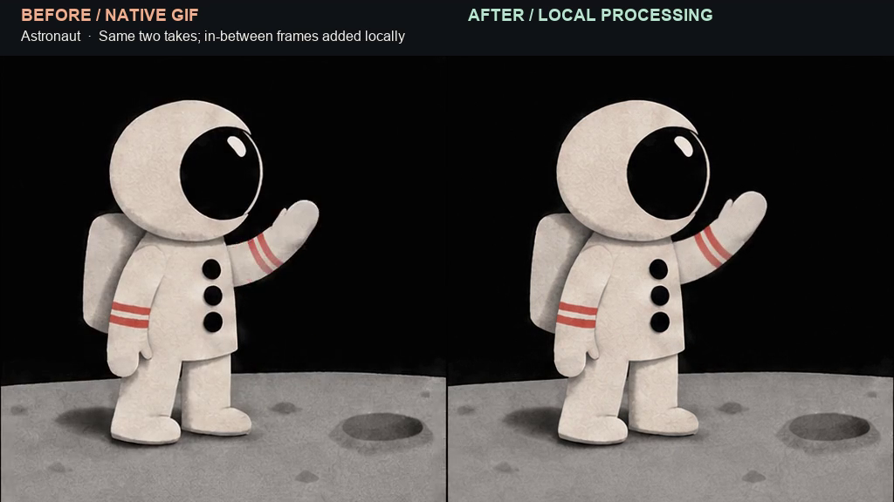
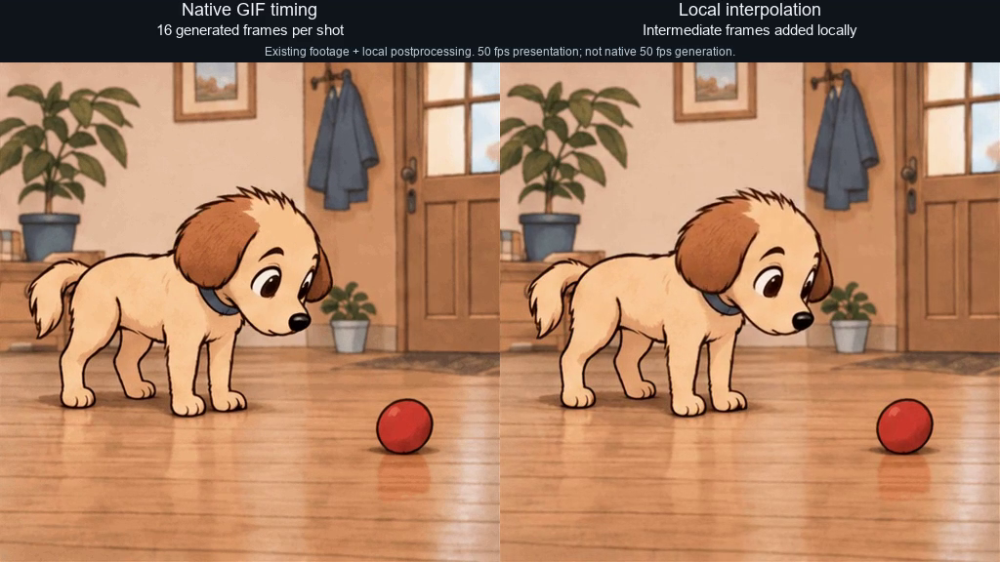

# GIF Cinema

**Turn short GPT GIFs into a film, one shot at a time.**

An agent skill and local CLI for **Codex** and **Claude Code**. Generate short takes with
still-image references, inspect how they cut together, reshoot a single moment, and
export an MP4. Start with the included footage and make a film without an API key.

[**Download the skill**](https://github.com/antropos17/chatgpt-gif-cinema/releases/tag/skill-v0.1.1) · [**Run the no-key demo**](#try-it-without-an-api-key) · [Watch the full cat film](#full-cat-film) · [Filmmaking tips](docs/TIPS.md)

[](https://github.com/antropos17/chatgpt-gif-cinema/actions/workflows/tests.yml) [](https://github.com/antropos17/chatgpt-gif-cinema/releases/tag/skill-v0.1.1) [](LICENSE)

## Source-only reliability preview

This branch adds bounded GIF decoding, FFmpeg capability checks, media-process
timeouts and durable render manifests. It keeps the existing CLI and checkout
examples. A standalone offline `motion` command now adds keyframed transforms,
retiming and verified exports for your own local image or footage. No new media,
packaged `demo`, editor, separate finishing command or standalone generation
receipts are included. It is not a new versioned release.
[Render limits and recovery](docs/SCRIPT-FORMAT.md).

Standalone `film --audio` also validates a bounded audio snapshot and checks the
final AAC track before publishing, including with `--force`. It requires ffprobe;
silent `film` remains FFmpeg-only. See [audio compatibility and limits](docs/SCRIPT-FORMAT.md#standalone-film-audio-compatibility).
[Motion recipes and limits](docs/MOTION-DESIGN.md).

```bash
python -m gif_cinema motion poster.png --preset push-in --out output/poster --dry-run
python -m gif_cinema motion poster.png --preset push-in --out output/poster
```

The source stays unchanged. Review the full-color MP4 and the separately quantized
GIF; technical verification does not automatically accept the result.

## Experimental independent layers

Unicode text can opt into the packaged, hash-pinned Noto Sans font for Russian
and Azerbaijani. Missing glyphs fail preflight instead of rendering as boxes.
Legacy text keeps its existing font and layout. [Unicode text and reproducibility](docs/UNICODE-TEXT.md).


A separate source-only PoC animates local image, text, rectangle and ellipse layers
independently, with editable keyframes and portable save/reopen verification.
It is **not Lottie-compatible** and does not load expressions, web fonts or plugins.
The [layered-scene guide](docs/MULTILAYER-POC.md) includes an asset-free JSON example
and explicit format, memory and timing limits. No showcase media are bundled.

## See the difference


**A cat finds the windowsill.** Walk across the room, jump up, curl into a ball. The
7.68-second comparison uses the same three generated takes on both sides. The
finished side combines framing corrections, compositing, and selective interpolation.

[Play the before/after](https://github.com/user-attachments/assets/4c200322-2bfc-46ad-8ba9-8548614608a5) · [Compare still frames](docs/assets/showcase/cat-frames.png)

The public toolkit covers GIF generation, still references, shot review, targeted
retakes, and MP4 assembly. The finished showcase uses additional local
postproduction. The no-key demo below shows the exact public-toolkit output.
[Showcase methods and frame samples](docs/SHOWCASE.md).

## Full cat film

**57.2 seconds · Silent short.** GPT-generated GIF shots, assembled and finished locally.

https://github.com/user-attachments/assets/32e3381d-dbd7-4ff3-8356-1d379b2b7456

[Open the MP4 file](docs/assets/showcase/cat-film.mp4)

## Try it without an API key

**Three bundled GIFs → a 7.68-second astronaut film.** An astronaut waves into
space, a star answers, and the astronaut brings a hand to his chest.

[**Watch the exact CLI export**](https://github.com/user-attachments/assets/c4dc8c9b-1e97-4f1a-9632-e285d9b969e0) · [View the film script](examples/film.json)

Install **Python 3.10+, Git, FFmpeg and ffprobe**. Make sure both video tools are
on your PATH. [FFmpeg downloads](https://ffmpeg.org/download.html).

```bash
git clone https://github.com/antropos17/chatgpt-gif-cinema.git
cd chatgpt-gif-cinema
python -m venv .venv
```

Activate the environment with `source .venv/bin/activate` on macOS/Linux or
`.\.venv\Scripts\Activate.ps1` in Windows PowerShell.

```bash
python -m pip install .
python -m gif_cinema render examples/film.json --dry-run --max-api-calls 0
python -m gif_cinema render examples/film.json --execute --max-api-calls 0 --out output/my-first-film
```

Open `output/my-first-film/film.mp4`. The same folder contains a contact sheet,
first and last frame PNGs, SRT captions, a continuity report, and a resumable
manifest. Repeating the last command reuses the verified result.

The export is 512 × 512 at 25 fps. Each source GIF has 16 generated drawings
with 160 ms holds. The export preserves those holds across its playback frames.
[Verification and timing evidence](STATUS.md).

## Give the skill to your agent

Extract the `gif-cinema` folder from the [skill ZIP](https://github.com/antropos17/chatgpt-gif-cinema/releases/download/skill-v0.1.1/gif-cinema-skill-0.1.1.zip)
into the skill directory for your agent.

| Agent | Installed folder |
| --- | --- |
| Codex | `~/.codex/skills/gif-cinema` |
| Claude Code | `~/.claude/skills/gif-cinema` |

Then ask your agent:

> Use the gif-cinema skill to assemble the included astronaut example with zero
> API calls. Show me the MP4 and the frames on either side of both cuts.

The package includes the three GIFs, the film script, setup steps for the pinned
runtime, and an offline smoke test. [Read the skill instructions](.agents/skills/gif-cinema/SKILL.md).

## Make a shot, keep a take

| Step | What you control |
| --- | --- |
| **Direct** | Define the action, camera, and opening and closing poses in a JSON script. |
| **Generate** | Dry-run the script, review the request count, and authorize a bounded run. |
| **Match** | Use a clean identity reference and a reviewed endpoint to guide the next shot. |
| **Inspect** | Compare the character, props, framing, and direction at each cut. |
| **Reshoot** | Target one shot with `--force-shot SHOT_ID`. Unchanged accepted shots can be reused. |
| **Export** | Assemble the chosen GIFs into MP4 and keep the review artifacts with the edit. |

**The cut is the test.** Review the last frame of a shot before passing it forward
as a reference. When you replace the middle shot, check its entrance and exit
before accepting the take. Continuity is a visual decision made by the author.

New generation uses your own OpenAI API key, billing, and supported model access.
The dry-run counts requests. Dollar cost depends on actual usage.
[Production guide](docs/PRODUCTION.md) · [Script format](docs/SCRIPT-FORMAT.md) · [Practical tips](docs/TIPS.md)

## Two more editing experiments

| Astronaut | Dog and ball |
| --- | --- |
|  |  |
| **5.12 s · Two shots.** Look at the movement between the held drawings as the astronaut raises a hand. | **10.24 s · Four takes.** Watch the ball and paw through the faster motion. Prop and contact errors can survive interpolation. |
| [Watch before/after](https://github.com/user-attachments/assets/86a158cc-c346-4486-8373-1a08fd54fd34) · [Frame pairs](docs/assets/showcase/astronaut-frames.png) | [Watch before/after](https://github.com/user-attachments/assets/63d2cff7-2cf6-4ba9-82a2-1d61dd4e0638) · [Frame pairs](docs/assets/showcase/dog-frames.png) |

## Verification, license, and support

- **Verification.** The public release was checked with 40 offline tests and a fresh
  install, including real GIF assembly, endpoint extraction, full video decode, and
  resume. Authenticated generation evidence is documented separately. [Status and receipts](STATUS.md).
- **License.** Personal non-commercial evaluation and research are permitted.
  Commercial use, redistribution, and hosting require permission. GIF Cinema is an
  independent project. [Source-available evaluation license](LICENSE). The bundled
  Noto font has its separate OFL 1.1 license, not these evaluation restrictions;
  see [third-party notices](THIRD-PARTY-NOTICES.md).
- **Support.** Follow the experiments on [Buy Me a Coffee](https://buymeacoffee.com/gifcinema).
