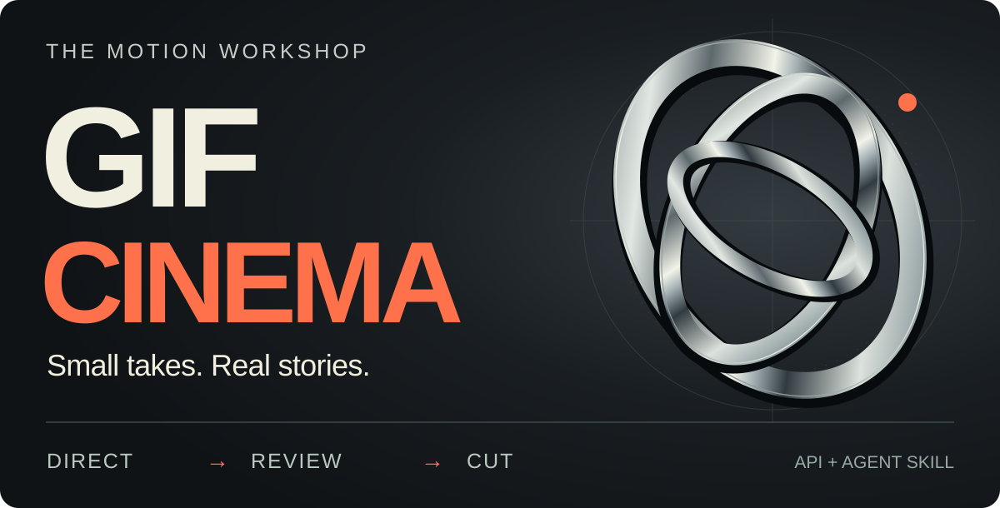

# GIF Cinema

**Direct short takes. Review the cuts. Keep the story.**

An agent skill and local Python toolkit for **Codex and Claude Code**. Assemble a
film from existing GIFs, add a title, and export MP4 or GIF. New shots use your own
supported API access; the included film works entirely offline.

[**Try the no-key demo**](#make-your-first-film) · [Watch the work](#selected-work) · [Install the skill](#install-the-skill) · [Production guide](docs/PRODUCTION.md)

[](https://github.com/antropos17/chatgpt-gif-cinema/actions/workflows/tests.yml) [](LICENSE)

<picture>
  <source media="(max-width: 600px)" srcset="docs/assets/identity/cover-mobile.svg">
  
</picture>

*Static cover. The motion examples below are actual existing footage.*

<a id="see-it-in-motion"></a>

<a id="on-the-screen"></a>

## Selected work

[**One GIF**](#a-wave-from-the-moon) · [**A three-shot film**](#a-reply-from-the-stars) · [**3D archive**](#archived-3d-study) · [**Finishing studies**](#finishing-studies)

The examples separate original API output, the public toolkit's exact export, and
additional local finishing. The separate 3D archive is an independently rendered
Blender reference. Each example has its source or method linked below.

<a id="01--one-prompt-one-small-performance"></a>

### A wave from the Moon

<p align="center">
  
</p>

**Direct API output** · 1.80 s · 9 drawings · 512 × 512 · Silent

One small hand movement, shown at its original stepped cadence. This historical
GIF is unaltered. A new take needs supported account access and billing; results vary.

[Repeat the request](docs/RECIPES.md#one-prompt-one-gif) · [Original parameters](docs/assets/first-live-render.json) · [Decoded timing](docs/assets/first-live-render-inspect.json)

<details>
<summary>Read the original prompt</summary>

> A tiny paper-cut astronaut waves once on the Moon, locked camera, matte monochrome background, clear silhouette, smooth loop, no text

“Smooth loop” is a request in the prompt, not a passed quality check.

</details>

<a id="02--three-takes-a-complete-little-exchange"></a>

### A Reply from the Stars

**Public toolkit export** · 7.68 s · 512 × 512 · Silent

An astronaut waves into the dark. A light answers. A hand moves toward the chest.
The three bundled source GIFs become one MP4, with a contact sheet and the frames
on both sides of every cut.

https://github.com/user-attachments/assets/c4dc8c9b-1e97-4f1a-9632-e285d9b969e0

[**Make this exact edit →**](#make-your-first-film) · [Open the MP4](docs/assets/showcase/astronaut-native-film.mp4) · [Read the three-shot script](examples/film.json)

**Next:** [add a title and export a GIF](docs/RECIPES.md#add-a-title-and-export-a-gif),
or split a completed edit into whole-shot chapters. The title recipe makes a
9.68-second MP4 from these same three actions.

<details>
<summary>See the three-shot structure</summary>


</details>

## Archived 3D study

**Chrome Trefoil** · Blender EEVEE · 3.20 s · 80 unique frames · 512 × 512 · Silent

<p align="center">
  <picture>
    <source media="(prefers-reduced-motion: reduce)" srcset="docs/assets/motion-elements/poster.png">
    
  </picture>
</p>

This is the original completed Blender art study, **not native API output** and not
a feature of the public generator. It is preserved here as a separate visual
reference. The public API workflow does not require Blender. One loop is complete.

[**Play the MP4**](docs/assets/motion-elements/chrome.mp4) · [Original GIF, 6.17 MB](docs/assets/motion-elements/chrome.gif) · [Decoded phases](docs/assets/motion-elements/decoded-phases.png) · [Provenance and source](docs/MOTION-DESIGN.md)

<a id="03--from-the-cutting-room"></a>

## Finishing studies

**Existing generated takes + additional local postproduction**

Each preview loops a **2.24-second excerpt**. Open its full comparison to judge
the complete action.
The right-hand panels use private finishing tools that are **not included in the
public CLI**. The [runnable film above](#02--three-takes-a-complete-little-exchange)
shows what the public source actually exports.

### Cat / Walk, jump, curl up


**Three actions · 7.68-second comparison · Silent**

Cross the room, reach the window, settle down. The finished version changes framing
and compositing as well as motion; the difference is not solely interpolation.

[**Watch the comparison →**](https://github.com/user-attachments/assets/4c200322-2bfc-46ad-8ba9-8548614608a5) · [Inspect frame pairs](docs/assets/showcase/cat-frames.png) · [Watch the 57.2-second assembled cat film](https://github.com/user-attachments/assets/32e3381d-dbd7-4ff3-8356-1d379b2b7456)

### Dog / Follow the ball


**Four takes · 10.24-second comparison · Silent**

Track the ball, the paws and the moment of contact. Intermediate playback frames can
soften a hold; they cannot fix a disappearing object or an incorrect paw.

[**Watch the comparison →**](https://github.com/user-attachments/assets/63d2cff7-2cf6-4ba9-82a2-1d61dd4e0638) · [Inspect frame pairs](docs/assets/showcase/dog-frames.png) · [Read the method](docs/SHOWCASE.md#dog--the-same-four-takes)

### Astronaut / A signal, an answer


**Two takes · 5.12-second comparison · Silent**

A greeting and a reply at matching timeline positions. This uses the first two
takes. The [public three-shot film](#a-reply-from-the-stars) preserves original timing
and does not apply this finishing step.

[**Watch the comparison →**](https://github.com/user-attachments/assets/86a158cc-c346-4486-8373-1a08fd54fd34) · [Inspect frame pairs](docs/assets/showcase/astronaut-frames.png) · [Read the method](docs/SHOWCASE.md#astronaut--two-shots-one-exchange)

[All methods, media provenance and known faults →](docs/SHOWCASE.md)

<a id="try-it-without-an-api-key"></a>

## Make your first film

**No key. No API calls. Real output.** You need Python 3.10+, Git, FFmpeg and ffprobe.
[Install FFmpeg](https://ffmpeg.org/download.html) if the two video tools are missing.

```bash
git clone https://github.com/antropos17/chatgpt-gif-cinema.git
cd chatgpt-gif-cinema
python -m venv .venv
```

Activate the environment: `source .venv/bin/activate` on macOS/Linux or
`.\.venv\Scripts\Activate.ps1` in Windows PowerShell. Then:

```bash
python -m pip install .
python -m gif_cinema doctor   # checks Python, Pillow and FFmpeg; sends no requests
python -m gif_cinema render examples/film.json --dry-run --max-api-calls 0
python -m gif_cinema render examples/film.json --execute --max-api-calls 0 --out output/my-first-film
```

**Open `output/my-first-film/film.mp4`.** You also get a contact sheet, six endpoint
images, a continuity report, SRT captions and a resumable manifest. Run the same
render command again to reuse the verified movie.

The MP4 plays at 25 fps; each source GIF contains 16 drawings held for 160 ms.
Export FPS does not create extra poses. [Verification and limits](STATUS.md).

<a id="copy-a-prompt"></a>

## Use it with your agent

Give these briefs to your agent after [installing the skill](#install-the-skill).
Each says what to make, what to preserve, and what to return.

### Assemble the included story

> Use the gif-cinema skill to render examples/film.json with zero API calls. Keep the original source timing. Return the 7.68-second MP4, contact sheet, and first/last frames. Tell me what changes across the two cuts instead of claiming automatic continuity.

**You get:** the runnable film shown above plus inspectable review artifacts.

<details>
<summary>Add a title, then make a GIF</summary>

> Use the gif-cinema skill to compile the bundled storyboard.json, render it with zero API calls, and export a 320-pixel GIF at 10 fps. Keep the 2-second animated title and the three existing astronaut takes. Return the MP4, GIF, and editable project. Do not generate new footage.

**You get:** a 9.68-second MP4 and a 9.70-second play-once GIF. The title is locally
animated; the astronaut drawings are unchanged. [Exact commands](docs/RECIPES.md#add-a-title-and-export-a-gif).

</details>

<details>
<summary>Plan a story with new actions</summary>

> Use the gif-cinema skill to plan a short illustrated story about a courier delivering a lantern. Keep the character, lantern, palette, and direction of travel consistent. Give each shot one visible action with a clear state before and after. Show the storyboard and request count before generation. Mark all missing footage as unrendered.

**You get:** an editable production plan and individual generation inputs, not a
finished cartoon. The included *Lantern Delivery* plan has 14 intended actions and
35.84 seconds of planned footage. [Plan, select takes, and continue](docs/STORYTELLING-SKILL.md).

</details>

<a id="give-the-skill-to-your-agent"></a>

## Install the skill

From the checkout, package the **current** source skill:

```bash
python tools/package_skill.py --out dist/gif-cinema-story-skill.zip
```

Extract the ZIP's single `gif-cinema` folder into:

- **Codex:** `~/.codex/skills/gif-cinema`
- **Claude Code:** `~/.claude/skills/gif-cinema`

[Read the skill](.agents/skills/gif-cinema/SKILL.md) · [Package checks](docs/STORYTELLING-SKILL.md#package-and-verify-the-skill)

<details>
<summary>Already using the published skill-v0.1.1 ZIP?</summary>

That [older release](https://github.com/antropos17/chatgpt-gif-cinema/releases/tag/skill-v0.1.1)
contains the core assembly workflow. It predates story planning, take selection and
chapter export. Package the current source for those helpers; this README is not a
new versioned release.

</details>

<a id="a-small-production-kept-editable"></a>

<a id="the-cut-is-the-test"></a>

## Production workflow

1. **Direct one change.** Define the state before, the visible action and the state after. Keep character, prop and camera choices explicit.
2. **Review the actual drawings.** Check both sides of every cut. A reference image or pixel score does not prove continuity; keep the accepted source bytes.
3. **Assemble and inspect.** Add a local title, build the MP4, then export a smaller GIF or whole-shot chapters. Preserve the editable storyboard and review artifacts.

The public source includes bounded API generation, still references, endpoint
inspection, MP4 assembly and GIF/chapter export. Private Studio, interpolation and
compositing tools are not bundled. New story actions need new footage.

Dry-run before generation and approve a bounded request count. Counts are not dollar
quotes. GIFs are silent; MP4 can import optional local audio.

## Guides

- [Example gallery](docs/EXAMPLES.md): source drawings, measured timing and reproducible outputs.
- [Recipes](docs/RECIPES.md): repeat a request, rebuild the film, or add a title.
- [Story workflow](docs/STORYTELLING-SKILL.md): plan actions, choose takes and continue an edit.
- [Script format](docs/SCRIPT-FORMAT.md): the exact project contract.
- [Verification](STATUS.md): tested behavior and known limits.
- [Website source](docs/WEBSITE.md): the separate screening-room presentation.

## Credits & license

Inspired by [GIF Factory](https://github.com/WoYun520/gif-factory)'s separation of
appearance, movement and purpose. [Attribution and MIT notice](.agents/skills/gif-cinema/THIRD_PARTY_NOTICES.md).
No GIF Factory artwork, fonts or exporter code are bundled. The cover and story diagram are static typography using outlined Open Sans;
[design and media provenance](docs/README-DESIGN.md), [font notice](docs/assets/identity/FONT-NOTICE.txt).

GIF Cinema is an independent **source-available** project. Personal non-commercial
evaluation and research are permitted; commercial use, redistribution and hosting
require permission. [Read the license](LICENSE).

[Support the workshop on Buy Me a Coffee ↗](https://buymeacoffee.com/gifcinema)
