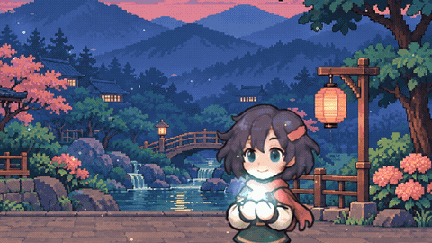

<h1 align="center">GIF Cinema</h1>
<p align="center"><strong>Turn GIF shots into short films.</strong><br>
Control cuts, inspect frame timing, and cap new generation requests.</p>
<p align="center">
<a href="#make-your-first-film"><strong>Run the no-key demo</strong></a> &nbsp; / &nbsp;
<a href="docs/CHARACTER-GALLERY.md">Explore 100 characters</a> &nbsp; / &nbsp;
<a href="docs/WORKFLOWS.md">Workflows & examples</a>
</p>

<p align="center"><sub>LANTERN ECHO · 20.8 SECONDS · SOUND INCLUDED</sub></p>
<p align="center">
<a href="https://raw.githubusercontent.com/antropos17/chatgpt-gif-cinema/8844c1a04a01566bcb3bd8308ee9e16d15f67825/docs/assets/lantern-echo/lantern-echo.mp4"><picture><source media="(prefers-reduced-motion: reduce)" srcset="docs/assets/lantern-echo/poster.png"></picture></a>
</p>

### Lantern Echo

A traveler sends a light to a courier; it returns to her hands and lights the
garden. Drawn actions, prepared local RIFE inbetweens and authored effects.
The looping GIF above is a **silent 6.4-second excerpt**, not the full film.

**[Download the full film with sound (MP4)](https://raw.githubusercontent.com/antropos17/chatgpt-gif-cinema/8844c1a04a01566bcb3bd8308ee9e16d15f67825/docs/assets/lantern-echo/lantern-echo.mp4)** ·
[Production & review](docs/LANTERN-ECHO.md) · [Still](docs/assets/lantern-echo/poster.png) ·
[Rebuild offline](examples/lantern-echo/README.md)

### Your footage, your edit

- **Choose the cuts.** Assemble accepted GIFs, inspect both sides of every join, and keep a resumable project.
- **Respect the drawings.** Preserve source holds in the bundled example. More playback frames do not create new character actions.
- **Control generation spend.** Reuse footage without new requests. Optional generation has an explicit request cap, not a dollar-budget guarantee.

A local Python CLI and an optional skill for **Codex or Claude Code**. No hosted
editor or API key is needed for the demo. The private browser editor is separate.

<a id="try-it-without-an-api-key"></a>

## Make your first film

**Three included GIFs → a 7.68-second silent MP4. Zero new API calls.**
[Watch the demo](https://github.com/antropos17/chatgpt-gif-cinema/releases/tag/skill-v0.1.1#watch-the-public-skill-output) (archived playback, not the current install package).

You need **Python 3.10+, Git, FFmpeg and ffprobe** with `libx264` support.
Pillow installs with the package. [Setup help](docs/GETTING-STARTED.md#1-install-from-this-repository).

```bash
git clone https://github.com/antropos17/chatgpt-gif-cinema.git
cd chatgpt-gif-cinema
python -m venv .venv
```

Activate with `source .venv/bin/activate` on macOS/Linux, or
`.\.venv\Scripts\Activate.ps1` in Windows PowerShell. Then install once:

```bash
python -m pip install .
```

**Run the demo:**

```bash
python tools/demo.py
```

The launcher checks local prerequisites and renders only the bundled footage.
It prints the exact movie path; the first run writes **`output/demo/film.mp4`**.
Repeat runs choose a new folder, leaving earlier results untouched. It does not
install software, open a browser or contact a generation provider.

Inspect the contact sheet and both cuts. The MP4 is a fixed-FPS, lossy viewing
format, not proof of seamless continuity. [What the example preserves](docs/EXAMPLES.md#1-plain-film-preserve-the-source-timing) ·
[Direct CLI and reuse](docs/GETTING-STARTED.md#2-make-a-film-without-a-key) · [Exact-frame master](docs/GIF-MASTER.md).

<a id="give-the-skill-to-your-agent"></a>
<a id="copy-a-prompt"></a>

## Install the skill

**[Download GIF Cinema skill 0.4.3](https://github.com/antropos17/chatgpt-gif-cinema/releases/tag/skill-v0.4.3)** for Codex or Claude Code. Follow the bundled `SKILL.md` to install the pinned Python runtime separately.

Prefer to build it yourself? [Build the skill from this checkout](docs/WORKFLOWS.md#install-the-skill). Older release ZIPs do not update automatically.

<a id="see-it-in-motion"></a>
<a id="on-the-screen"></a>
<a id="a-wave-from-the-moon"></a>
<a id="01--one-prompt-one-small-performance"></a>
<a id="character-stories"></a>
<a id="a-reply-from-the-stars"></a>
<a id="02--three-takes-a-complete-little-exchange"></a>
<a id="motion-graphics"></a>

## Selected work

[Stories, lettering and graphic layers](docs/WORKFLOWS.md#selected-work) ·
[Native Lantern Echo fragment](examples/native-shots/README.md) ·
[Original API take](docs/RECIPES.md#one-prompt-one-gif) · [Vertical motion](docs/VERTICAL-MOTION-EXAMPLE.md)

<a id="blender-motion-study"></a>
<a id="sculptural-loops"></a>

**Sculptural loops:** [FORM / 01 and its Blender source](docs/WORKFLOWS.md#sculptural-loops),
plus [Chrome Trefoil](docs/MOTION-DESIGN.md). Standalone Blender scenes, not a CLI rendering backend.

## Anime pixel art

**[Open the full gallery: 100 characters + 3 outfit studies](docs/CHARACTER-GALLERY.md).**
All animated previews, stills, sources and limitations are preserved on a separate
page. Short pose studies are not finished 15-second scenes.

<a id="cast-001-024"></a><a id="cast-001024"></a>
[001–024](docs/CHARACTER-GALLERY.md#cast-001-024) ·
<a id="cast-025-048"></a><a id="cast-025048"></a>
[025–048](docs/CHARACTER-GALLERY.md#cast-025-048) ·
<a id="cast-049-072"></a><a id="cast-049072"></a>
[049–072](docs/CHARACTER-GALLERY.md#cast-049-072) ·
<a id="cast-073-096"></a><a id="cast-073096"></a>
[073–096](docs/CHARACTER-GALLERY.md#cast-073-096) ·
<a id="cast-097-100"></a><a id="cast-097100-and-outfit-studies"></a>
[097–100 + outfits](docs/CHARACTER-GALLERY.md#cast-097-100)

<a id="sprites-and-frame-review"></a>
<a id="exact-script-montage"></a>
<a id="build-an-offline-gif-collection"></a>

## Choose a workflow

| Next step | Guide |
| --- | --- |
| Use your own GIFs | [Import footage](docs/GETTING-STARTED.md#bring-your-own-footage) |
| Review frames and joins | [Review checklist](docs/GIF-REVIEW.md) · [Sprite tools](docs/SPRITES.md) |
| Add titles, layers, sound or connected scenes | [Workflow index](docs/WORKFLOWS.md#choose-a-workflow) |
| Build a local GIF collection | [Offline factory](docs/OFFLINE-FACTORY.md) |
| Read the format or verification scope | [Script contract](docs/SCRIPT-FORMAT.md) · [Status](STATUS.md) |

## Before making new footage

Generation is optional and requires supported provider access, billing and an
explicitly authorized request cap. [Generation guide](.agents/skills/gif-cinema/references/generation.md) ·
[Production and review](docs/PRODUCTION.md). Technical checks do not approve visual continuity.

<a id="finishing-studies"></a>
<a id="03--from-the-cutting-room"></a>
<a id="from-the-cutting-room"></a>
<a id="cat--walk-jump-curl-up"></a>
<a id="dog--follow-the-ball"></a>
<a id="astronaut--a-signal-an-answer"></a>
<a id="archived-3d-study"></a>

[Earlier films and finishing studies](docs/WORKFLOWS.md#finishing-studies) remain
available. Their private finishing tools are **not included in the public CLI**.

## Rights and credits

**Source-available, not OSI open source.** Personal non-commercial evaluation and
research are permitted; commercial use, redistribution and hosting require permission.
[License](LICENSE) · [Support the workshop](https://buymeacoffee.com/gifcinema).

Inspired by [GIF Factory](https://github.com/WoYun520/gif-factory)'s visual catalog
and separation of production methods. No upstream artwork, character assets or code
are copied into this catalog. [Attribution](.agents/skills/gif-cinema/THIRD_PARTY_NOTICES.md).
