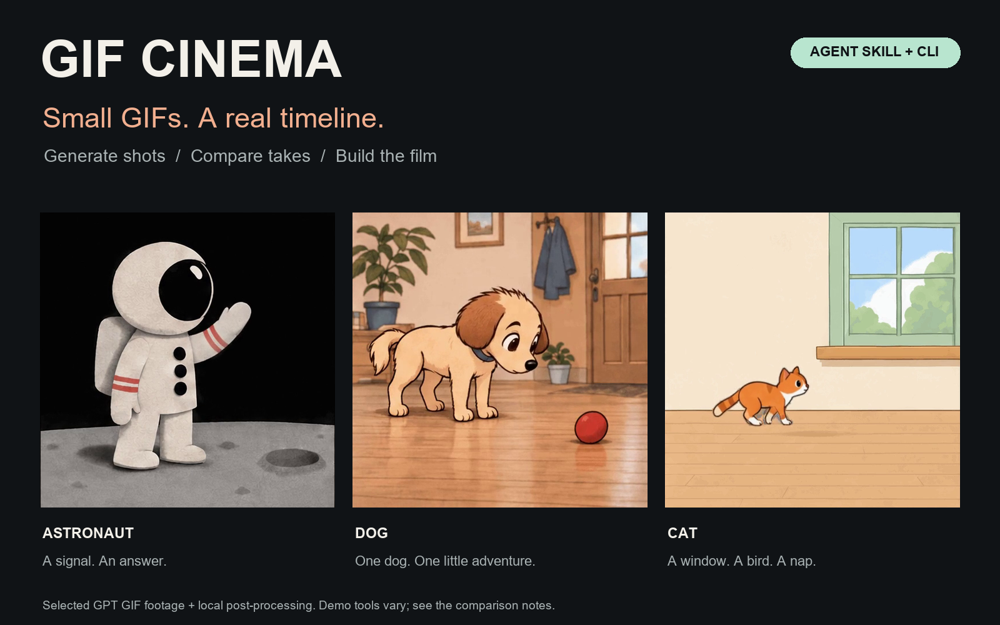

# GIF Cinema

[](https://github.com/antropos17/chatgpt-gif-cinema/actions/workflows/tests.yml)
[](https://github.com/antropos17/chatgpt-gif-cinema/releases/tag/skill-v0.1.1)
[](LICENSE)
[](https://buymeacoffee.com/gifcinema)



**An agent skill that turns short GPT GIFs into a film, one shot at a time.**

Plan a scene, generate a take, inspect the cut, replace what does not work, and export MP4.
The public toolkit runs locally with Codex or Claude Code and your own OpenAI API key.

[**Get the skill →**](https://github.com/antropos17/chatgpt-gif-cinema/releases/tag/skill-v0.1.1) · [Try the included GIFs](#try-it-without-an-api-key) · [Before / after](#see-the-difference) · [Tips](docs/TIPS.md) · [Verification](STATUS.md)

## See the difference

### An astronaut gets an answer

[](https://github.com/user-attachments/assets/86a158cc-c346-4486-8373-1a08fd54fd34)

Two separately generated shots, the same takes on both sides. Left: native GIF timing.
Right: locally interpolated motion. This 5.12-second comparison covers the first two
shots; it makes the difference between a held drawing and an intermediate pose visible.

[Watch comparison](https://github.com/user-attachments/assets/86a158cc-c346-4486-8373-1a08fd54fd34) · [Inspect three frame pairs](docs/assets/showcase/astronaut-frames.png) · [Run the native three-shot example](examples/film.json)

### A dog and a ball

[](https://github.com/user-attachments/assets/63d2cff7-2cf6-4ba9-82a2-1d61dd4e0638)

Four selected takes, compared over 10.24 seconds. Local interpolation fills time between
existing drawings. It can also reveal trails or prop errors; a smoother playback does
not establish that every generated action is correct.

[Watch comparison](https://github.com/user-attachments/assets/63d2cff7-2cf6-4ba9-82a2-1d61dd4e0638) · [Inspect three frame pairs](docs/assets/showcase/dog-frames.png)

### A cat finds the windowsill

[](https://github.com/user-attachments/assets/4c200322-2bfc-46ad-8ba9-8548614608a5)

Walk, jump, curl up. The 7.68-second comparison uses the same three generated takes.
The finished side combines framing corrections, compositing and selective interpolation.
The complete silent cat edit runs **57.2 seconds**.

[Watch comparison](https://github.com/user-attachments/assets/4c200322-2bfc-46ad-8ba9-8548614608a5) · [Inspect three frame pairs](docs/assets/showcase/cat-frames.png) · [Watch the full cat film](https://github.com/user-attachments/assets/32e3381d-dbd7-4ff3-8356-1d379b2b7456)

https://github.com/user-attachments/assets/32e3381d-dbd7-4ff3-8356-1d379b2b7456

**What ships:** the public skill and CLI generate reference-conditioned GIF shots,
review endpoints, handle explicit retakes and assemble MP4. The comparison films also
use additional private motion/compositing tools. Those finishing tools and the Studio
interface are separate from this release. [Methods and exact comparison scope](docs/SHOWCASE.md).

## Try it without an API key

You need **Python 3.10+, Git, FFmpeg and ffprobe**. Check `ffmpeg -version` and
`ffprobe -version` before rendering. [FFmpeg downloads](https://ffmpeg.org/download.html).

```bash
git clone https://github.com/antropos17/chatgpt-gif-cinema.git
cd chatgpt-gif-cinema
python -m venv .venv
```

Activate `.venv` for your shell (`source .venv/bin/activate` on macOS/Linux,
`.\.venv\Scripts\Activate.ps1` on Windows PowerShell), then:

```bash
python -m pip install .
python -m gif_cinema render examples/film.json --dry-run
python -m gif_cinema render examples/film.json --execute --max-api-calls 0 --out output/my-first-film
```

Open `output/my-first-film/film.mp4`. Three committed GPT GIFs become a **7.68-second**
H.264 MP4 at 512×512. The source has **16 generated drawings per shot**; 25 export fps
preserves playback timing rather than generating extra motion. Repeat the last command
to reuse the verified result. This example needs **zero paid API calls**.

The exact public-toolkit output:

https://github.com/user-attachments/assets/c4dc8c9b-1e97-4f1a-9632-e285d9b969e0

You also get first/last PNGs, a contact sheet, separate SRT captions, a continuity
report and a resumable manifest. The older 5.4-second assembly experiment is retained
as [film-historical.json](examples/film-historical.json).

## Give the skill to your agent

Download [the skill ZIP](https://github.com/antropos17/chatgpt-gif-cinema/releases/download/skill-v0.1.1/gif-cinema-skill-0.1.1.zip)
and extract its `gif-cinema` folder to:

| Agent | Skill directory |
| --- | --- |
| Codex | `~/.codex/skills/gif-cinema` |
| Claude Code | `~/.claude/skills/gif-cinema` |

The [skill instructions](.agents/skills/gif-cinema/SKILL.md) include an isolated runtime
setup, an executable offline check, and three real GIFs with a runnable script.
The ZIP includes this example too. Start with:

> Use gif-cinema to assemble the included example without paid calls. Show the movie
> and both cuts, and report native frame timing separately from export FPS.

Then try an authored scene:

> Plan three short shots for a tiny story. Keep the character and camera geography
> recognizable. Show the dry-run and request budget before generating. Review each
> shot before using its last frame as a reference for the next one.

## Make a shot, keep a take

| Step | What the public toolkit does |
| --- | --- |
| Direct | The agent writes a versioned JSON script with first/last pose targets. |
| Generate | `render` submits explicitly authorized shots using your API key and request cap. |
| Reference | Local PNG/JPEG/WebP images condition a shot; a reviewed endpoint can guide the next. |
| Inspect | Native timing, first/last frames and contact sheets support visual review. |
| Retake | `--force-shot SHOT_ID` replaces the target while unchanged accepted shots are reused. |
| Export | FFmpeg assembles selected GIFs, preserving source timing within export precision. |

Reference chaining is explicit: create and review an endpoint before validating the
next script. A middle-shot retake needs review at **both** neighboring cuts.
See [the script format](docs/SCRIPT-FORMAT.md) and [production guide](docs/PRODUCTION.md).

New GIF generation uses your own API billing and model access. Keep `OPENAI_API_KEY`
in your local environment. Dry-runs report request counts; monetary cost depends on
actual usage and current provider rates. Local assembly and finishing do not imply
another generation charge.

## What is verified

Fresh public installation, real GIF-to-MP4 assembly, unchanged source hashes, exact
endpoint extraction, full video decode, repeat/resume and **40 offline tests** were
checked on November 6, 2026. [Evidence and limits](STATUS.md).

Historical authenticated generation is documented separately. Offline tests do not
prove current access on every account, guaranteed character continuity, or a finished
long film from one prompt. Native GIF drawings, repeated export frames and locally
interpolated frames are different things.

## Support the experiments

[Follow GIF Cinema on Buy Me a Coffee](https://buymeacoffee.com/gifcinema).
The creator page is live; payments are not enabled yet while payout setup is pending.
Future support will help fund generation experiments and improvements to motion and
continuity. Support does not grant a commercial license or a feature entitlement.

## License

[Source-available evaluation license](LICENSE). Personal non-commercial evaluation
and research are permitted. Commercial use, redistribution and hosting require
permission. This is an independent project, not an OpenAI product.
