# GIF Cinema

**Turn existing GIFs into a film. Inspect every cut.**

A local workshop for **Codex and Claude Code**. No API key needed for the bundled demo.

[Try it](#make-your-first-film) · [Exact-frame master](docs/GIF-MASTER.md) · [Agent skill](#install-the-skill) · [100-character grid](#anime-pixel-art) · [Workflows](#choose-a-workflow)

<a href="docs/EXAMPLES.md#2-titled-story-a-small-gif-to-share"><picture></picture></a>

**Three takes + a title.** A 9.70-second example, not proof of perfect continuity.
[Sources & recipe](docs/EXAMPLES.md)

<a id="try-it-without-an-api-key"></a>

## Make your first film

**Three bundled GIFs → a 7.68-second MP4. No key, no paid requests.**

You need Python 3.10+, Git, FFmpeg and ffprobe. Pillow installs with the package.

```bash
git clone https://github.com/antropos17/chatgpt-gif-cinema.git
cd chatgpt-gif-cinema
python -m venv .venv
```

Activate with `source .venv/bin/activate` on macOS/Linux, or
`.\.venv\Scripts\Activate.ps1` in Windows PowerShell. Then:

```bash
python -m pip install .
python -m gif_cinema doctor
python -m gif_cinema render examples/film.json --dry-run --max-api-calls 0
python -m gif_cinema render examples/film.json --execute --max-api-calls 0 --out output/my-first-film
```

Open **`output/my-first-film/film.mp4`**. The folder also includes a contact sheet,
cut endpoints and a resumable manifest. Repeat the last command to verify reuse
with zero new provider calls. [What this example preserves](docs/EXAMPLES.md#1-plain-film-preserve-the-source-timing).

Need exact decoded drawings and native GIF holds? Use the optional
[lossless film master](docs/GIF-MASTER.md). Ordinary MP4 export is a fixed-FPS,
lossy viewing format.

<a id="give-the-skill-to-your-agent"></a>
<a id="copy-a-prompt"></a>

## Install the skill

Build the maintained **0.4.2 skill package** from this checkout:

```bash
python tools/package_skill.py --out dist/gif-cinema.skill.zip
```

Extract its single `gif-cinema` folder into:

- **Codex:** `~/.codex/skills/gif-cinema`
- **Claude Code:** `~/.claude/skills/gif-cinema`

Follow [the included installation check](.agents/skills/gif-cinema/SKILL.md#runtime-and-a-no-key-check)
to install and verify its pinned Python runtime separately. The older `skill-v0.1.1`
GitHub Release is not this package.

Try this with your agent:

> Use the gif-cinema skill to assemble the included astronaut story with zero API calls. Return the MP4, a small GIF, the editable project and a review of both cuts.

## Anime pixel art

Already tried the film? Explore the full cast below, or [browse methods and recipes](docs/GALLERY.md).
The full grid stays on this page by design; animated media across the README totals about **93 MB**.
On a slow connection, jump straight to [setup](#make-your-first-film) or open a character’s **Still** link.


**100 characters · 3 outfit studies · real GIF previews**

Short 1.44–1.92 s character studies, not finished 15-second scenes. Click to watch; “Method & limits” explains the remaining drift.

<table>
<tr>
<td align="center" valign="top" width="33.33%">
<a href="examples/anime-pixel/character-previews/fox-knight.gif"><picture><source media="(prefers-reduced-motion: reduce)" srcset="examples/anime-pixel/character-previews/frames/fox-knight/00.png">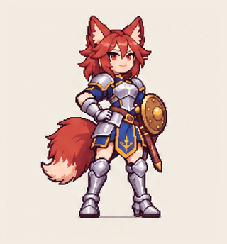</picture></a><br>
<strong>001 · Fox knight</strong><br>
<sub>shield salute · 1.92 s</sub><br>
<sub><a href="examples/anime-pixel/character-previews/README.md" title="Generated-pose preview; face/outline drift.">Method &amp; limits</a> · <a href="examples/anime-pixel/character-previews/frames/fox-knight/00.png">Still</a></sub>
</td>
<td align="center" valign="top" width="33.33%">
<a href="examples/anime-pixel/character-previews/dragon-chef.gif"><picture><source media="(prefers-reduced-motion: reduce)" srcset="examples/anime-pixel/character-previews/frames/dragon-chef/00.png"></picture></a><br>
<strong>002 · Dragon chef</strong><br>
<sub>offering basket · 1.92 s</sub><br>
<sub><a href="examples/anime-pixel/character-previews/README.md" title="Generated-pose preview; face/outline drift.">Method &amp; limits</a> · <a href="examples/anime-pixel/character-previews/frames/dragon-chef/00.png">Still</a></sub>
</td>
<td align="center" valign="top" width="33.33%">
<a href="examples/anime-pixel/character-previews-batch2/raccoon-courier.gif"><picture><source media="(prefers-reduced-motion: reduce)" srcset="examples/anime-pixel/character-previews-batch2/frames/raccoon-courier/00.png">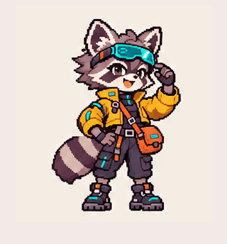</picture></a><br>
<strong>003 · Raccoon courier</strong><br>
<sub>goggle salute · 1.92 s</sub><br>
<sub><a href="examples/anime-pixel/character-previews-batch2/README.md" title="Generated-pose preview; face/outline drift.">Method &amp; limits</a> · <a href="examples/anime-pixel/character-previews-batch2/frames/raccoon-courier/00.png">Still</a></sub>
</td>
</tr>
<tr>
<td align="center" valign="top" width="33.33%">
<a href="examples/anime-pixel/character-previews-batch2/coral-astronaut.gif"><picture><source media="(prefers-reduced-motion: reduce)" srcset="examples/anime-pixel/character-previews-batch2/frames/coral-astronaut/00.png">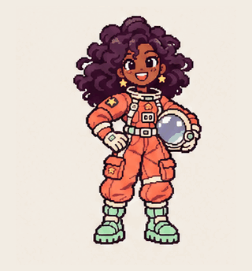</picture></a><br>
<strong>004 · Coral astronaut</strong><br>
<sub>hand wave · 1.92 s</sub><br>
<sub><a href="examples/anime-pixel/character-previews-batch2/README.md" title="Generated-pose preview; face/outline drift.">Method &amp; limits</a> · <a href="examples/anime-pixel/character-previews-batch2/frames/coral-astronaut/00.png">Still</a></sub>
</td>
<td align="center" valign="top" width="33.33%">
<a href="examples/anime-pixel/character-previews-batch3/violinist.gif"><picture><source media="(prefers-reduced-motion: reduce)" srcset="examples/anime-pixel/character-previews-batch3/frames/violinist/00.png">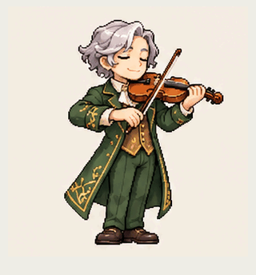</picture></a><br>
<strong>005 · Violinist</strong><br>
<sub>bow gesture · 1.92 s</sub><br>
<sub><a href="examples/anime-pixel/character-previews-batch3/README.md" title="Generated-pose preview; face/outline drift.">Method &amp; limits</a> · <a href="examples/anime-pixel/character-previews-batch3/frames/violinist/00.png">Still</a></sub>
</td>
<td align="center" valign="top" width="33.33%">
<a href="examples/anime-pixel/character-previews-batch3/blacksmith.gif"><picture><source media="(prefers-reduced-motion: reduce)" srcset="examples/anime-pixel/character-previews-batch3/frames/blacksmith/00.png">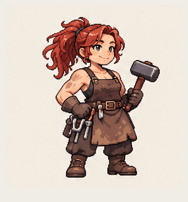</picture></a><br>
<strong>006 · Blacksmith</strong><br>
<sub>hammer inspection · 1.92 s</sub><br>
<sub><a href="examples/anime-pixel/character-previews-batch3/README.md" title="Generated-pose preview; face/outline drift.">Method &amp; limits</a> · <a href="examples/anime-pixel/character-previews-batch3/frames/blacksmith/00.png">Still</a></sub>
</td>
</tr>
<tr>
<td align="center" valign="top" width="33.33%">
<a href="examples/anime-pixel/catalog-100/herbalist.gif"><picture><source media="(prefers-reduced-motion: reduce)" srcset="examples/anime-pixel/catalog-100/posters/herbalist.png">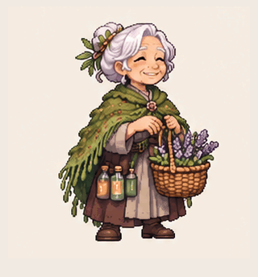</picture></a><br>
<strong>007 · Herbalist</strong><br>
<sub>lavender offering · 1.92 s</sub><br>
<sub><a href="examples/anime-pixel/catalog-100/README.md" title="Generated-pose preview. Residual face/outline drift; opaque ivory background; short 1.92 s loop, not a 15 s narrative or finished acting animation.">Method &amp; limits</a> · <a href="examples/anime-pixel/catalog-100/posters/herbalist.png">Still</a></sub>
</td>
<td align="center" valign="top" width="33.33%">
<a href="examples/anime-pixel/catalog-100/magician.gif"><picture><source media="(prefers-reduced-motion: reduce)" srcset="examples/anime-pixel/catalog-100/posters/magician.png">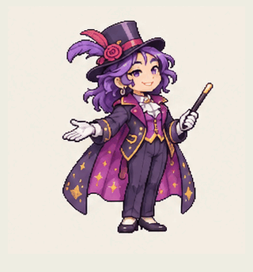</picture></a><br>
<strong>008 · Magician</strong><br>
<sub>wand flourish · 1.92 s</sub><br>
<sub><a href="examples/anime-pixel/catalog-100/README.md" title="Generated-pose preview. Residual face/outline drift; opaque ivory background; short 1.92 s loop, not a 15 s narrative or finished acting animation.">Method &amp; limits</a> · <a href="examples/anime-pixel/catalog-100/posters/magician.png">Still</a></sub>
</td>
<td align="center" valign="top" width="33.33%">
<a href="examples/anime-pixel/catalog-100/baker.gif"><picture><source media="(prefers-reduced-motion: reduce)" srcset="examples/anime-pixel/catalog-100/posters/baker.png">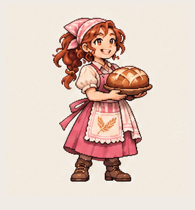</picture></a><br>
<strong>009 · Baker</strong><br>
<sub>bread presentation · 1.92 s</sub><br>
<sub><a href="examples/anime-pixel/catalog-100/README.md" title="Generated-pose preview. Residual face/outline drift; opaque ivory background; short 1.92 s loop, not a 15 s narrative or finished acting animation.">Method &amp; limits</a> · <a href="examples/anime-pixel/catalog-100/posters/baker.png">Still</a></sub>
</td>
</tr>
<tr>
<td align="center" valign="top" width="33.33%">
<a href="examples/anime-pixel/catalog-100/lantern-sailor.gif"><picture><source media="(prefers-reduced-motion: reduce)" srcset="examples/anime-pixel/catalog-100/posters/lantern-sailor.png">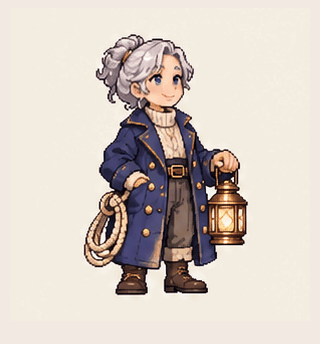</picture></a><br>
<strong>010 · Lantern sailor</strong><br>
<sub>lantern lift · 1.92 s</sub><br>
<sub><a href="examples/anime-pixel/catalog-100/README.md" title="Generated-pose preview. Residual face/outline drift; opaque ivory background; short 1.92 s loop, not a 15 s narrative or finished acting animation.">Method &amp; limits</a> · <a href="examples/anime-pixel/catalog-100/posters/lantern-sailor.png">Still</a></sub>
</td>
<td align="center" valign="top" width="33.33%">
<a href="examples/anime-pixel/catalog-100/botanist.gif"><picture><source media="(prefers-reduced-motion: reduce)" srcset="examples/anime-pixel/catalog-100/posters/botanist.png">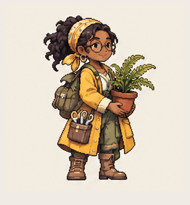</picture></a><br>
<strong>011 · Botanist</strong><br>
<sub>plant inspection · 1.92 s</sub><br>
<sub><a href="examples/anime-pixel/catalog-100/README.md" title="Generated-pose preview. Residual face/outline drift; opaque ivory background; short 1.92 s loop, not a 15 s narrative or finished acting animation.">Method &amp; limits</a> · <a href="examples/anime-pixel/catalog-100/posters/botanist.png">Still</a></sub>
</td>
<td align="center" valign="top" width="33.33%">
<a href="examples/anime-pixel/catalog-100/dancer.gif"><picture><source media="(prefers-reduced-motion: reduce)" srcset="examples/anime-pixel/catalog-100/posters/dancer.png">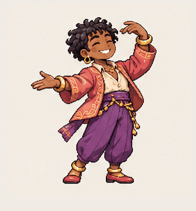</picture></a><br>
<strong>012 · Dancer</strong><br>
<sub>arm flourish · 1.92 s</sub><br>
<sub><a href="examples/anime-pixel/catalog-100/README.md" title="Generated-pose preview. Residual face/outline drift; opaque ivory background; short 1.92 s loop, not a 15 s narrative or finished acting animation.">Method &amp; limits</a> · <a href="examples/anime-pixel/catalog-100/posters/dancer.png">Still</a></sub>
</td>
</tr>
<tr>
<td align="center" valign="top" width="33.33%">
<a href="examples/anime-pixel/catalog-100/mechanic.gif"><picture><source media="(prefers-reduced-motion: reduce)" srcset="examples/anime-pixel/catalog-100/posters/mechanic.png">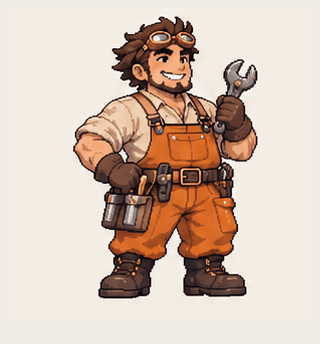</picture></a><br>
<strong>013 · Mechanic</strong><br>
<sub>wrench inspection · 1.92 s</sub><br>
<sub><a href="examples/anime-pixel/catalog-100/README.md" title="Generated-pose preview. Residual face/outline drift; opaque ivory background; short 1.92 s loop, not a 15 s narrative or finished acting animation.">Method &amp; limits</a> · <a href="examples/anime-pixel/catalog-100/posters/mechanic.png">Still</a></sub>
</td>
<td align="center" valign="top" width="33.33%">
<a href="examples/anime-pixel/catalog-100/detective.gif"><picture><source media="(prefers-reduced-motion: reduce)" srcset="examples/anime-pixel/catalog-100/posters/detective.png">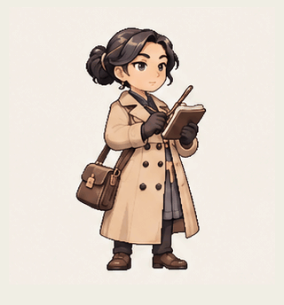</picture></a><br>
<strong>014 · Detective</strong><br>
<sub>notebook idle · 1.92 s</sub><br>
<sub><a href="examples/anime-pixel/catalog-100/README.md" title="Generated-pose preview. Residual face/outline drift; opaque ivory background; short 1.92 s loop, not a 15 s narrative or finished acting animation.">Method &amp; limits</a> · <a href="examples/anime-pixel/catalog-100/posters/detective.png">Still</a></sub>
</td>
<td align="center" valign="top" width="33.33%">
<a href="examples/anime-pixel/catalog-100/potter.gif"><picture><source media="(prefers-reduced-motion: reduce)" srcset="examples/anime-pixel/catalog-100/posters/potter.png"></picture></a><br>
<strong>015 · Potter</strong><br>
<sub>bowl inspection · 1.92 s</sub><br>
<sub><a href="examples/anime-pixel/catalog-100/README.md" title="Generated-pose preview. Residual face/outline drift; opaque ivory background; short 1.92 s loop, not a 15 s narrative or finished acting animation.">Method &amp; limits</a> · <a href="examples/anime-pixel/catalog-100/posters/potter.png">Still</a></sub>
</td>
</tr>
<tr>
<td align="center" valign="top" width="33.33%">
<a href="examples/anime-pixel/catalog-100/tea-merchant.gif"><picture><source media="(prefers-reduced-motion: reduce)" srcset="examples/anime-pixel/catalog-100/posters/tea-merchant.png">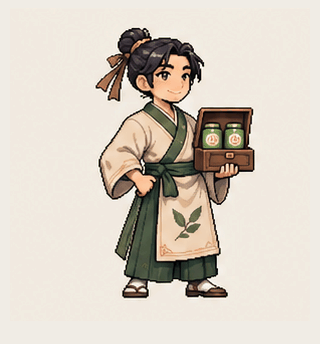</picture></a><br>
<strong>016 · Tea merchant</strong><br>
<sub>presentation · 1.92 s</sub><br>
<sub><a href="examples/anime-pixel/catalog-100/README.md" title="Generated-pose preview. Residual face/outline drift; opaque ivory background; short 1.92 s loop, not a 15 s narrative or finished acting animation.">Method &amp; limits</a> · <a href="examples/anime-pixel/catalog-100/posters/tea-merchant.png">Still</a></sub>
</td>
<td align="center" valign="top" width="33.33%">
<a href="examples/anime-pixel/catalog-100/silver-knight.gif"><picture><source media="(prefers-reduced-motion: reduce)" srcset="examples/anime-pixel/catalog-100/posters/silver-knight.png">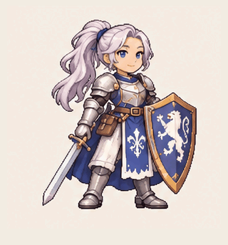</picture></a><br>
<strong>017 · Silver knight</strong><br>
<sub>sword gesture · 1.92 s</sub><br>
<sub><a href="examples/anime-pixel/catalog-100/README.md" title="Generated-pose preview. Residual face/outline drift; opaque ivory background; short 1.92 s loop, not a 15 s narrative or finished acting animation.">Method &amp; limits</a> · <a href="examples/anime-pixel/catalog-100/posters/silver-knight.png">Still</a></sub>
</td>
<td align="center" valign="top" width="33.33%">
<a href="examples/anime-pixel/catalog-100/cartographer.gif"><picture><source media="(prefers-reduced-motion: reduce)" srcset="examples/anime-pixel/catalog-100/posters/cartographer.png">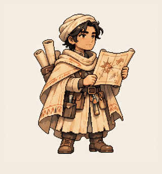</picture></a><br>
<strong>018 · Cartographer</strong><br>
<sub>map study · 1.92 s</sub><br>
<sub><a href="examples/anime-pixel/catalog-100/README.md" title="Generated-pose preview. Residual face/outline drift; opaque ivory background; short 1.92 s loop, not a 15 s narrative or finished acting animation.">Method &amp; limits</a> · <a href="examples/anime-pixel/catalog-100/posters/cartographer.png">Still</a></sub>
</td>
</tr>
<tr>
<td align="center" valign="top" width="33.33%">
<a href="examples/anime-pixel/catalog-100/aviator.gif"><picture><source media="(prefers-reduced-motion: reduce)" srcset="examples/anime-pixel/catalog-100/posters/aviator.png">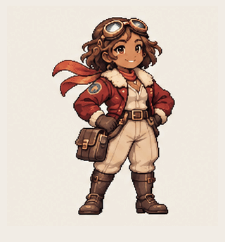</picture></a><br>
<strong>019 · Aviator</strong><br>
<sub>goggles salute · 1.92 s</sub><br>
<sub><a href="examples/anime-pixel/catalog-100/README.md" title="Generated-pose preview. Residual face/outline drift; opaque ivory background; short 1.92 s loop, not a 15 s narrative or finished acting animation.">Method &amp; limits</a> · <a href="examples/anime-pixel/catalog-100/posters/aviator.png">Still</a></sub>
</td>
<td align="center" valign="top" width="33.33%">
<a href="examples/anime-pixel/catalog-100/polar-traveler.gif"><picture><source media="(prefers-reduced-motion: reduce)" srcset="examples/anime-pixel/catalog-100/posters/polar-traveler.png">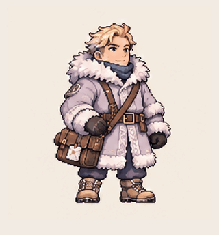</picture></a><br>
<strong>020 · Polar traveler</strong><br>
<sub>scarf adjustment · 1.92 s</sub><br>
<sub><a href="examples/anime-pixel/catalog-100/README.md" title="Generated-pose preview. Residual face/outline drift; opaque ivory background; short 1.92 s loop, not a 15 s narrative or finished acting animation.">Method &amp; limits</a> · <a href="examples/anime-pixel/catalog-100/posters/polar-traveler.png">Still</a></sub>
</td>
<td align="center" valign="top" width="33.33%">
<a href="examples/anime-pixel/catalog-100/professor.gif"><picture><source media="(prefers-reduced-motion: reduce)" srcset="examples/anime-pixel/catalog-100/posters/professor.png">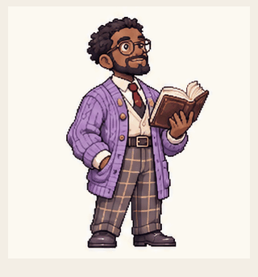</picture></a><br>
<strong>021 · Professor</strong><br>
<sub>adjusts glasses · 1.92 s</sub><br>
<sub><a href="examples/anime-pixel/catalog-100/README.md" title="Generated-pose preview. Residual face/outline drift; opaque ivory background; short 1.92 s loop, not a 15 s narrative or finished acting animation.">Method &amp; limits</a> · <a href="examples/anime-pixel/catalog-100/posters/professor.png">Still</a></sub>
</td>
</tr>
<tr>
<td align="center" valign="top" width="33.33%">
<a href="examples/anime-pixel/catalog-100/mountain-climber.gif"><picture><source media="(prefers-reduced-motion: reduce)" srcset="examples/anime-pixel/catalog-100/posters/mountain-climber.png">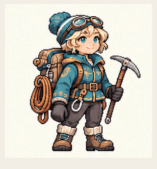</picture></a><br>
<strong>022 · Mountain climber</strong><br>
<sub>strap gesture · 1.92 s</sub><br>
<sub><a href="examples/anime-pixel/catalog-100/README.md" title="Generated-pose preview. Residual face/outline drift; opaque ivory background; short 1.92 s loop, not a 15 s narrative or finished acting animation.">Method &amp; limits</a> · <a href="examples/anime-pixel/catalog-100/posters/mountain-climber.png">Still</a></sub>
</td>
<td align="center" valign="top" width="33.33%">
<a href="examples/anime-pixel/catalog-100/forest-courier.gif"><picture><source media="(prefers-reduced-motion: reduce)" srcset="examples/anime-pixel/catalog-100/posters/forest-courier.png">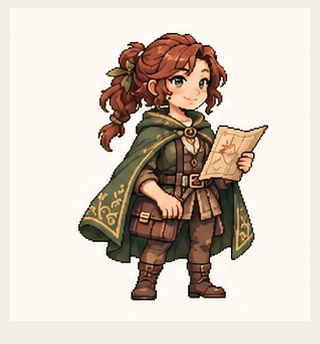</picture></a><br>
<strong>023 · Forest courier</strong><br>
<sub>map gesture · 1.92 s</sub><br>
<sub><a href="examples/anime-pixel/catalog-100/README.md" title="Generated-pose preview. Residual face/outline drift; opaque ivory background; short 1.92 s loop, not a 15 s narrative or finished acting animation.">Method &amp; limits</a> · <a href="examples/anime-pixel/catalog-100/posters/forest-courier.png">Still</a></sub>
</td>
<td align="center" valign="top" width="33.33%">
<a href="examples/anime-pixel/catalog-100/innkeeper.gif"><picture><source media="(prefers-reduced-motion: reduce)" srcset="examples/anime-pixel/catalog-100/posters/innkeeper.png">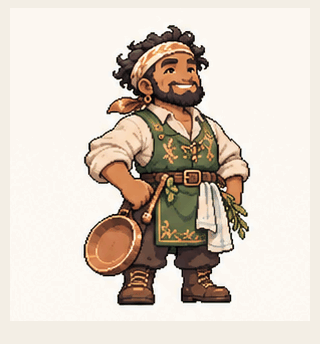</picture></a><br>
<strong>024 · Innkeeper</strong><br>
<sub>welcome gesture · 1.92 s</sub><br>
<sub><a href="examples/anime-pixel/catalog-100/README.md" title="Generated-pose preview. Residual face/outline drift; opaque ivory background; short 1.92 s loop, not a 15 s narrative or finished acting animation.">Method &amp; limits</a> · <a href="examples/anime-pixel/catalog-100/posters/innkeeper.png">Still</a></sub>
</td>
</tr>
<tr>
<td align="center" valign="top" width="33.33%">
<a href="examples/anime-pixel/catalog-100/astronomer.gif"><picture><source media="(prefers-reduced-motion: reduce)" srcset="examples/anime-pixel/catalog-100/posters/astronomer.png">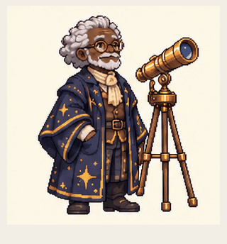</picture></a><br>
<strong>025 · Astronomer</strong><br>
<sub>glasses adjustment · 1.92 s</sub><br>
<sub><a href="examples/anime-pixel/catalog-100/README.md" title="Generated-pose preview. Residual face/outline drift; opaque ivory background; short 1.92 s loop, not a 15 s narrative or finished acting animation.">Method &amp; limits</a> · <a href="examples/anime-pixel/catalog-100/posters/astronomer.png">Still</a></sub>
</td>
<td align="center" valign="top" width="33.33%">
<a href="examples/anime-pixel/catalog-100/fisherman.gif"><picture><source media="(prefers-reduced-motion: reduce)" srcset="examples/anime-pixel/catalog-100/posters/fisherman.png">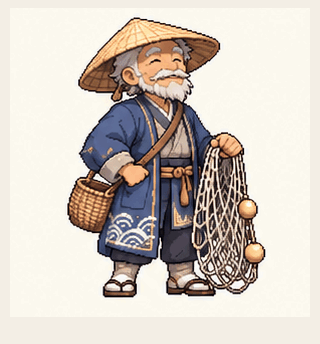</picture></a><br>
<strong>026 · Fisherman</strong><br>
<sub>net lift · 1.92 s</sub><br>
<sub><a href="examples/anime-pixel/catalog-100/README.md" title="Generated-pose preview. Residual face/outline drift; opaque ivory background; short 1.92 s loop, not a 15 s narrative or finished acting animation.">Method &amp; limits</a> · <a href="examples/anime-pixel/catalog-100/posters/fisherman.png">Still</a></sub>
</td>
<td align="center" valign="top" width="33.33%">
<a href="examples/anime-pixel/catalog-100/trumpeter.gif"><picture><source media="(prefers-reduced-motion: reduce)" srcset="examples/anime-pixel/catalog-100/posters/trumpeter.png">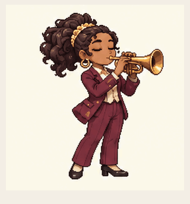</picture></a><br>
<strong>027 · Trumpeter</strong><br>
<sub>subtle performance idle · 1.92 s</sub><br>
<sub><a href="examples/anime-pixel/catalog-100/README.md" title="Generated-pose preview. Residual face/outline drift; opaque ivory background; short 1.92 s loop, not a 15 s narrative or finished acting animation. Very subtle finger/elbow changes; some variation is generative drift, not validated musical performance.">Method &amp; limits</a> · <a href="examples/anime-pixel/catalog-100/posters/trumpeter.png">Still</a></sub>
</td>
</tr>
<tr>
<td align="center" valign="top" width="33.33%">
<a href="examples/anime-pixel/catalog-100/toolbox-mechanic.gif"><picture><source media="(prefers-reduced-motion: reduce)" srcset="examples/anime-pixel/catalog-100/posters/toolbox-mechanic.png">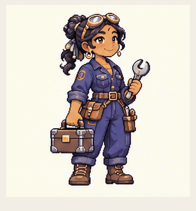</picture></a><br>
<strong>028 · Toolbox mechanic</strong><br>
<sub>wrench lift · 1.92 s</sub><br>
<sub><a href="examples/anime-pixel/catalog-100/README.md" title="Generated-pose preview. Residual face/outline drift; opaque ivory background; short 1.92 s loop, not a 15 s narrative or finished acting animation.">Method &amp; limits</a> · <a href="examples/anime-pixel/catalog-100/posters/toolbox-mechanic.png">Still</a></sub>
</td>
<td align="center" valign="top" width="33.33%">
<a href="examples/anime-pixel/catalog-100/martial-artist.gif"><picture><source media="(prefers-reduced-motion: reduce)" srcset="examples/anime-pixel/catalog-100/posters/martial-artist.png">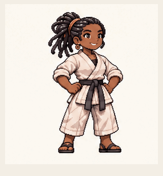</picture></a><br>
<strong>029 · Martial artist</strong><br>
<sub>palm block · 1.92 s</sub><br>
<sub><a href="examples/anime-pixel/catalog-100/README.md" title="Generated-pose preview. Residual face/outline drift; opaque ivory background; short 1.92 s loop, not a 15 s narrative or finished acting animation.">Method &amp; limits</a> · <a href="examples/anime-pixel/catalog-100/posters/martial-artist.png">Still</a></sub>
</td>
<td align="center" valign="top" width="33.33%">
<a href="examples/anime-pixel/catalog-100/bicycle-courier.gif"><picture><source media="(prefers-reduced-motion: reduce)" srcset="examples/anime-pixel/catalog-100/posters/bicycle-courier.png">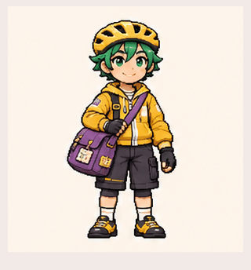</picture></a><br>
<strong>030 · Bicycle courier</strong><br>
<sub>wave · 1.92 s</sub><br>
<sub><a href="examples/anime-pixel/catalog-100/README.md" title="Generated-pose preview. Residual face/outline drift; opaque ivory background; short 1.92 s loop, not a 15 s narrative or finished acting animation.">Method &amp; limits</a> · <a href="examples/anime-pixel/catalog-100/posters/bicycle-courier.png">Still</a></sub>
</td>
</tr>
<tr>
<td align="center" valign="top" width="33.33%">
<a href="examples/anime-pixel/catalog-100/conductor.gif"><picture><source media="(prefers-reduced-motion: reduce)" srcset="examples/anime-pixel/catalog-100/posters/conductor.png">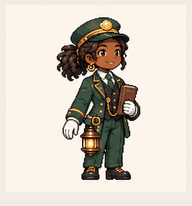</picture></a><br>
<strong>031 · Conductor</strong><br>
<sub>salute · 1.92 s</sub><br>
<sub><a href="examples/anime-pixel/catalog-100/README.md" title="Generated-pose preview. Residual face/outline drift; opaque ivory background; short 1.92 s loop, not a 15 s narrative or finished acting animation.">Method &amp; limits</a> · <a href="examples/anime-pixel/catalog-100/posters/conductor.png">Still</a></sub>
</td>
<td align="center" valign="top" width="33.33%">
<a href="examples/anime-pixel/catalog-100/gardener.gif"><picture><source media="(prefers-reduced-motion: reduce)" srcset="examples/anime-pixel/catalog-100/posters/gardener.png">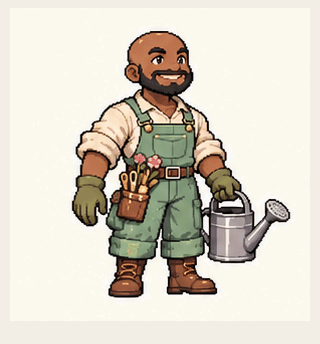</picture></a><br>
<strong>032 · Gardener</strong><br>
<sub>wave · 1.92 s</sub><br>
<sub><a href="examples/anime-pixel/catalog-100/README.md" title="Generated-pose preview. Residual face/outline drift; opaque ivory background; short 1.92 s loop, not a 15 s narrative or finished acting animation.">Method &amp; limits</a> · <a href="examples/anime-pixel/catalog-100/posters/gardener.png">Still</a></sub>
</td>
<td align="center" valign="top" width="33.33%">
<a href="examples/anime-pixel/catalog-100/pastry-chef.gif"><picture><source media="(prefers-reduced-motion: reduce)" srcset="examples/anime-pixel/catalog-100/posters/pastry-chef.png">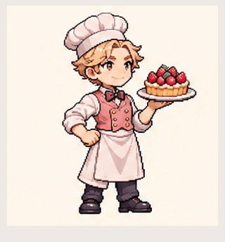</picture></a><br>
<strong>033 · Pastry chef</strong><br>
<sub>presentation · 1.92 s</sub><br>
<sub><a href="examples/anime-pixel/catalog-100/README.md" title="Generated-pose preview. Residual face/outline drift; opaque ivory background; short 1.92 s loop, not a 15 s narrative or finished acting animation.">Method &amp; limits</a> · <a href="examples/anime-pixel/catalog-100/posters/pastry-chef.png">Still</a></sub>
</td>
</tr>
<tr>
<td align="center" valign="top" width="33.33%">
<a href="examples/anime-pixel/catalog-100/armorer.gif"><picture><source media="(prefers-reduced-motion: reduce)" srcset="examples/anime-pixel/catalog-100/posters/armorer.png">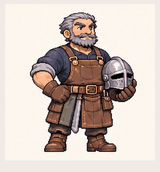</picture></a><br>
<strong>034 · Armorer</strong><br>
<sub>hand gesture · 1.92 s</sub><br>
<sub><a href="examples/anime-pixel/catalog-100/README.md" title="Generated-pose preview. Residual face/outline drift; opaque ivory background; short 1.92 s loop, not a 15 s narrative or finished acting animation.">Method &amp; limits</a> · <a href="examples/anime-pixel/catalog-100/posters/armorer.png">Still</a></sub>
</td>
<td align="center" valign="top" width="33.33%">
<a href="examples/anime-pixel/catalog-100/archaeologist.gif"><picture><source media="(prefers-reduced-motion: reduce)" srcset="examples/anime-pixel/catalog-100/posters/archaeologist.png">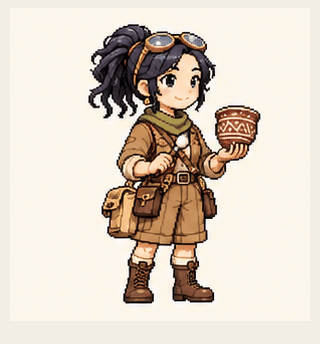</picture></a><br>
<strong>035 · Archaeologist</strong><br>
<sub>brush inspection · 1.92 s</sub><br>
<sub><a href="examples/anime-pixel/catalog-100/README.md" title="Generated-pose preview. Residual face/outline drift; opaque ivory background; short 1.92 s loop, not a 15 s narrative or finished acting animation.">Method &amp; limits</a> · <a href="examples/anime-pixel/catalog-100/posters/archaeologist.png">Still</a></sub>
</td>
<td align="center" valign="top" width="33.33%">
<a href="examples/anime-pixel/catalog-100/rope-sailor.gif"><picture><source media="(prefers-reduced-motion: reduce)" srcset="examples/anime-pixel/catalog-100/posters/rope-sailor.png">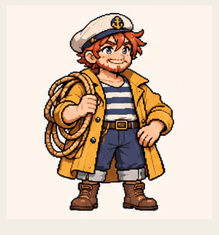</picture></a><br>
<strong>036 · Rope sailor</strong><br>
<sub>salute · 1.92 s</sub><br>
<sub><a href="examples/anime-pixel/catalog-100/README.md" title="Generated-pose preview. Residual face/outline drift; opaque ivory background; short 1.92 s loop, not a 15 s narrative or finished acting animation.">Method &amp; limits</a> · <a href="examples/anime-pixel/catalog-100/posters/rope-sailor.png">Still</a></sub>
</td>
</tr>
<tr>
<td align="center" valign="top" width="33.33%">
<a href="examples/anime-pixel/catalog-100/moon-wizard.gif"><picture><source media="(prefers-reduced-motion: reduce)" srcset="examples/anime-pixel/catalog-100/posters/moon-wizard.png">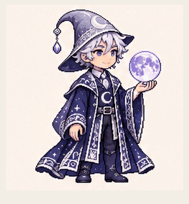</picture></a><br>
<strong>037 · Moon wizard</strong><br>
<sub>conjuring gesture · 1.92 s</sub><br>
<sub><a href="examples/anime-pixel/catalog-100/README.md" title="Generated-pose preview. Residual face/outline drift; opaque ivory background; short 1.92 s loop, not a 15 s narrative or finished acting animation.">Method &amp; limits</a> · <a href="examples/anime-pixel/catalog-100/posters/moon-wizard.png">Still</a></sub>
</td>
<td align="center" valign="top" width="33.33%">
<a href="examples/anime-pixel/catalog-100/falconer.gif"><picture><source media="(prefers-reduced-motion: reduce)" srcset="examples/anime-pixel/catalog-100/posters/falconer.png">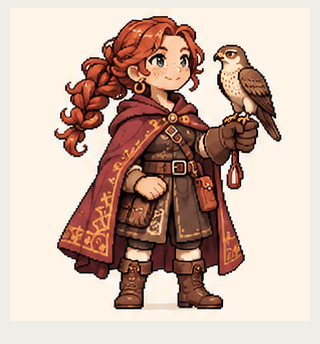</picture></a><br>
<strong>038 · Falconer</strong><br>
<sub>greeting · 1.92 s</sub><br>
<sub><a href="examples/anime-pixel/catalog-100/README.md" title="Generated-pose preview. Residual face/outline drift; opaque ivory background; short 1.92 s loop, not a 15 s narrative or finished acting animation.">Method &amp; limits</a> · <a href="examples/anime-pixel/catalog-100/posters/falconer.png">Still</a></sub>
</td>
<td align="center" valign="top" width="33.33%">
<a href="examples/anime-pixel/catalog-100/beekeeper.gif"><picture><source media="(prefers-reduced-motion: reduce)" srcset="examples/anime-pixel/catalog-100/posters/beekeeper.png">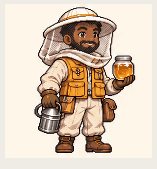</picture></a><br>
<strong>039 · Beekeeper</strong><br>
<sub>honey presentation · 1.92 s</sub><br>
<sub><a href="examples/anime-pixel/catalog-100/README.md" title="Generated-pose preview. Residual face/outline drift; opaque ivory background; short 1.92 s loop, not a 15 s narrative or finished acting animation.">Method &amp; limits</a> · <a href="examples/anime-pixel/catalog-100/posters/beekeeper.png">Still</a></sub>
</td>
</tr>
<tr>
<td align="center" valign="top" width="33.33%">
<a href="examples/anime-pixel/catalog-100/mushroom-picker.gif"><picture><source media="(prefers-reduced-motion: reduce)" srcset="examples/anime-pixel/catalog-100/posters/mushroom-picker.png">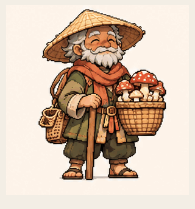</picture></a><br>
<strong>040 · Mushroom picker</strong><br>
<sub>basket offering · 1.92 s</sub><br>
<sub><a href="examples/anime-pixel/catalog-100/README.md" title="Generated-pose preview. Residual face/outline drift; opaque ivory background; short 1.92 s loop, not a 15 s narrative or finished acting animation.">Method &amp; limits</a> · <a href="examples/anime-pixel/catalog-100/posters/mushroom-picker.png">Still</a></sub>
</td>
<td align="center" valign="top" width="33.33%">
<a href="examples/anime-pixel/catalog-100/ice-sorceress.gif"><picture><source media="(prefers-reduced-motion: reduce)" srcset="examples/anime-pixel/catalog-100/posters/ice-sorceress.png">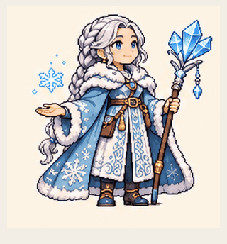</picture></a><br>
<strong>041 · Ice sorceress</strong><br>
<sub>spell gesture · 1.92 s</sub><br>
<sub><a href="examples/anime-pixel/catalog-100/README.md" title="Generated-pose preview. Residual face/outline drift; opaque ivory background; short 1.92 s loop, not a 15 s narrative or finished acting animation.">Method &amp; limits</a> · <a href="examples/anime-pixel/catalog-100/posters/ice-sorceress.png">Still</a></sub>
</td>
<td align="center" valign="top" width="33.33%">
<a href="examples/anime-pixel/catalog-100/pirate.gif"><picture><source media="(prefers-reduced-motion: reduce)" srcset="examples/anime-pixel/catalog-100/posters/pirate.png">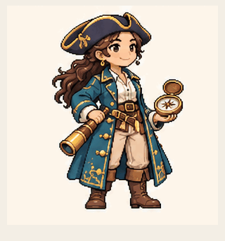</picture></a><br>
<strong>042 · Pirate</strong><br>
<sub>compass gesture · 1.92 s</sub><br>
<sub><a href="examples/anime-pixel/catalog-100/README.md" title="Generated-pose preview. Residual face/outline drift; opaque ivory background; short 1.92 s loop, not a 15 s narrative or finished acting animation.">Method &amp; limits</a> · <a href="examples/anime-pixel/catalog-100/posters/pirate.png">Still</a></sub>
</td>
</tr>
<tr>
<td align="center" valign="top" width="33.33%">
<a href="examples/anime-pixel/catalog-100/quilter.gif"><picture><source media="(prefers-reduced-motion: reduce)" srcset="examples/anime-pixel/catalog-100/posters/quilter.png">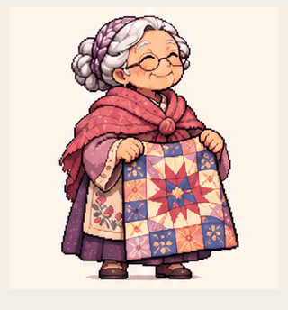</picture></a><br>
<strong>043 · Quilter</strong><br>
<sub>showing quilt · 1.92 s</sub><br>
<sub><a href="examples/anime-pixel/catalog-100/README.md" title="Generated-pose preview. Residual face/outline drift; opaque ivory background; short 1.92 s loop, not a 15 s narrative or finished acting animation.">Method &amp; limits</a> · <a href="examples/anime-pixel/catalog-100/posters/quilter.png">Still</a></sub>
</td>
<td align="center" valign="top" width="33.33%">
<a href="examples/anime-pixel/catalog-100/drummer.gif"><picture><source media="(prefers-reduced-motion: reduce)" srcset="examples/anime-pixel/catalog-100/posters/drummer.png"></picture></a><br>
<strong>044 · Drummer</strong><br>
<sub>alternating hands · 1.92 s</sub><br>
<sub><a href="examples/anime-pixel/catalog-100/README.md" title="Generated-pose preview. Residual face/outline drift; opaque ivory background; short 1.92 s loop, not a 15 s narrative or finished acting animation.">Method &amp; limits</a> · <a href="examples/anime-pixel/catalog-100/posters/drummer.png">Still</a></sub>
</td>
<td align="center" valign="top" width="33.33%">
<a href="examples/anime-pixel/catalog-100/lute-player.gif"><picture><source media="(prefers-reduced-motion: reduce)" srcset="examples/anime-pixel/catalog-100/posters/lute-player.png">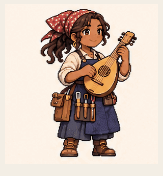</picture></a><br>
<strong>045 · Lute player</strong><br>
<sub>strum gesture · 1.92 s</sub><br>
<sub><a href="examples/anime-pixel/catalog-100/README.md" title="Generated-pose preview. Residual face/outline drift; opaque ivory background; short 1.92 s loop, not a 15 s narrative or finished acting animation.">Method &amp; limits</a> · <a href="examples/anime-pixel/catalog-100/posters/lute-player.png">Still</a></sub>
</td>
</tr>
<tr>
<td align="center" valign="top" width="33.33%">
<a href="examples/anime-pixel/catalog-100/cellist.gif"><picture><source media="(prefers-reduced-motion: reduce)" srcset="examples/anime-pixel/catalog-100/posters/cellist.png">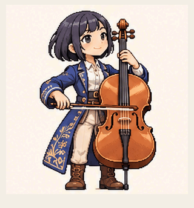</picture></a><br>
<strong>046 · Cellist</strong><br>
<sub>bow stroke · 1.92 s</sub><br>
<sub><a href="examples/anime-pixel/catalog-100/README.md" title="Generated-pose preview. Residual face/outline drift; opaque ivory background; short 1.92 s loop, not a 15 s narrative or finished acting animation.">Method &amp; limits</a> · <a href="examples/anime-pixel/catalog-100/posters/cellist.png">Still</a></sub>
</td>
<td align="center" valign="top" width="33.33%">
<a href="examples/anime-pixel/catalog-100/stage-technician.gif"><picture><source media="(prefers-reduced-motion: reduce)" srcset="examples/anime-pixel/catalog-100/posters/stage-technician.png">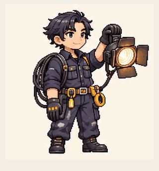</picture></a><br>
<strong>047 · Stage technician</strong><br>
<sub>lamp adjustment · 1.92 s</sub><br>
<sub><a href="examples/anime-pixel/catalog-100/README.md" title="Generated-pose preview. Residual face/outline drift; opaque ivory background; short 1.92 s loop, not a 15 s narrative or finished acting animation.">Method &amp; limits</a> · <a href="examples/anime-pixel/catalog-100/posters/stage-technician.png">Still</a></sub>
</td>
<td align="center" valign="top" width="33.33%">
<a href="examples/anime-pixel/catalog-100/flutist.gif"><picture><source media="(prefers-reduced-motion: reduce)" srcset="examples/anime-pixel/catalog-100/posters/flutist.png">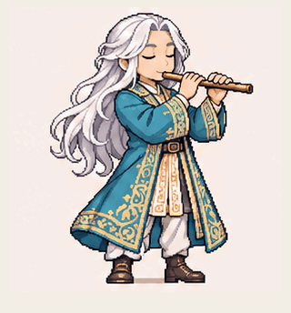</picture></a><br>
<strong>048 · Flutist</strong><br>
<sub>finger gesture · 1.92 s</sub><br>
<sub><a href="examples/anime-pixel/catalog-100/README.md" title="Generated-pose preview. Residual face/outline drift; opaque ivory background; short 1.92 s loop, not a 15 s narrative or finished acting animation.">Method &amp; limits</a> · <a href="examples/anime-pixel/catalog-100/posters/flutist.png">Still</a></sub>
</td>
</tr>
<tr>
<td align="center" valign="top" width="33.33%">
<a href="examples/anime-pixel/catalog-100/calligrapher.gif"><picture><source media="(prefers-reduced-motion: reduce)" srcset="examples/anime-pixel/catalog-100/posters/calligrapher.png">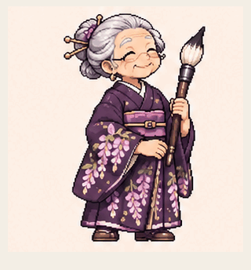</picture></a><br>
<strong>049 · Calligrapher</strong><br>
<sub>collar gesture · 1.92 s</sub><br>
<sub><a href="examples/anime-pixel/catalog-100/README.md" title="Generated-pose preview. Residual face/outline drift; opaque ivory background; short 1.92 s loop, not a 15 s narrative or finished acting animation.">Method &amp; limits</a> · <a href="examples/anime-pixel/catalog-100/posters/calligrapher.png">Still</a></sub>
</td>
<td align="center" valign="top" width="33.33%">
<a href="examples/anime-pixel/catalog-100/cyclops-robot.gif"><picture><source media="(prefers-reduced-motion: reduce)" srcset="examples/anime-pixel/catalog-100/posters/cyclops-robot.png">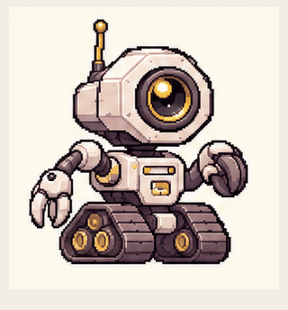</picture></a><br>
<strong>050 · Cyclops robot</strong><br>
<sub>claw articulation · 1.92 s</sub><br>
<sub><a href="examples/anime-pixel/catalog-100/README.md" title="Generated-pose preview. Residual face/outline drift; opaque ivory background; short 1.92 s loop, not a 15 s narrative or finished acting animation.">Method &amp; limits</a> · <a href="examples/anime-pixel/catalog-100/posters/cyclops-robot.png">Still</a></sub>
</td>
<td align="center" valign="top" width="33.33%">
<a href="examples/anime-pixel/catalog-100/penguin-admiral.gif"><picture><source media="(prefers-reduced-motion: reduce)" srcset="examples/anime-pixel/catalog-100/posters/penguin-admiral.png">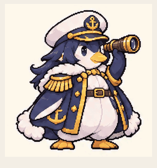</picture></a><br>
<strong>051 · Penguin admiral</strong><br>
<sub>flipper wave · 1.92 s</sub><br>
<sub><a href="examples/anime-pixel/catalog-100/README.md" title="Generated-pose preview. Residual face/outline drift; opaque ivory background; short 1.92 s loop, not a 15 s narrative or finished acting animation.">Method &amp; limits</a> · <a href="examples/anime-pixel/catalog-100/posters/penguin-admiral.png">Still</a></sub>
</td>
</tr>
<tr>
<td align="center" valign="top" width="33.33%">
<a href="examples/anime-pixel/catalog-100/lobster-boxer.gif"><picture><source media="(prefers-reduced-motion: reduce)" srcset="examples/anime-pixel/catalog-100/posters/lobster-boxer.png">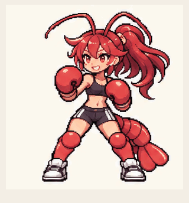</picture></a><br>
<strong>052 · Lobster boxer</strong><br>
<sub>jab gestures · 1.92 s</sub><br>
<sub><a href="examples/anime-pixel/catalog-100/README.md" title="Generated-pose preview. Residual face/outline drift; opaque ivory background; short 1.92 s loop, not a 15 s narrative or finished acting animation.">Method &amp; limits</a> · <a href="examples/anime-pixel/catalog-100/posters/lobster-boxer.png">Still</a></sub>
</td>
<td align="center" valign="top" width="33.33%">
<a href="examples/anime-pixel/catalog-100/wolf-detective.gif"><picture><source media="(prefers-reduced-motion: reduce)" srcset="examples/anime-pixel/catalog-100/posters/wolf-detective.png">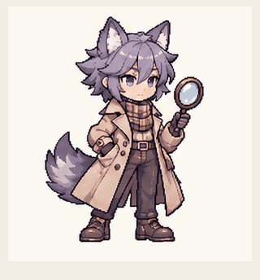</picture></a><br>
<strong>053 · Wolf detective</strong><br>
<sub>lens inspection · 1.92 s</sub><br>
<sub><a href="examples/anime-pixel/catalog-100/README.md" title="Generated-pose preview. Residual face/outline drift; opaque ivory background; short 1.92 s loop, not a 15 s narrative or finished acting animation.">Method &amp; limits</a> · <a href="examples/anime-pixel/catalog-100/posters/wolf-detective.png">Still</a></sub>
</td>
<td align="center" valign="top" width="33.33%">
<a href="examples/anime-pixel/catalog-100/shark-mechanic.gif"><picture><source media="(prefers-reduced-motion: reduce)" srcset="examples/anime-pixel/catalog-100/posters/shark-mechanic.png"></picture></a><br>
<strong>054 · Shark mechanic</strong><br>
<sub>goggles adjustment · 1.92 s</sub><br>
<sub><a href="examples/anime-pixel/catalog-100/README.md" title="Generated-pose preview. Residual face/outline drift; opaque ivory background; short 1.92 s loop, not a 15 s narrative or finished acting animation. Initial sheet rejected for disappearing glove; corrected glove remains present. Goggles end slightly higher than start; hair, tool and tail detail drift.">Method &amp; limits</a> · <a href="examples/anime-pixel/catalog-100/posters/shark-mechanic.png">Still</a></sub>
</td>
</tr>
<tr>
<td align="center" valign="top" width="33.33%">
<a href="examples/anime-pixel/catalog-100/raven-queen.gif"><picture><source media="(prefers-reduced-motion: reduce)" srcset="examples/anime-pixel/catalog-100/posters/raven-queen.png"></picture></a><br>
<strong>055 · Raven queen</strong><br>
<sub>head tilt and blink · 1.92 s</sub><br>
<sub><a href="examples/anime-pixel/catalog-100/README.md" title="Generated-pose preview. Residual face/outline drift; opaque ivory background; short 1.92 s loop, not a 15 s narrative or finished acting animation. Subtle head tilt/blink; bird briefly opens beak, does not fly. Hair, crown and feather detail drift.">Method &amp; limits</a> · <a href="examples/anime-pixel/catalog-100/posters/raven-queen.png">Still</a></sub>
</td>
<td align="center" valign="top" width="33.33%">
<a href="examples/anime-pixel/catalog-100/moth-witch.gif"><picture><source media="(prefers-reduced-motion: reduce)" srcset="examples/anime-pixel/catalog-100/posters/moth-witch.png"></picture></a><br>
<strong>056 · Moth witch</strong><br>
<sub>wing folding · 1.92 s</sub><br>
<sub><a href="examples/anime-pixel/catalog-100/README.md" title="Generated-pose preview. Residual face/outline drift; opaque ivory background; short 1.92 s loop, not a 15 s narrative or finished acting animation. Wing patterns and dress trim drift; antennae end angle differs slightly; wing fold is not flight.">Method &amp; limits</a> · <a href="examples/anime-pixel/catalog-100/posters/moth-witch.png">Still</a></sub>
</td>
<td align="center" valign="top" width="33.33%">
<a href="examples/anime-pixel/catalog-100/axolotl-alchemist.gif"><picture><source media="(prefers-reduced-motion: reduce)" srcset="examples/anime-pixel/catalog-100/posters/axolotl-alchemist.png"></picture></a><br>
<strong>057 · Axolotl alchemist</strong><br>
<sub>flask tilt · 1.92 s</sub><br>
<sub><a href="examples/anime-pixel/catalog-100/README.md" title="Generated-pose preview. Residual face/outline drift; opaque ivory background; short 1.92 s loop, not a 15 s narrative or finished acting animation. Flask tilts with approximate liquid behavior, not physically simulated mixing. Tail and gill outlines drift; outfit remains same.">Method &amp; limits</a> · <a href="examples/anime-pixel/catalog-100/posters/axolotl-alchemist.png">Still</a></sub>
</td>
</tr>
<tr>
<td align="center" valign="top" width="33.33%">
<a href="examples/anime-pixel/catalog-100/jellyfish-princess.gif"><picture><source media="(prefers-reduced-motion: reduce)" srcset="examples/anime-pixel/catalog-100/posters/jellyfish-princess.png"></picture></a><br>
<strong>058 · Jellyfish princess</strong><br>
<sub>cap pulse · 1.92 s</sub><br>
<sub><a href="examples/anime-pixel/catalog-100/README.md" title="Generated-pose preview. Residual face/outline drift; opaque ivory background; short 1.92 s loop, not a 15 s narrative or finished acting animation. Visible cap compression and ribbon sway; bubbles/hem detail drift. Not swimming or physical jellyfish simulation.">Method &amp; limits</a> · <a href="examples/anime-pixel/catalog-100/posters/jellyfish-princess.png">Still</a></sub>
</td>
<td align="center" valign="top" width="33.33%">
<a href="examples/anime-pixel/catalog-100/steampunk-librarian.gif"><picture><source media="(prefers-reduced-motion: reduce)" srcset="examples/anime-pixel/catalog-100/posters/steampunk-librarian.png"></picture></a><br>
<strong>059 · Steampunk librarian</strong><br>
<sub>reading and page flutter · 1.92 s</sub><br>
<sub><a href="examples/anime-pixel/catalog-100/README.md" title="Generated-pose preview. Residual face/outline drift; opaque ivory background; short 1.92 s loop, not a 15 s narrative or finished acting animation. Reading head/eye motion and short page lift; page drops abruptly at frame9, not a smooth complete page turn. Book stack differs from reference but remains consistent within clip.">Method &amp; limits</a> · <a href="examples/anime-pixel/catalog-100/posters/steampunk-librarian.png">Still</a></sub>
</td>
<td align="center" valign="top" width="33.33%">
<a href="examples/anime-pixel/catalog-100/rabbit-samurai.gif"><picture><source media="(prefers-reduced-motion: reduce)" srcset="examples/anime-pixel/catalog-100/posters/rabbit-samurai.png"></picture></a><br>
<strong>060 · Rabbit samurai</strong><br>
<sub>ceremonial bow · 1.92 s</sub><br>
<sub><a href="examples/anime-pixel/catalog-100/README.md" title="Generated-pose preview. Residual face/outline drift; opaque ivory background; short 1.92 s loop, not a 15 s narrative or finished acting animation. Ceremonial bow, sword stays sheathed. Floral pattern and ear angles drift; minor feet registration variation. No sword fighting.">Method &amp; limits</a> · <a href="examples/anime-pixel/catalog-100/posters/rabbit-samurai.png">Still</a></sub>
</td>
</tr>
<tr>
<td align="center" valign="top" width="33.33%">
<a href="examples/anime-pixel/catalog-100/dragon-aviator.gif"><picture><source media="(prefers-reduced-motion: reduce)" srcset="examples/anime-pixel/catalog-100/posters/dragon-aviator.png"></picture></a><br>
<strong>061 · Dragon aviator</strong><br>
<sub>grounded wingbeats · 1.92 s</sub><br>
<sub><a href="examples/anime-pixel/catalog-100/README.md" title="Generated-pose preview. Residual face/outline drift; opaque ivory background; short 1.92 s loop, not a 15 s narrative or finished acting animation. Two grounded wing sweeps, not flight. Wing membrane and tail shape drift, slightly uneven timing.">Method &amp; limits</a> · <a href="examples/anime-pixel/catalog-100/posters/dragon-aviator.png">Still</a></sub>
</td>
<td align="center" valign="top" width="33.33%">
<a href="examples/anime-pixel/catalog-100/slime-bard.gif"><picture><source media="(prefers-reduced-motion: reduce)" srcset="examples/anime-pixel/catalog-100/posters/slime-bard.png"></picture></a><br>
<strong>062 · Slime bard</strong><br>
<sub>singing expression and strum · 1.92 s</sub><br>
<sub><a href="examples/anime-pixel/catalog-100/README.md" title="Generated-pose preview. Residual face/outline drift; opaque ivory background; short 1.92 s loop, not a 15 s narrative or finished acting animation. Singing-like facial expressions and small strum, silent GIF not lip synced. Lute contour/strings drift and slime squash is subtle, not fluid simulation.">Method &amp; limits</a> · <a href="examples/anime-pixel/catalog-100/posters/slime-bard.png">Still</a></sub>
</td>
<td align="center" valign="top" width="33.33%">
<a href="examples/anime-pixel/catalog-100/horned-gardener.gif"><picture><source media="(prefers-reduced-motion: reduce)" srcset="examples/anime-pixel/catalog-100/posters/horned-gardener.png"></picture></a><br>
<strong>063 · Horned gardener</strong><br>
<sub>watering · 1.92 s</sub><br>
<sub><a href="examples/anime-pixel/catalog-100/README.md" title="Generated-pose preview. Residual face/outline drift; opaque ivory background; short 1.92 s loop, not a 15 s narrative or finished acting animation. Watering-can tilt and drawn stream; splash is stylized not simulated. Apron/basket pattern drifts; slight can-angle mismatch at wrap.">Method &amp; limits</a> · <a href="examples/anime-pixel/catalog-100/posters/horned-gardener.png">Still</a></sub>
</td>
</tr>
<tr>
<td align="center" valign="top" width="33.33%">
<a href="examples/anime-pixel/catalog-100/moon-knight.gif"><picture><source media="(prefers-reduced-motion: reduce)" srcset="examples/anime-pixel/catalog-100/posters/moon-knight.png"></picture></a><br>
<strong>064 · Moon knight</strong><br>
<sub>shield guard · 1.92 s</sub><br>
<sub><a href="examples/anime-pixel/catalog-100/README.md" title="Generated-pose preview. Residual face/outline drift; opaque ivory background; short 1.92 s loop, not a 15 s narrative or finished acting animation. Shield raising and crouch; sword is visibly drawn throughout despite initial prompt asking sheathed. No unsheathing action. Sword shape and cape-stars drift.">Method &amp; limits</a> · <a href="examples/anime-pixel/catalog-100/posters/moon-knight.png">Still</a></sub>
</td>
<td align="center" valign="top" width="33.33%">
<a href="examples/anime-pixel/catalog-100/mushroom-druid.gif"><picture><source media="(prefers-reduced-motion: reduce)" srcset="examples/anime-pixel/catalog-100/posters/mushroom-druid.png"></picture></a><br>
<strong>065 · Mushroom druid</strong><br>
<sub>bell swing · 1.92 s</sub><br>
<sub><a href="examples/anime-pixel/catalog-100/README.md" title="Generated-pose preview. Residual face/outline drift; opaque ivory background; short 1.92 s loop, not a 15 s narrative or finished acting animation. Small bell swing and head/blink motion, silent GIF. Bell attachment and robe decoration drift; short uneven pendulum poses not physical simulation.">Method &amp; limits</a> · <a href="examples/anime-pixel/catalog-100/posters/mushroom-druid.png">Still</a></sub>
</td>
<td align="center" valign="top" width="33.33%">
<a href="examples/anime-pixel/catalog-100/cyber-violinist.gif"><picture><source media="(prefers-reduced-motion: reduce)" srcset="examples/anime-pixel/catalog-100/posters/cyber-violinist.png"></picture></a><br>
<strong>066 · Cyber violinist</strong><br>
<sub>bow gesture · 1.92 s</sub><br>
<sub><a href="examples/anime-pixel/catalog-100/README.md" title="Generated-pose preview. Residual face/outline drift; opaque ivory background; short 1.92 s loop, not a 15 s narrative or finished acting animation. Bow gesture rather than anatomically accurate violin performance: bow angle/length and contact vary. Hair and coat detail drift.">Method &amp; limits</a> · <a href="examples/anime-pixel/catalog-100/posters/cyber-violinist.png">Still</a></sub>
</td>
</tr>
<tr>
<td align="center" valign="top" width="33.33%">
<a href="examples/anime-pixel/catalog-100/bat-courier.gif"><picture><source media="(prefers-reduced-motion: reduce)" srcset="examples/anime-pixel/catalog-100/posters/bat-courier.png"></picture></a><br>
<strong>067 · Bat courier</strong><br>
<sub>inspecting envelope · 1.92 s</sub><br>
<sub><a href="examples/anime-pixel/catalog-100/README.md" title="Generated-pose preview. Residual face/outline drift; opaque ivory background; short 1.92 s loop, not a 15 s narrative or finished acting animation. Inspects closed envelope, not actually reading its contents. Wing/bag outlines drift; subtle head and wrist registration mismatch.">Method &amp; limits</a> · <a href="examples/anime-pixel/catalog-100/posters/bat-courier.png">Still</a></sub>
</td>
<td align="center" valign="top" width="33.33%">
<a href="examples/anime-pixel/catalog-100/robot-wolf.gif"><picture><source media="(prefers-reduced-motion: reduce)" srcset="examples/anime-pixel/catalog-100/posters/robot-wolf.png"></picture></a><br>
<strong>068 · Robot wolf</strong><br>
<sub>head tilt and tail wag · 1.92 s</sub><br>
<sub><a href="examples/anime-pixel/catalog-100/README.md" title="Generated-pose preview. Residual face/outline drift; opaque ivory background; short 1.92 s loop, not a 15 s narrative or finished acting animation. Seated head tilt and tail wag, not walking. Face turns somewhat abruptly at frame7; armor and tail silhouette drift.">Method &amp; limits</a> · <a href="examples/anime-pixel/catalog-100/posters/robot-wolf.png">Still</a></sub>
</td>
<td align="center" valign="top" width="33.33%">
<a href="examples/anime-pixel/catalog-100/owl-cartographer.gif"><picture><source media="(prefers-reduced-motion: reduce)" srcset="examples/anime-pixel/catalog-100/posters/owl-cartographer.png"></picture></a><br>
<strong>069 · Owl cartographer</strong><br>
<sub>looking around · 1.92 s</sub><br>
<sub><a href="examples/anime-pixel/catalog-100/README.md" title="Generated-pose preview. Residual face/outline drift; opaque ivory background; short 1.92 s loop, not a 15 s narrative or finished acting animation. Looks around while holding map, not clearly reading it. Map markings/feathers change subtly; no actual navigation.">Method &amp; limits</a> · <a href="examples/anime-pixel/catalog-100/posters/owl-cartographer.png">Still</a></sub>
</td>
</tr>
<tr>
<td align="center" valign="top" width="33.33%">
<a href="examples/anime-pixel/catalog-100/red-panda-host.gif"><picture><source media="(prefers-reduced-motion: reduce)" srcset="examples/anime-pixel/catalog-100/posters/red-panda-host.png"></picture></a><br>
<strong>070 · Red panda host</strong><br>
<sub>cooling tea · 1.92 s</sub><br>
<sub><a href="examples/anime-pixel/catalog-100/README.md" title="Generated-pose preview. Residual face/outline drift; opaque ivory background; short 1.92 s loop, not a 15 s narrative or finished acting animation. Pursed mouth/head lean and steam curls. Steam is stylized, not physically responding to breath; hat/robe details drift. Minor wrap head/tray registration mismatch.">Method &amp; limits</a> · <a href="examples/anime-pixel/catalog-100/posters/red-panda-host.png">Still</a></sub>
</td>
<td align="center" valign="top" width="33.33%">
<a href="examples/anime-pixel/catalog-100/crystal-golem.gif"><picture><source media="(prefers-reduced-motion: reduce)" srcset="examples/anime-pixel/catalog-100/posters/crystal-golem.png"></picture></a><br>
<strong>071 · Crystal golem</strong><br>
<sub>opening palm · 1.92 s</sub><br>
<sub><a href="examples/anime-pixel/catalog-100/README.md" title="Generated-pose preview. Residual face/outline drift; opaque ivory background; short 1.92 s loop, not a 15 s narrative or finished acting animation. Palm opens/closes and head looks down. Finger/knuckle shape drifts; closing at9-to10 faster than opening. Minor shoulder/facet mismatch at wrap.">Method &amp; limits</a> · <a href="examples/anime-pixel/catalog-100/posters/crystal-golem.png">Still</a></sub>
</td>
<td align="center" valign="top" width="33.33%">
<a href="examples/anime-pixel/catalog-100/polar-bear-smith.gif"><picture><source media="(prefers-reduced-motion: reduce)" srcset="examples/anime-pixel/catalog-100/posters/polar-bear-smith.png"></picture></a><br>
<strong>072 · Polar bear smith</strong><br>
<sub>yawn · 1.92 s</sub><br>
<sub><a href="examples/anime-pixel/catalog-100/README.md" title="Generated-pose preview. Residual face/outline drift; opaque ivory background; short 1.92 s loop, not a 15 s narrative or finished acting animation. Yawn with paw-to-chest gesture; hammer stays held. Mouth recovery9-to10 is quicker; apron/fur/hammer facets drift and minor wrist wrap mismatch.">Method &amp; limits</a> · <a href="examples/anime-pixel/catalog-100/posters/polar-bear-smith.png">Still</a></sub>
</td>
</tr>
<tr>
<td align="center" valign="top" width="33.33%">
<a href="examples/anime-pixel/catalog-100/chameleon-rogue.gif"><picture><source media="(prefers-reduced-motion: reduce)" srcset="examples/anime-pixel/catalog-100/posters/chameleon-rogue.png"></picture></a><br>
<strong>073 · Chameleon rogue</strong><br>
<sub>wary glance · 1.92 s</sub><br>
<sub><a href="examples/anime-pixel/catalog-100/README.md" title="Generated-pose preview. Residual face/outline drift; opaque ivory background; short 1.92 s loop, not a 15 s narrative or finished acting animation. Subtle head/eye scan with tail curl; independent eye movement not clearly achieved. Tail/hood contour drift and residual seam offset.">Method &amp; limits</a> · <a href="examples/anime-pixel/catalog-100/posters/chameleon-rogue.png">Still</a></sub>
</td>
<td align="center" valign="top" width="33.33%">
<a href="examples/anime-pixel/catalog-100/bee-honeykeeper.gif"><picture><source media="(prefers-reduced-motion: reduce)" srcset="examples/anime-pixel/catalog-100/posters/bee-honeykeeper.png"></picture></a><br>
<strong>074 · Bee honeykeeper</strong><br>
<sub>admiring jar · 1.92 s</sub><br>
<sub><a href="examples/anime-pixel/catalog-100/README.md" title="Generated-pose preview. Residual face/outline drift; opaque ivory background; short 1.92 s loop, not a 15 s narrative or finished acting animation. Raises and admires closed honey jar; not actually tasting/smelling honey. Wing/flower/hand details drift.">Method &amp; limits</a> · <a href="examples/anime-pixel/catalog-100/posters/bee-honeykeeper.png">Still</a></sub>
</td>
<td align="center" valign="top" width="33.33%">
<a href="examples/anime-pixel/catalog-100/turtle-paladin.gif"><picture><source media="(prefers-reduced-motion: reduce)" srcset="examples/anime-pixel/catalog-100/posters/turtle-paladin.png"></picture></a><br>
<strong>075 · Turtle paladin</strong><br>
<sub>sleepy nod · 1.92 s</sub><br>
<sub><a href="examples/anime-pixel/catalog-100/README.md" title="Generated-pose preview. Residual face/outline drift; opaque ivory background; short 1.92 s loop, not a 15 s narrative or finished acting animation. Small head nod and blink rather than full neck retraction; armor/trident outlines drift and head rises quickly around frame 11.">Method &amp; limits</a> · <a href="examples/anime-pixel/catalog-100/posters/turtle-paladin.png">Still</a></sub>
</td>
</tr>
<tr>
<td align="center" valign="top" width="33.33%">
<a href="examples/anime-pixel/catalog-100/snail-postwoman.gif"><picture><source media="(prefers-reduced-motion: reduce)" srcset="examples/anime-pixel/catalog-100/posters/snail-postwoman.png"></picture></a><br>
<strong>076 · Snail postwoman</strong><br>
<sub>cherished letter · 1.92 s</sub><br>
<sub><a href="examples/anime-pixel/catalog-100/README.md" title="Generated-pose preview. Residual face/outline drift; opaque ivory background; short 1.92 s loop, not a 15 s narrative or finished acting animation. Envelope-to-cheek gesture and closed-eye smile; letter and cap details drift slightly, no letter opening or locomotion.">Method &amp; limits</a> · <a href="examples/anime-pixel/catalog-100/posters/snail-postwoman.png">Still</a></sub>
</td>
<td align="center" valign="top" width="33.33%">
<a href="examples/anime-pixel/catalog-100/salamander-firefighter.gif"><picture><source media="(prefers-reduced-motion: reduce)" srcset="examples/anime-pixel/catalog-100/posters/salamander-firefighter.png"></picture></a><br>
<strong>077 · Salamander firefighter</strong><br>
<sub>nozzle drill · 1.92 s</sub><br>
<sub><a href="examples/anime-pixel/catalog-100/README.md" title="Generated-pose preview. Residual face/outline drift; opaque ivory background; short 1.92 s loop, not a 15 s narrative or finished acting animation. Nozzle lowering and raising with blink, no water simulation. Nozzle length and tail spots drift slightly.">Method &amp; limits</a> · <a href="examples/anime-pixel/catalog-100/posters/salamander-firefighter.png">Still</a></sub>
</td>
<td align="center" valign="top" width="33.33%">
<a href="examples/anime-pixel/catalog-100/vampire-librarian.gif"><picture><source media="(prefers-reduced-motion: reduce)" srcset="examples/anime-pixel/catalog-100/posters/vampire-librarian.png"></picture></a><br>
<strong>078 · Vampire librarian</strong><br>
<sub>reading · 1.92 s</sub><br>
<sub><a href="examples/anime-pixel/catalog-100/README.md" title="Generated-pose preview. Residual face/outline drift; opaque ivory background; short 1.92 s loop, not a 15 s narrative or finished acting animation. Head dips toward book; finger gesture is small and not a clear line trace. Finger rest differs slightly at wrap; page markings drift.">Method &amp; limits</a> · <a href="examples/anime-pixel/catalog-100/posters/vampire-librarian.png">Still</a></sub>
</td>
</tr>
<tr>
<td align="center" valign="top" width="33.33%">
<a href="examples/anime-pixel/catalog-100/phoenix-drummer.gif"><picture><source media="(prefers-reduced-motion: reduce)" srcset="examples/anime-pixel/catalog-100/posters/phoenix-drummer.png"></picture></a><br>
<strong>079 · Phoenix drummer</strong><br>
<sub>stick flourish · 1.92 s</sub><br>
<sub><a href="examples/anime-pixel/catalog-100/README.md" title="Generated-pose preview. Residual face/outline drift; opaque ivory background; short 1.92 s loop, not a 15 s narrative or finished acting animation. Stick flourish only: generated poses do not clearly show drumhead contact or alternating strikes. Feather, drum trim and stick details drift. Silent.">Method &amp; limits</a> · <a href="examples/anime-pixel/catalog-100/posters/phoenix-drummer.png">Still</a></sub>
</td>
<td align="center" valign="top" width="33.33%">
<a href="examples/anime-pixel/catalog-100/lightning-mage.gif"><picture><source media="(prefers-reduced-motion: reduce)" srcset="examples/anime-pixel/catalog-100/posters/lightning-mage.png"></picture></a><br>
<strong>080 · Lightning mage</strong><br>
<sub>palm spark · 1.92 s</sub><br>
<sub><a href="examples/anime-pixel/catalog-100/README.md" title="Generated-pose preview. Residual face/outline drift; opaque ivory background; short 1.92 s loop, not a 15 s narrative or finished acting animation. Palm opens with spark; hand closes quickly around frame 13. Hair tips and staff details drift.">Method &amp; limits</a> · <a href="examples/anime-pixel/catalog-100/posters/lightning-mage.png">Still</a></sub>
</td>
<td align="center" valign="top" width="33.33%">
<a href="examples/anime-pixel/catalog-100/rose-duelist.gif"><picture><source media="(prefers-reduced-motion: reduce)" srcset="examples/anime-pixel/catalog-100/posters/rose-duelist.png"></picture></a><br>
<strong>081 · Rose duelist</strong><br>
<sub>flower scent · 1.92 s</sub><br>
<sub><a href="examples/anime-pixel/catalog-100/README.md" title="Generated-pose preview. Residual face/outline drift; opaque ivory background; short 1.92 s loop, not a 15 s narrative or finished acting animation. Rose-to-face gesture with closed eyes. Sword guard, rose petals and dress trim drift slightly.">Method &amp; limits</a> · <a href="examples/anime-pixel/catalog-100/posters/rose-duelist.png">Still</a></sub>
</td>
</tr>
<tr>
<td align="center" valign="top" width="33.33%">
<a href="examples/anime-pixel/catalog-100/beetle-knight.gif"><picture><source media="(prefers-reduced-motion: reduce)" srcset="examples/anime-pixel/catalog-100/posters/beetle-knight.png"></picture></a><br>
<strong>082 · Beetle knight</strong><br>
<sub>shield guard · 1.92 s</sub><br>
<sub><a href="examples/anime-pixel/catalog-100/README.md" title="Generated-pose preview. Residual face/outline drift; opaque ivory background; short 1.92 s loop, not a 15 s narrative or finished acting animation. Shield guard and knee bend. Helmet horns and shield crest drift; recovery around frame 9 is relatively fast.">Method &amp; limits</a> · <a href="examples/anime-pixel/catalog-100/posters/beetle-knight.png">Still</a></sub>
</td>
<td align="center" valign="top" width="33.33%">
<a href="examples/anime-pixel/catalog-100/star-witch.gif"><picture><source media="(prefers-reduced-motion: reduce)" srcset="examples/anime-pixel/catalog-100/posters/star-witch.png"></picture></a><br>
<strong>083 · Star witch</strong><br>
<sub>wand sweep · 1.92 s</sub><br>
<sub><a href="examples/anime-pixel/catalog-100/README.md" title="Generated-pose preview. Residual face/outline drift; opaque ivory background; short 1.92 s loop, not a 15 s narrative or finished acting animation. Wand sweep with fading stars. Long near-hold around frames10-15, hand/hat decorations drift slightly.">Method &amp; limits</a> · <a href="examples/anime-pixel/catalog-100/posters/star-witch.png">Still</a></sub>
</td>
<td align="center" valign="top" width="33.33%">
<a href="examples/anime-pixel/catalog-100/whale-conductor.gif"><picture><source media="(prefers-reduced-motion: reduce)" srcset="examples/anime-pixel/catalog-100/posters/whale-conductor.png"></picture></a><br>
<strong>084 · Whale conductor</strong><br>
<sub>downbeat · 1.92 s</sub><br>
<sub><a href="examples/anime-pixel/catalog-100/README.md" title="Generated-pose preview. Residual face/outline drift; opaque ivory background; short 1.92 s loop, not a 15 s narrative or finished acting animation. Baton downbeat and blink, silent and not synchronized to music. Baton angle and jacket trim drift at wrap.">Method &amp; limits</a> · <a href="examples/anime-pixel/catalog-100/posters/whale-conductor.png">Still</a></sub>
</td>
</tr>
<tr>
<td align="center" valign="top" width="33.33%">
<a href="examples/anime-pixel/catalog-100/ice-elf-archer.gif"><picture><source media="(prefers-reduced-motion: reduce)" srcset="examples/anime-pixel/catalog-100/posters/ice-elf-archer.png"></picture></a><br>
<strong>085 · Ice elf archer</strong><br>
<sub>collar adjustment · 1.92 s</sub><br>
<sub><a href="examples/anime-pixel/catalog-100/README.md" title="Generated-pose preview. Residual face/outline drift; opaque ivory background; short 1.92 s loop, not a 15 s narrative or finished acting animation. Collar adjustment and blink, no bow draw or shot. Bow string and fur edges drift; fingers schematic.">Method &amp; limits</a> · <a href="examples/anime-pixel/catalog-100/posters/ice-elf-archer.png">Still</a></sub>
</td>
<td align="center" valign="top" width="33.33%">
<a href="examples/anime-pixel/catalog-100/cactus-cowboy.gif"><picture><source media="(prefers-reduced-motion: reduce)" srcset="examples/anime-pixel/catalog-100/posters/cactus-cowboy.png"></picture></a><br>
<strong>086 · Cactus cowboy</strong><br>
<sub>hat tip · 1.92 s</sub><br>
<sub><a href="examples/anime-pixel/catalog-100/README.md" title="Generated-pose preview. Residual face/outline drift; opaque ivory background; short 1.92 s loop, not a 15 s narrative or finished acting animation. Hat tip and wink. Hat flower/spines and toy nozzle details drift slightly; no shooting.">Method &amp; limits</a> · <a href="examples/anime-pixel/catalog-100/posters/cactus-cowboy.png">Still</a></sub>
</td>
<td align="center" valign="top" width="33.33%">
<a href="examples/anime-pixel/catalog-100/fox-shrine-maiden.gif"><picture><source media="(prefers-reduced-motion: reduce)" srcset="examples/anime-pixel/catalog-100/posters/fox-shrine-maiden.png"></picture></a><br>
<strong>087 · Fox shrine maiden</strong><br>
<sub>lantern lift · 1.92 s</sub><br>
<sub><a href="examples/anime-pixel/catalog-100/README.md" title="Generated-pose preview. Residual face/outline drift; opaque ivory background; short 1.92 s loop, not a 15 s narrative or finished acting animation. Lantern lift/head tilt. Tail curls overlap so exact nine-tail count is not visually verifiable; lantern trim and hem drift. Smaller subject from landscape sheet, no upscale.">Method &amp; limits</a> · <a href="examples/anime-pixel/catalog-100/posters/fox-shrine-maiden.png">Still</a></sub>
</td>
</tr>
<tr>
<td align="center" valign="top" width="33.33%">
<a href="examples/anime-pixel/catalog-100/ghost-gardener.gif"><picture><source media="(prefers-reduced-motion: reduce)" srcset="examples/anime-pixel/catalog-100/posters/ghost-gardener.png"></picture></a><br>
<strong>088 · Ghost gardener</strong><br>
<sub>watering · 1.92 s</sub><br>
<sub><a href="examples/anime-pixel/catalog-100/README.md" title="Generated-pose preview. Residual face/outline drift; opaque ivory background; short 1.92 s loop, not a 15 s narrative or finished acting animation. Watering-can tilt and drawn stream, not fluid simulation. Pot/leaves and dress trim drift slightly; opaque background, not transparent ghost asset.">Method &amp; limits</a> · <a href="examples/anime-pixel/catalog-100/posters/ghost-gardener.png">Still</a></sub>
</td>
<td align="center" valign="top" width="33.33%">
<a href="examples/anime-pixel/catalog-100/roller-postgirl.gif"><picture><source media="(prefers-reduced-motion: reduce)" srcset="examples/anime-pixel/catalog-100/posters/roller-postgirl.png"></picture></a><br>
<strong>089 · Roller postgirl</strong><br>
<sub>letter presentation · 1.92 s</sub><br>
<sub><a href="examples/anime-pixel/catalog-100/README.md" title="Generated-pose preview. Residual face/outline drift; opaque ivory background; short 1.92 s loop, not a 15 s narrative or finished acting animation. Envelope presentation while stationary, not skating. Eyes remain cheerfully closed; wheel/braid details drift.">Method &amp; limits</a> · <a href="examples/anime-pixel/catalog-100/posters/roller-postgirl.png">Still</a></sub>
</td>
<td align="center" valign="top" width="33.33%">
<a href="examples/anime-pixel/catalog-100/clockwork-ballerina.gif"><picture><source media="(prefers-reduced-motion: reduce)" srcset="examples/anime-pixel/catalog-100/posters/clockwork-ballerina.png"></picture></a><br>
<strong>090 · Clockwork ballerina</strong><br>
<sub>plie · 1.44 s</sub><br>
<sub><a href="examples/anime-pixel/catalog-100/README.md" title="Generated-pose preview. Residual face/outline drift; opaque ivory background; short 1.44 s loop, not a 15 s narrative or finished acting animation. 12-pose 1.44s plie preview. Source frames13-16 start another movement and were excluded to close first cycle. Joint/tutu detail drift; stylized, not verified ballet technique.">Method &amp; limits</a> · <a href="examples/anime-pixel/catalog-100/posters/clockwork-ballerina.png">Still</a></sub>
</td>
</tr>
<tr>
<td align="center" valign="top" width="33.33%">
<a href="examples/anime-pixel/catalog-100/lantern-ranger.gif"><picture><source media="(prefers-reduced-motion: reduce)" srcset="examples/anime-pixel/catalog-100/posters/lantern-ranger.png"></picture></a><br>
<strong>091 · Lantern ranger</strong><br>
<sub>lookout · 1.92 s</sub><br>
<sub><a href="examples/anime-pixel/catalog-100/README.md" title="Generated-pose preview. Residual face/outline drift; opaque ivory background; short 1.92 s loop, not a 15 s narrative or finished acting animation. Hand-to-brow lookout. Cloak embroidery, hair and lantern details drift; fingers simplified.">Method &amp; limits</a> · <a href="examples/anime-pixel/catalog-100/posters/lantern-ranger.png">Still</a></sub>
</td>
<td align="center" valign="top" width="33.33%">
<a href="examples/anime-pixel/catalog-100/painter.gif"><picture><source media="(prefers-reduced-motion: reduce)" srcset="examples/anime-pixel/catalog-100/posters/painter.png"></picture></a><br>
<strong>092 · Painter</strong><br>
<sub>palette glance · 1.92 s</sub><br>
<sub><a href="examples/anime-pixel/catalog-100/README.md" title="Generated-pose preview. Residual face/outline drift; opaque ivory background; short 1.92 s loop, not a 15 s narrative or finished acting animation. Head tilt/blink with brush held upright consistently; not a painting stroke. Palette spots, smock stains and hair drift. Replaces earlier rejected brush-flip attempt.">Method &amp; limits</a> · <a href="examples/anime-pixel/catalog-100/posters/painter.png">Still</a></sub>
</td>
<td align="center" valign="top" width="33.33%">
<a href="examples/anime-pixel/catalog-100/clockmaker.gif"><picture><source media="(prefers-reduced-motion: reduce)" srcset="examples/anime-pixel/catalog-100/posters/clockmaker.png"></picture></a><br>
<strong>093 · Clockmaker</strong><br>
<sub>watch inspection · 1.92 s</sub><br>
<sub><a href="examples/anime-pixel/catalog-100/README.md" title="Generated-pose preview. Residual face/outline drift; opaque ivory background; short 1.92 s loop, not a 15 s narrative or finished acting animation. Watch inspection head dip. Watch height/hand differs slightly at wrap; dial marks and skirt grid drift. Not mechanically accurate watch animation. New source replaces earlier hold.">Method &amp; limits</a> · <a href="examples/anime-pixel/catalog-100/posters/clockmaker.png">Still</a></sub>
</td>
</tr>
<tr>
<td align="center" valign="top" width="33.33%">
<a href="examples/anime-pixel/catalog-100/giraffe-astronomer.gif"><picture><source media="(prefers-reduced-motion: reduce)" srcset="examples/anime-pixel/catalog-100/posters/giraffe-astronomer.png"></picture></a><br>
<strong>094 · Giraffe astronomer</strong><br>
<sub>discovery gesture · 1.92 s</sub><br>
<sub><a href="examples/anime-pixel/catalog-100/README.md" title="Generated-pose preview. Residual face/outline drift; opaque ivory background; short 1.92 s loop, not a 15 s narrative or finished acting animation. Raised index discovery gesture beside telescope, not looking through it. Telescope rings and fingers drift; hand ends lower than first pose. New source replaces earlier rejected telescope action.">Method &amp; limits</a> · <a href="examples/anime-pixel/catalog-100/posters/giraffe-astronomer.png">Still</a></sub>
</td>
<td align="center" valign="top" width="33.33%">
<a href="examples/anime-pixel/catalog-100/desert-dancer.gif"><picture><source media="(prefers-reduced-motion: reduce)" srcset="examples/anime-pixel/catalog-100/posters/desert-dancer.png"></picture></a><br>
<strong>095 · Desert dancer</strong><br>
<sub>wrist gesture · 1.92 s</sub><br>
<sub><a href="examples/anime-pixel/catalog-100/README.md" title="Generated-pose preview. Residual face/outline drift; opaque ivory background; short 1.92 s loop, not a 15 s narrative or finished acting animation. Stationary wrist gesture and blink, not full dance. Two grounded feet preserved; veil/jewelry/fingers drift. New source replaces earlier extra-foot hold.">Method &amp; limits</a> · <a href="examples/anime-pixel/catalog-100/posters/desert-dancer.png">Still</a></sub>
</td>
<td align="center" valign="top" width="33.33%">
<a href="examples/anime-pixel/catalog-100/rabbit-baker.gif"><picture><source media="(prefers-reduced-motion: reduce)" srcset="examples/anime-pixel/catalog-100/posters/rabbit-baker.png"></picture></a><br>
<strong>096 · Rabbit baker</strong><br>
<sub>ear dip · 1.92 s</sub><br>
<sub><a href="examples/anime-pixel/catalog-100/README.md" title="Generated-pose preview. Residual face/outline drift; opaque ivory background; short 1.92 s loop, not a 15 s narrative or finished acting animation. Gentle ear lowering and head tilt, not baking. Tray and basket remain held; bread and apron detail drift. New source replaces old wrap-jump hold.">Method &amp; limits</a> · <a href="examples/anime-pixel/catalog-100/posters/rabbit-baker.png">Still</a></sub>
</td>
</tr>
<tr>
<td align="center" valign="top" width="33.33%">
<a href="examples/anime-pixel/catalog-100/octopus-scientist.gif"><picture><source media="(prefers-reduced-motion: reduce)" srcset="examples/anime-pixel/catalog-100/posters/octopus-scientist.png"></picture></a><br>
<strong>097 · Octopus scientist</strong><br>
<sub>blink · 1.92 s</sub><br>
<sub><a href="examples/anime-pixel/catalog-100/README.md" title="Generated-pose preview. Residual face/outline drift; opaque ivory background; short 1.92 s loop, not a 15 s narrative or finished acting animation. Head tilt and blink only, not pouring. Flask stays held by a purple appendage, not a sleeved arm; no sleeve transformation. Tentacle edges and glasses drift.">Method &amp; limits</a> · <a href="examples/anime-pixel/catalog-100/posters/octopus-scientist.png">Still</a></sub>
</td>
<td align="center" valign="top" width="33.33%">
<a href="examples/anime-pixel/catalog-100/glassworker.gif"><picture><source media="(prefers-reduced-motion: reduce)" srcset="examples/anime-pixel/catalog-100/posters/glassworker.png"></picture></a><br>
<strong>098 · Glassworker</strong><br>
<sub>vase inspection · 1.92 s</sub><br>
<sub><a href="examples/anime-pixel/catalog-100/README.md" title="Generated-pose preview. Residual face/outline drift; opaque ivory background; short 1.92 s loop, not a 15 s narrative or finished acting animation. Vase inspection nod and blink, not glassblowing. Rod stays diagonal; vase markings, glasses and hair drift.">Method &amp; limits</a> · <a href="examples/anime-pixel/catalog-100/posters/glassworker.png">Still</a></sub>
</td>
<td align="center" valign="top" width="33.33%">
<a href="examples/anime-pixel/catalog-100/sun-priestess.gif"><picture><source media="(prefers-reduced-motion: reduce)" srcset="examples/anime-pixel/catalog-100/posters/sun-priestess.png"></picture></a><br>
<strong>099 · Sun priestess</strong><br>
<sub>bow · 1.92 s</sub><br>
<sub><a href="examples/anime-pixel/catalog-100/README.md" title="Generated-pose preview. Residual face/outline drift; opaque ivory background; short 1.92 s loop, not a 15 s narrative or finished acting animation. Small reverent bow and blink, not a spellcast. Two hands remain stable; crown, fingers and robe embroidery drift.">Method &amp; limits</a> · <a href="examples/anime-pixel/catalog-100/posters/sun-priestess.png">Still</a></sub>
</td>
</tr>
<tr>
<td align="center" valign="top" width="33.33%">
<a href="examples/anime-pixel/catalog-100/solar-priestess.gif"><picture><source media="(prefers-reduced-motion: reduce)" srcset="examples/anime-pixel/catalog-100/posters/solar-priestess.png"></picture></a><br>
<strong>100 · Solar priestess</strong><br>
<sub>blink · 1.92 s</sub><br>
<sub><a href="examples/anime-pixel/catalog-100/README.md" title="Generated-pose preview. Residual face/outline drift; opaque ivory background; short 1.92 s loop, not a 15 s narrative or finished acting animation. Head turn and single blink; arms remain posed, not a hand spell. Same two hands, no third chest hand. Halo and facial details drift; final gaze slightly more front-facing than first.">Method &amp; limits</a> · <a href="examples/anime-pixel/catalog-100/posters/solar-priestess.png">Still</a></sub>
</td>
<td align="center" valign="top" width="33.33%">
<a href="examples/anime-pixel/outfit-poses/casual.gif"><picture><source media="(prefers-reduced-motion: reduce)" srcset="examples/anime-pixel/outfit-poses/casual-poster.png"></picture></a><br>
<strong>101 · Cream jacket</strong><br>
<sub>Outfit study · 2.56 s</sub><br>
<sub><a href="examples/anime-pixel/outfit-poses/README.md" title="Pose study; visible drawing shifts at joins.">Method &amp; limits</a> · <a href="examples/anime-pixel/outfit-poses/casual/00.png">Still</a></sub>
</td>
<td align="center" valign="top" width="33.33%">
<a href="examples/anime-pixel/outfit-poses/traveler.gif"><picture><source media="(prefers-reduced-motion: reduce)" srcset="examples/anime-pixel/outfit-poses/traveler-poster.png"></picture></a><br>
<strong>102 · Jade traveler</strong><br>
<sub>Outfit study · 2.56 s</sub><br>
<sub><a href="examples/anime-pixel/outfit-poses/README.md" title="Pose study; visible drawing shifts at joins.">Method &amp; limits</a> · <a href="examples/anime-pixel/outfit-poses/traveler/00.png">Still</a></sub>
</td>
</tr>
<tr>
<td align="center" valign="top" width="33.33%">
<a href="examples/anime-pixel/outfit-poses/festival.gif"><picture><source media="(prefers-reduced-motion: reduce)" srcset="examples/anime-pixel/outfit-poses/festival-poster.png"></picture></a><br>
<strong>103 · Coral festival</strong><br>
<sub>Outfit study · 2.56 s</sub><br>
<sub><a href="examples/anime-pixel/outfit-poses/README.md" title="Pose study; visible drawing shifts at joins.">Method &amp; limits</a> · <a href="examples/anime-pixel/outfit-poses/festival/00.png">Still</a></sub>
</td>
</tr>
</table>

**100 characters:** 99 previews have 16 frames / 1.92 s; the clockwork ballerina has 12 frames / 1.44 s.
These are short generated-pose previews with residual face, outline and prop drift, not 15-second films.
[Per-character limitations](examples/anime-pixel/character-previews/grid.json) · [Detailed catalog](docs/GALLERY.md)

The full GIF grid loads about 79 MB. [Recovery provenance and available sources](examples/anime-pixel/catalog-100/README.md).

**Outfit studies:** each has **32 frames · 2.56 s · transparent**.
Hair, face and sleeves still jump at **15 → 16** and **31 → 0**, not seamless loops.
Static concept sheets are not counted as animations.

[New character sources & method](examples/anime-pixel/character-previews/README.md) · [Measured GIF facts](examples/anime-pixel/character-previews/verification.json) · [Outfit frames](examples/anime-pixel/outfit-poses/README.md) · [Draft festival film](examples/anime-pixel/README.md#draft-festival-film)

<details>
<summary>Earlier shared-stage experiments</summary>

[Three outfits in one garden](examples/anime-pixel/README.md#three-outfits) and
[two heroes](examples/anime-pixel/README.md#two-heroes) are earlier composition tests,
each 16 frames / 1.92 seconds. Separate outfit sources are shown above.

</details>

<a id="blender-motion-study"></a>

## Sculptural loops

<p align="center">
<a href="examples/blender-form-01/README.md"><picture></picture></a>
</p>

<p align="center">
<strong>FORM / 01</strong><br>
Porcelain, copper, six seconds. Rendered in Blender EEVEE.<br>
<a href="examples/blender-form-01/deliverables/FORM-01.mp4">Watch MP4</a> · <a href="examples/blender-form-01/form_01.blend">Open the .blend</a> · <a href="examples/blender-form-01/README.md#import-into-gif-cinema-with-zero-api-calls">Import into GIF Cinema</a>
</p>

Blender scene + Python source included. Import the rendered GIF into Cinema.
No model call or JavaScript animation.

<a id="see-it-in-motion"></a>
<a id="on-the-screen"></a>
<a id="a-wave-from-the-moon"></a>
<a id="01--one-prompt-one-small-performance"></a>

## Selected work

**Stories, lettering and graphic layers.** Open any preview for its source and recipe.

<a id="character-stories"></a>
<a id="a-reply-from-the-stars"></a>
<a id="02--three-takes-a-complete-little-exchange"></a>
<a id="motion-graphics"></a>

<table>
<tr>
<td width="50%" align="center" valign="top">
<a href="docs/EXAMPLES.md#2-titled-story-a-small-gif-to-share">Watch the opening story demo</a><br>
<strong>A Reply from the Stars</strong><br>
Three generated takes + local title · 9.70 s GIF<br>
<a href="docs/EXAMPLES.md">Story recipe</a> · <a href=".agents/skills/gif-cinema/assets/example/storyboard.json">Storyboard</a>
</td>
<td width="50%" align="center" valign="top">
<a href="docs/MOTION-DESIGN.md"><picture><source media="(prefers-reduced-motion: reduce)" srcset="docs/assets/motion-elements/poster.png"></picture></a><br>
<strong>Chrome Trefoil</strong><br>
Archived Blender EEVEE study · 3.20 s loop<br>
<a href="docs/assets/motion-elements/chrome.mp4">Watch MP4</a> · <a href="docs/MOTION-DESIGN.md">Source & provenance</a>
</td>
</tr>
<tr>
<td width="50%" align="center" valign="top">
<a href="docs/STROKE-REVEAL.md"><picture></picture></a><br>
<strong>Draw, pause, finish</strong><br>
Editable stroke paths · 4.00 s play-once GIF<br>
<a href="docs/STROKE-REVEAL.md">Draw-on workflow</a> · <a href="examples/stroke-reveal.json">Scene JSON</a>
</td>
<td width="50%" align="center" valign="top">
<a href="docs/GIF-LAYERS.md"><picture></picture></a><br>
<strong>Action beside typography</strong><br>
Existing GIF + local graphic layers · 3.20 s<br>
<a href="docs/GIF-LAYERS.md">Composition workflow</a> · <a href="examples/gif-layer/scene.json">Scene JSON</a>
</td>
</tr>
</table>

[More examples & recipes](docs/GALLERY.md) · [Original API take](docs/RECIPES.md#one-prompt-one-gif) · [Vertical motion](docs/VERTICAL-MOTION-EXAMPLE.md) · [Review the source drawings](docs/EXAMPLES.md#the-actual-three-shot-story)

The astronaut cards reuse existing footage, with differences between takes. Graphics
use the experimental layer renderer. Blender examples are standalone scenes, not a CLI rendering backend.

<a id="sprites-and-frame-review"></a>

<a id="exact-script-montage"></a>

## Choose a workflow

| Make or inspect | Start here |
| --- | --- |
| Connected actions on one shared stage, with persistent props | [Scene sequences](docs/SCENE-SEQUENCES.md) |
| A short film with titles or illustrated story pages | [Storytelling skill](docs/STORYTELLING-SKILL.md) |
| Independent text, shapes, strokes and existing GIF layers | [Layer renderer](docs/MULTILAYER-POC.md) · [GIF composition](docs/GIF-LAYERS.md) |
| Whole-image motion with editable timing | [Motion recipes](docs/STANDALONE-MOTION.md) |
| Exact GIF palette control and integer pixel-art scaling | [Pixel palettes](docs/PIXEL-PALETTES.md) |
| Explicit pose holds and continuity from accepted atlas drawings | [Authored pose tracks](docs/AUTHORED-POSES.md) |
| A sprite atlas from accepted drawings | [Pack or slice sprites](docs/SPRITES.md) |
| Every frame, cut and loop seam | [Review player & checklist](docs/GIF-REVIEW.md) |
| Frame-accurate cuts, subtitle sidecars and a soundtrack | [Exact script montage](docs/EXACT-SCRIPT-EDIT.md) |
| A portable collection with an offline gallery and ZIP | [Offline GIF factory](docs/OFFLINE-FACTORY.md) |

<a id="build-an-offline-gif-collection"></a>

The factory combines existing GIFs and local layer scenes. From the installed
checkout, build and verify the bundled collection:

```bash
python -m gif_cinema factory build factory.example.json --out output/my-collection
python -m gif_cinema factory verify output/my-collection
```

Open `output/my-collection/index.html`, or share `collection.zip` when you have the
rights to its contents. The gallery is static HTML with native GIF playback, no scripts.

## Before making new footage

- **Generation is optional.** New model-generated takes need supported provider
  access, billing and an explicitly authorized request cap. The demo and local tools
  work without them. [Generation guide](.agents/skills/gif-cinema/references/generation.md).
- **Review the actual motion.** Matching prompts, high playback FPS and successful
  checks do not establish character continuity or a clean loop. Missing actions
  stay unrendered until suitable footage exists.
- **Keep the edit reproducible.** Preserve accepted source files, inspect neighboring
  cuts after a retake, and deliver the project with its receipts. Technical
  verification and artistic acceptance are separate.

[Production guide](docs/PRODUCTION.md) · [Script format](docs/SCRIPT-FORMAT.md) · [Verification status](STATUS.md)

<a id="finishing-studies"></a>
<a id="03--from-the-cutting-room"></a>
<a id="from-the-cutting-room"></a>
<a id="cat--walk-jump-curl-up"></a>
<a id="dog--follow-the-ball"></a>
<a id="astronaut--a-signal-an-answer"></a>
<a id="archived-3d-study"></a>

<details>
<summary>Earlier films and finishing studies</summary>

The [cat, dog and astronaut comparisons](docs/SHOWCASE.md) show native takes beside
private local finishing, **not included in the public CLI**. The gallery previews
loop a 2.24-second excerpt; linked films show the full action.

- [A window, a jump, a nap](docs/SHOWCASE.md#cat--walk-jump-curl-up): three takes, 7.68-second comparison.
- [Follow the red ball](docs/SHOWCASE.md#dog--the-same-four-takes): four takes, 10.24-second comparison.
- [A signal, an answer](docs/SHOWCASE.md#astronaut--two-shots-one-exchange): two takes, 5.12-second comparison.
- [The complete cat short](docs/assets/showcase/cat-film.mp4): 57.2 seconds, assembled and locally finished.

[Chrome Trefoil](docs/MOTION-DESIGN.md) above is one archived Blender EEVEE loop,
not native API output. [FORM / 01 review scope](examples/blender-form-01/README.md#review-status)
records the newer scene's technical checks and sampled visual review.

</details>

## Rights and credits

Inspired by [GIF Factory](https://github.com/WoYun520/gif-factory)'s visual catalog
and separation of production methods. No upstream artwork, character assets or code
are copied into this catalog. [Attribution](.agents/skills/gif-cinema/THIRD_PARTY_NOTICES.md).

GIF Cinema is **source-available**, not an OSI open-source release. Personal
non-commercial evaluation and research are permitted; commercial use, redistribution
and hosting require permission. [License](LICENSE) · [Support the workshop](https://buymeacoffee.com/gifcinema).
