# GIF Cinema

**Short takes, moving stories, reusable frames. See the results, then choose a method.**

[Stories](#character-stories) · [Motion](#motion-graphics) · [Sprites & review](#sprites-and-frame-review) · [Finishing](#finishing-studies) · [3D archive](#archived-3d-study) · [Install](#install-the-skill)

<a id="a-wave-from-the-moon"></a>
<a id="01--one-prompt-one-small-performance"></a>

<p align="center">
<a href="docs/SHOWCASE.md#cat--walk-jump-curl-up"><picture>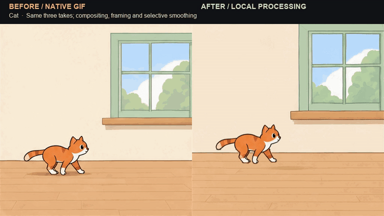</picture></a>
<a href="docs/RECIPES.md#one-prompt-one-gif"><picture>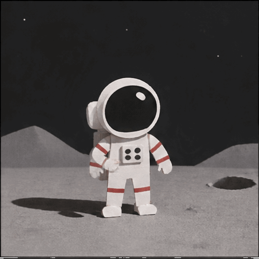</picture></a>
<a href="docs/MOTION-DESIGN.md"><picture>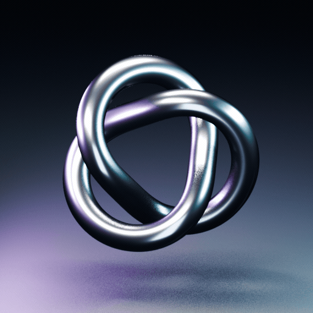</picture></a>
</p>

*A native/finished comparison, an original API take, and an archived Blender render.* [Methods & recipes](docs/GALLERY.md) · [Try the no-key film](#make-your-first-film)

<a id="see-it-in-motion"></a>
<a id="on-the-screen"></a>
<a id="selected-work"></a>

<a id="a-reply-from-the-stars"></a>
<a id="02--three-takes-a-complete-little-exchange"></a>

## Character stories

Existing generated footage, turned into small edits. Titles and layouts do not create new character actions.

<table>
<tr>
<td width="50%" align="center" valign="top">
<a href="docs/assets/example-gallery/titled-story.gif"><picture>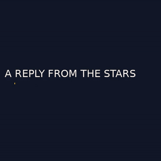</picture></a><br>
<strong>A Reply from the Stars</strong><br>Three takes + local title · 9.70 s play-once GIF<br>
<a href="docs/EXAMPLES.md#2-titled-story-a-small-gif-to-share">Make this edit</a> · <a href=".agents/skills/gif-cinema/assets/example/storyboard.json">Editable story</a>
</td>
<td width="50%" align="center" valign="top">
<a href=".agents/skills/gif-cinema/assets/example/shot-02.gif"><picture></picture></a><br>
<strong>Something answers</strong><br>Original source take · 2.56 s loop<br>
<a href="docs/EXAMPLES.md#the-actual-three-shot-story">See the three takes</a> · <a href="examples/asset-catalog.json">Source facts</a>
</td>
</tr>
</table>

<details>
<summary>Direct a new take, or assemble the existing story</summary>

- [One prompt, one original GIF](docs/RECIPES.md#one-prompt-one-gif): the exact historical request. New generation needs supported access, billing and an authorized request budget.
- [Plain three-shot film](docs/EXAMPLES.md#1-plain-film-preserve-the-source-timing): 7.68 seconds, zero new requests, original drawing cadence.
- [Titles and GIF chapters](docs/EXAMPLES.md#2-titled-story-a-small-gif-to-share): editable local typography and whole-shot delivery.
- [Story pages](docs/STORYTELLING-SKILL.md): layouts around existing actions. Missing footage stays unrendered.

</details>

## Motion graphics

Real outputs from the public local renderer. Shapes, text and keyframes are editable; no model or API call is involved.

<table>
<tr>
<td width="50%" align="center" valign="top">
<a href="docs/assets/catalog/local-shapes.gif"><picture>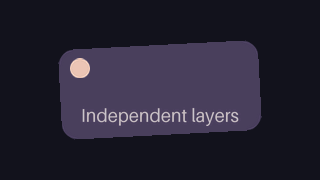</picture></a><br>
<strong>Independent layers</strong><br>Four editable layers · 1.00 s loop<br>
<a href="docs/MULTILAYER-POC.md">Layer workflow</a> · <a href="examples/layered-shapes.json">Scene JSON</a>
</td>
<td width="50%" align="center" valign="top">
<a href="docs/assets/catalog/vertical-motion.gif"><picture>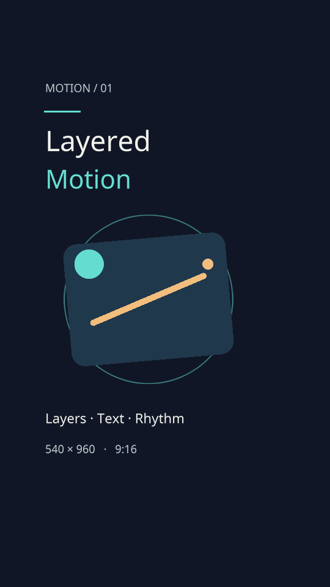</picture></a><br>
<strong>Made for a vertical frame</strong><br>Twelve layers · 3.20 s · 50 fps<br>
<a href="docs/VERTICAL-MOTION-EXAMPLE.md">Composition & margins</a> · <a href="examples/vertical-motion.json">Scene JSON</a>
</td>
</tr>
</table>

[Whole-image motion recipes](docs/STANDALONE-MOTION.md) · [Exact commands and output facts](docs/GALLERY.md#local-motion)

## Sprites and frame review

Turn accepted drawings into reusable assets. Inspect every delivered frame, not just the endpoints.

<table>
<tr>
<td width="50%" align="center" valign="top">
<a href=".agents/skills/gif-cinema/assets/example/shot-01.gif"><picture>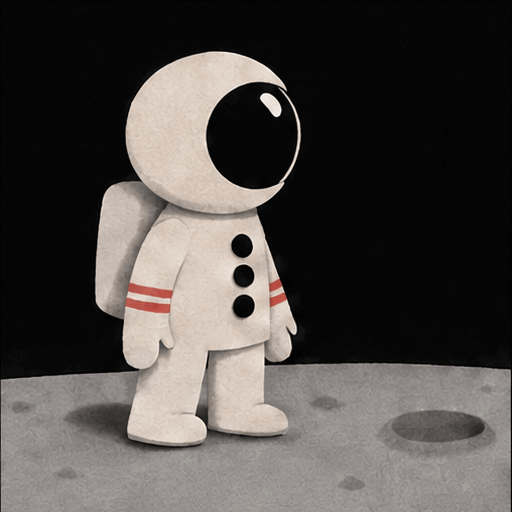</picture></a><br>
<strong>One take → reusable sprite cells</strong><br>Export these same sixteen drawings, with timing<br>
<a href="docs/SPRITES.md">Pack or slice sprites</a> · <a href="docs/GALLERY.md#sprites-and-review">Try the real source</a>
</td>
<td width="50%" align="center" valign="top">
<strong>See the state across a cut</strong><br>Actual decoded samples · full-frame tools linked below<br>
<a href="docs/GIF-REVIEW.md">Review player & checklist</a> · <a href="docs/GALLERY.md#sprites-and-review">Extract every frame</a>
</td>
</tr>
</table>

<p align="center">
<a href="docs/assets/example-gallery/astronaut-storyboard.png">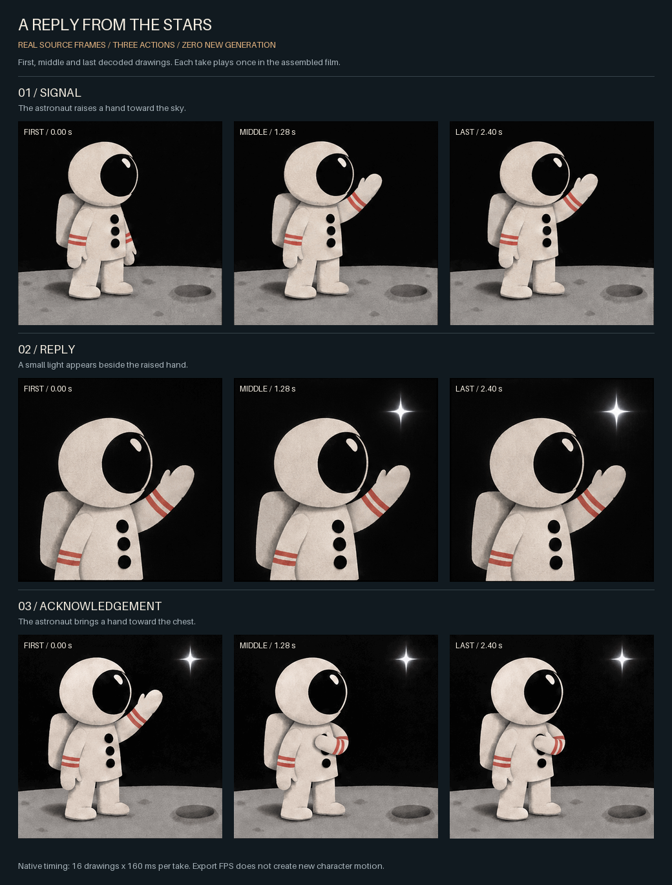</a>
</p>


<details>
<summary>What stays intact, and what still needs a person</summary>

Sprite export preserves source timing and one shared crop; it does not generate poses or remove a background. The review helper extracts actual decoded frames and starts with a pending record. These cards show the original take and an existing sample sheet; run the tools for the complete atlas and review pack. Counts and pixel metrics do not approve identity, contact or loop quality. [Sprite limits](docs/SPRITES.md) · [Complete a review](docs/GIF-REVIEW.md).

</details>

<a id="03--from-the-cutting-room"></a>
<a id="from-the-cutting-room"></a>

## Finishing studies

Earlier footage with additional local postproduction, **not included in the
public CLI**. Each thumbnail loops a **2.24-second excerpt**; the linked films show the complete action.

<table>
<tr>
<td width="50%" align="center" valign="top">
<a id="cat--walk-jump-curl-up"></a>
<a href="docs/assets/showcase/cat-preview.gif"><picture></picture></a><br>
<strong>A window, a jump, a nap</strong><br>Three takes · 7.68 s comparison<br>
<a href="https://github.com/user-attachments/assets/4c200322-2bfc-46ad-8ba9-8548614608a5">Watch comparison</a> · <a href="docs/SHOWCASE.md#cat--walk-jump-curl-up">Method & frame pairs</a>
</td>
<td width="50%" align="center" valign="top">
<a id="dog--follow-the-ball"></a>
<a href="docs/assets/showcase/dog-preview.gif"><picture>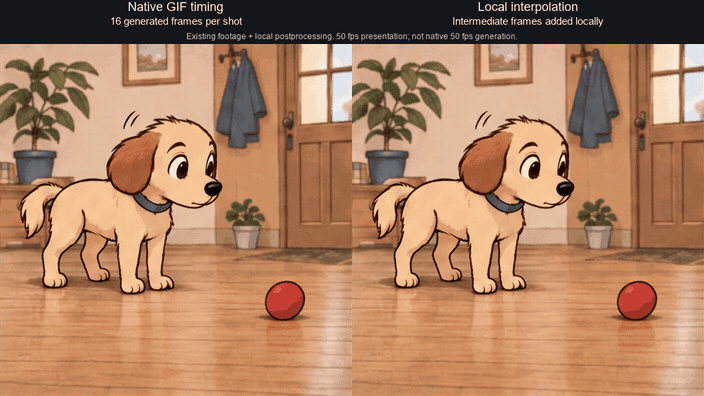</picture></a><br>
<strong>Follow the red ball</strong><br>Four takes · 10.24 s comparison<br>
<a href="https://github.com/user-attachments/assets/63d2cff7-2cf6-4ba9-82a2-1d61dd4e0638">Watch comparison</a> · <a href="docs/SHOWCASE.md#dog--the-same-four-takes">Method & frame pairs</a>
</td>
</tr>
<tr>
<td width="50%" align="center" valign="top">
<a id="astronaut--a-signal-an-answer"></a>
<a href="docs/assets/showcase/astronaut-preview.gif"><picture>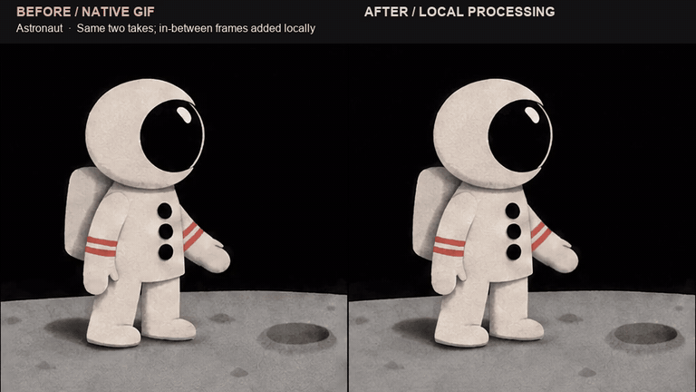</picture></a><br>
<strong>A signal, an answer</strong><br>Two takes · 5.12 s comparison<br>
<a href="https://github.com/user-attachments/assets/86a158cc-c346-4486-8373-1a08fd54fd34">Watch comparison</a> · <a href="docs/SHOWCASE.md#astronaut--two-shots-one-exchange">Method & frame pairs</a>
</td>
<td width="50%" align="center" valign="top">
<a href="docs/assets/showcase/cat-film.mp4">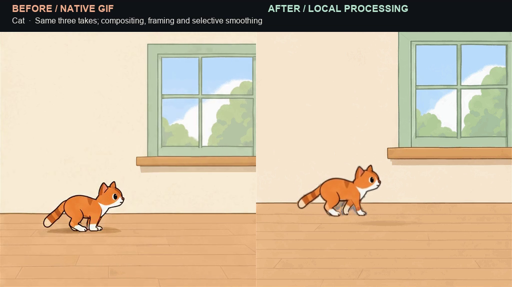</a><br>
<strong>The complete cat short</strong><br>57.2 s · assembled and locally finished<br>
<a href="https://github.com/user-attachments/assets/32e3381d-dbd7-4ff3-8356-1d379b2b7456">Watch the film</a> · <a href="docs/SHOWCASE.md">Production notes</a>
</td>
</tr>
</table>

## Archived 3D study

**Blender EEVEE reference, not native API output.** One loop is complete; this is separate artwork, not a feature of the public generator.

<table>
<tr>
<td width="50%" align="center" valign="top">
<a href="docs/assets/motion-elements/chrome.gif"><picture><source media="(prefers-reduced-motion: reduce)" srcset="docs/assets/motion-elements/poster.png"></picture></a><br>
<strong>Chrome Trefoil</strong><br>3.20 s · 80 unique frames · silent loop<br>
<a href="docs/assets/motion-elements/chrome.mp4">Play the MP4</a> · <a href="docs/MOTION-DESIGN.md">Provenance & source</a>
</td>
<td width="50%" align="center" valign="top">
<a href="docs/assets/motion-elements/decoded-phases.png">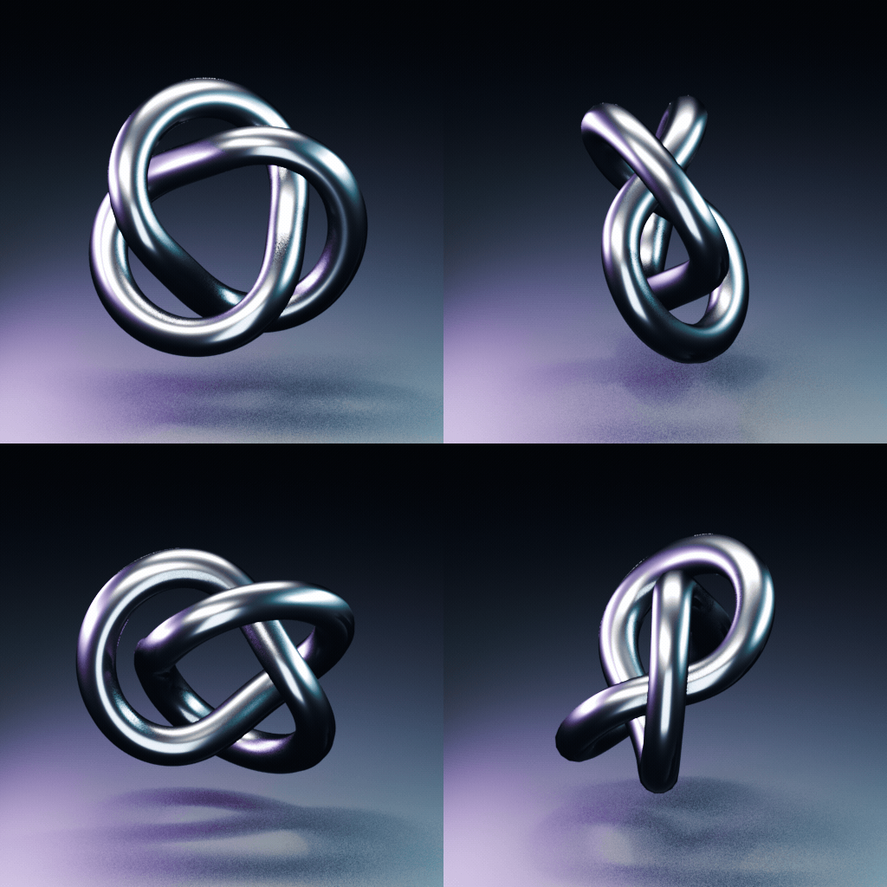</a><br>
<strong>Inside the same loop</strong><br>Four decoded phases, one animation<br>
<a href="docs/assets/motion-elements/manifest.json">Original timing & hashes</a> · <a href="tools/motion_elements/render_studio.py">Archive source</a>
</td>
</tr>
</table>

<a id="try-it-without-an-api-key"></a>

## Make your first film

**Three bundled GIFs → a 7.68-second MP4. No key, no paid requests.** Python 3.10+, Pillow, Git, FFmpeg and ffprobe are required.

<details>
<summary>Copy the complete setup and zero-call demo</summary>

```bash
git clone https://github.com/antropos17/chatgpt-gif-cinema.git
cd chatgpt-gif-cinema
python -m venv .venv
```

Activate with `source .venv/bin/activate` on macOS/Linux, or `.\.venv\Scripts\Activate.ps1` in Windows PowerShell. Then:

```bash
python -m pip install .
python -m gif_cinema doctor
python -m gif_cinema render examples/film.json --dry-run --max-api-calls 0
python -m gif_cinema render examples/film.json --execute --max-api-calls 0 --out output/my-first-film
```

Open `output/my-first-film/film.mp4`, its contact sheet and cut endpoints. Repeating the render verifies reuse with zero new provider calls. [Timing and outputs](docs/EXAMPLES.md#1-plain-film-preserve-the-source-timing).

</details>

<a id="give-the-skill-to-your-agent"></a>
<a id="copy-a-prompt"></a>

## Install the skill

For Codex or Claude Code, build the **current source skill** and extract its single `gif-cinema` folder into your agent's skill directory. The runtime is installed separately; follow the included setup/check instructions.

```bash
python tools/package_skill.py --out dist/gif-cinema.skill.zip
```

- Codex: `~/.codex/skills/gif-cinema`
- Claude Code: `~/.claude/skills/gif-cinema`

> Use the gif-cinema skill to assemble the included astronaut story with zero API calls. Return the MP4, a small GIF and an honest review of both cuts.

[Skill instructions](.agents/skills/gif-cinema/SKILL.md) · [Production guide](docs/PRODUCTION.md) · [Methods & recipes](docs/GALLERY.md) · [Verification](STATUS.md)

## Rights and credits

Inspired by [GIF Factory](https://github.com/WoYun520/gif-factory)'s visual catalog and production separation. No upstream artwork, character assets or code are copied into this catalog. [Attribution](.agents/skills/gif-cinema/THIRD_PARTY_NOTICES.md).

GIF Cinema is **source-available**, not an OSI open-source release. Personal non-commercial evaluation and research are permitted; commercial use, redistribution and hosting require permission. [License](LICENSE) · [Support the workshop](https://buymeacoffee.com/gifcinema).
