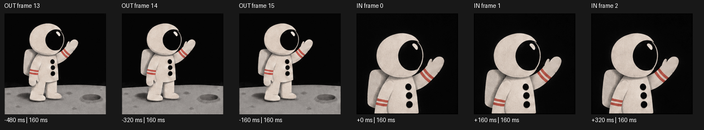
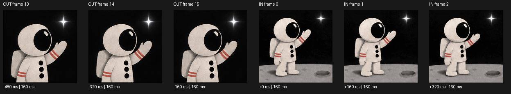

# Inspect the action around a cut

A matching last/first drawing can hide a pause or a reversal. The continuity
diagnostics now expose up to three decoded drawings on each side of a hard cut,
their original frame numbers and their actual GIF delays.

## What render produces

Each join in `continuity-report.json` includes `cut_context` and a
`context_sheet` filename, for example `join-01.png`. The chronological strip
shows the outgoing drawings on the left and incoming drawings on the right.
Negative start times precede the cut; zero is the incoming shot's first drawing.
The existing full-size first/last PNGs and contact sheet remain available.





These examples reuse the three committed astronaut GIFs, without new generation,
interpolation, retiming or source edits. The source hashes and inspection scope
are recorded in [the offline review receipt](assets/cut-context/review.json).
The strips show a wide shot changing to a close-up and back. Camera scale changes
can be deliberate; the large pixel jump does not establish an identity error.
The raised hand, wrist stripes, three buttons and backpack remain visible in the
inspected endpoints. This is an endpoint/context inspection, not full playback
acceptance or proof that every intervening pose is correct.

Run the normal zero-call render for a complete project:

```bash
python -m gif_cinema render examples/film.json --execute --max-api-calls 0 --out output/cut-review
```

This command needs FFmpeg and ffprobe. It never creates new character drawings.
Use a new output path or resume a valid render project.

## Check two existing takes without FFmpeg

```bash
python -m gif_cinema continuity previous.gif next.gif -o output/cut.json
```

This emits the same timing context as JSON. It retains the existing threshold/status
fields and output no-clobber behavior. The standalone command writes JSON, not a
PNG strip. It requires only Python and Pillow and makes no provider requests.

The context also includes adjacent pixel changes, each divided by the outgoing
drawing's hold time, a median local change, and the cut-to-local-change ratio.
These are thumbnail RGB pixel diagnostics. They do not estimate object velocity,
direction, anatomy or identity; camera changes and backgrounds affect them.
A zero local median yields a JSON null ratio, never infinity or an automatic pass.
Unequal frame delays are retained, including the outgoing final hold.
Times describe the source GIF cadence, before the film's output-FPS quantization.

## Review the performance

Inspect the original GIFs in real playback and step through the native endpoint
PNGs. Use the strips to locate the relevant drawings, then check:

- Character identity, costume and proportions.
- Pose, hands, props and contact.
- Gaze and screen direction.
- Action speed and holds immediately around the cut.
- Geography, lighting and cause and effect.

Every join remains `human-review-required`, including identical endpoints and a
zero pixel score. The diagnostic never synthesizes a pose, hides a mismatch with
a dissolve, or declares the story accepted. It adds no API calls and changes
neither OpenAI generation nor chat-directed production.

## Verification

Nine dedicated tests cover real GIF delays, final holds, correct frame numbers
after retaining only a three-frame tail, zero-baseline JSON, matching endpoints
with reversed sequences, no-clobber output, source hashes and render strips.
The existing CLI and render suites also passed locally: 54 passed, two FFmpeg
integration tests skipped because FFmpeg/ffprobe were unavailable.
