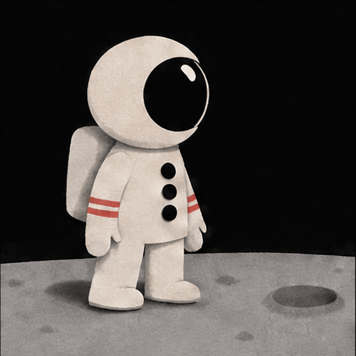
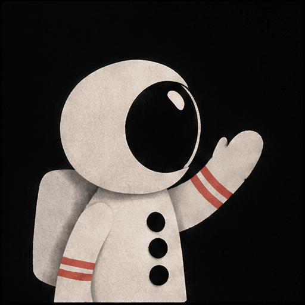
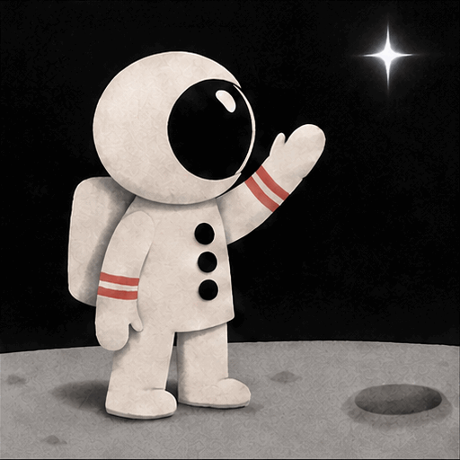
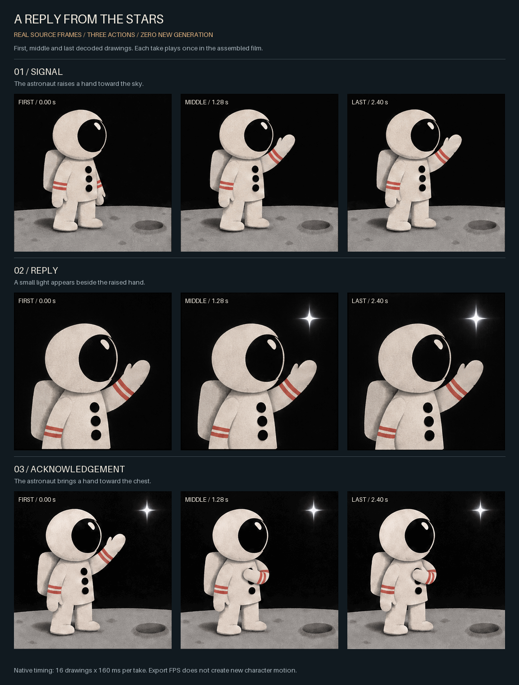
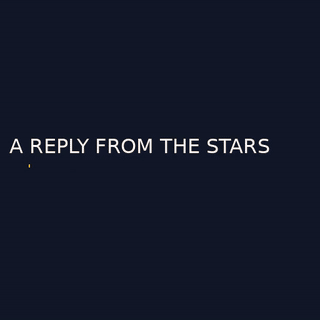

# Real examples you can reproduce

**Start with the result you want.** All three astronaut recipes below use the same
existing generated shots, require no API key, and make zero provider calls. They are
three edits of one short story, not three newly generated cartoons.

- **A plain film:** 7.68 seconds, three source shots, no design additions.
- **A GIF story with an animated title:** 9.68 seconds, the same action plus a
  2-second local title. Export as a compact GIF or whole-shot chapters.
- **An editorial motion study:** 12.24 seconds, the same action with typography,
  short holds, a small whole-image push and frozen-endpoint chapter slides.

The source GIFs, scripts and recipes are in this checkout. Python 3.10+, Pillow,
FFmpeg and ffprobe are required for the film/GIF recipes. After installing the
package with `python -m pip install .`, run the commands from the repository root.
Use a new output directory for the story compiler, inspector and editorial builder.

## The actual three-shot story

An astronaut sends a signal. A light replies. The astronaut acknowledges it.

| Signal | Reply | Acknowledgement |
| --- | --- | --- |
|  |  |  |
| Full-body view. | Close view. | Full-body view returns. |

Each source is **512 × 512, 16 distinct decoded drawings, 160 ms per drawing,
2.56 seconds**. The original GIFs loop forever when viewed directly. The film uses
each action once, forward, in the order shown. The title and editorial recipes do
not create extra character poses.



The samples are at 0.00, 1.28 and 2.40 seconds **within each source**, not global
film timestamps. The last drawing remains on screen until 2.56 seconds. Framing
changes wide → close → wide; hand, helmet and suit details differ between takes.
Those are visible continuity limits, not problems solved by titles or a higher
export frame rate. Watch the original GIFs as well as this still-frame sheet.

[Source facts and hashes](../examples/asset-catalog.json) ·
[Decoded-frame receipt](assets/example-gallery/source-report.json) ·
[Earlier generation evidence](../STATUS.md#generation-evidence)

Verify the exact source bytes, timing, dimensions, loop flag and distinct decoded
frame count without writing files:

```sh
python tools/inspect_example_sources.py --check
```

Recreate the storyboard and a source receipt in your own project folder:

```sh
python tools/inspect_example_sources.py --out output/example-review
```

The inspector works from any working directory when invoked by its absolute path.
It refuses changed source facts, missing files, symlinked inputs, and existing
output directories. It does not certify artistic acceptance. PNG pixels can vary
with Pillow/font versions; source GIF hashes identify the same footage regardless.

## 1. Plain film: preserve the source timing

[Watch the exact public CLI export](https://github.com/user-attachments/assets/c4dc8c9b-1e97-4f1a-9632-e285d9b969e0) ·
[Editable film script](../examples/film.json)

```sh
python -m gif_cinema render examples/film.json --dry-run --max-api-calls 0
python -m gif_cinema render examples/film.json --execute --max-api-calls 0 --out output/plain-example
```

Open `output/plain-example/film.mp4`. It is **7.68 seconds, 512 × 512, 25 fps,
silent**, with 192 playback frames carrying the 48 original drawings. The export
preserves the 160 ms holds; 25 fps does not mean 25 new character drawings per
second. The output folder also includes original endpoints, a contact sheet,
continuity diagnostics and a resumable render manifest.

## 2. Titled story: a small GIF to share



[Download the GIF](assets/example-gallery/titled-story.gif) ·
[Source and output receipt](assets/example-gallery/titled-story-receipt.json) ·
[Editable storyboard](../.agents/skills/gif-cinema/assets/example/storyboard.json) ·
[Story compiler and exact limits](../.agents/skills/gif-cinema/references/story-project.md)

```sh
python .agents/skills/gif-cinema/scripts/story_project.py compile .agents/skills/gif-cinema/assets/example/storyboard.json --out output/titled-project
python -m gif_cinema render output/titled-project/film.json --execute --max-api-calls 0 --out output/titled-render
python .agents/skills/gif-cinema/scripts/story_project.py export-gif output/titled-render/film.mp4 --out output/titled-story.gif
```

The MP4 is **9.68 seconds**, including the 2-second locally animated title. The GIF
is silent, defaults to **320 px wide and 10 fps**, and has no infinite-loop flag.
The verified GIF is **9.70 seconds**: delivery timing is quantized to the
100 ms GIF sampling grid, slightly different from the 9.68-second MP4. The source artwork still has 6.25 drawings per
second. Some GIF viewers override play-once behavior; `--repeat` explicitly makes
the entire story loop. The receipt pins the committed GIF; fresh exports can
differ in palette and encoded bytes with FFmpeg/Pillow versions.

For smaller chapters, keep whole actions together rather than cutting a hand
movement in half:

```sh
python .agents/skills/gif-cinema/scripts/story_chapters.py output/titled-project/film.json --render output/titled-render --out output/story-chapters --max-seconds 6 --dry-run
python .agents/skills/gif-cinema/scripts/story_chapters.py output/titled-project/film.json --render output/titled-render --out output/story-chapters --max-seconds 6
```

This recipe produces **two GIF chapters, 4.60 and 5.20 seconds**, corresponding to
4.56 and 5.12 seconds in the MP4. Chapters preserve shot order and whole-shot
boundaries. Their report distinguishes source timing from GIF delivery timing.
No action is replayed to fill a chapter.

## 3. Editorial study: give each action a page

[Full method, timing and limitations](GIF-STORY-DEMO.md)

```sh
python tools/build_story_demo.py --out output/editorial-example
```

This optional builder requires **Pillow 10.1 or newer** for scalable default text.
Open `output/editorial-example/a-reply-from-the-stars.mp4`. It is **12.24 seconds,
1024 × 576, 25 fps, silent**. The receipt separates 7.68 seconds of native action,
1.20 seconds of establishing holds, 2.40 seconds of result holds, and 0.96 seconds
of chapter slides. Its original-joins image shows both source cuts without the
design around them.

This is a fixed, inspectable example, not a general layered compositor. It borrows
the useful storybook principle of one action per page followed by a short result
hold. The source action is never reversed or repeated to reach a longer duration.

## Finished studies to watch, not zero-key reproduction recipes

The repository also contains earlier locally finished films. Their full private
finishing pipeline and raw per-shot cat/dog GIFs are not included here, so they are
presentation studies rather than promises that the recipes above reproduce them.

- [Cat: 57.2-second silent short](https://github.com/user-attachments/assets/32e3381d-dbd7-4ff3-8356-1d379b2b7456).
  Assembled from short generated takes and finished locally, not one minute-long
  generation request.
- [Cat: native vs finished, 7.68 seconds](https://github.com/user-attachments/assets/4c200322-2bfc-46ad-8ba9-8548614608a5).
  Includes framing cleanup, compositing and selective interpolation.
- [Dog and ball: native vs interpolated, 10.24 seconds](https://github.com/user-attachments/assets/63d2cff7-2cf6-4ba9-82a2-1d61dd4e0638).
  Extra intermediate frames do not repair prop or contact mistakes.
- [Astronaut: native vs interpolated, 5.12 seconds](https://github.com/user-attachments/assets/86a158cc-c346-4486-8373-1a08fd54fd34).
  A separate two-shot finishing comparison, not the plain three-shot recipe.

[Finishing methods and exact asset hashes](SHOWCASE.md)

For a genuinely longer new cartoon, add distinct state-changing actions and
reviewed takes. The bundled [14-action production plan](../.agents/skills/gif-cinema/assets/example/long-story.plan.json)
is **unrendered**. Compiling it prepares generation inputs; it does not create the
missing footage. All new provider requests require separate authorization and a
bounded call budget.
