# Visual catalog: methods, sources and recipes

[Browse the moving homepage](../README.md) · [Install the skill](../README.md#install-the-skill)

Original API footage, local compositions, reusable source drawings, private finishing and archived Blender artwork use different methods. The homepage labels those routes and links their actual sources. This is a smaller independent collection, not a claim of GIF Factory's style or example count.

## Pixel characters

100 new character previews: 99 have 16 frames / 1.92 seconds; the clockwork ballerina has 12 frames / 1.44 seconds. These are not 100 finished 15-second scenes. The restored additional 94 provide final GIFs and posters, not the original generation sheets. The full grid loads about 79 MB.
The three transparent outfit studies have 32 frames and run 2.56 seconds each.
Face/outline drift remains; the outfit joins at 15 → 16 and 31 → 0 need repair.

<table>
<tr>
<td align="center" valign="top">
<a href="../examples/anime-pixel/character-previews/fox-knight.gif"><picture><source media="(prefers-reduced-motion: reduce)" srcset="../examples/anime-pixel/character-previews/frames/fox-knight/00.png">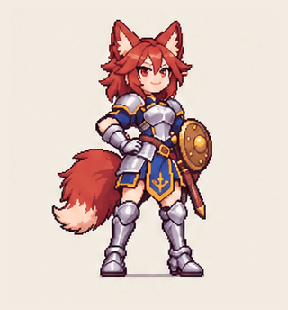</picture></a><br>
<strong>Fox knight · shield salute</strong><br>1.92 s · 16 frames<br>
Drawn poses<br><a href="../examples/anime-pixel/character-previews/README.md">Source &amp; method</a> · <a href="../examples/anime-pixel/character-previews/frames/fox-knight/00.png">First pose</a><br>
<small>Generated-pose preview; face/outline drift.</small>
</td>
<td align="center" valign="top">
<a href="../examples/anime-pixel/character-previews/dragon-chef.gif"><picture><source media="(prefers-reduced-motion: reduce)" srcset="../examples/anime-pixel/character-previews/frames/dragon-chef/00.png"></picture></a><br>
<strong>Dragon chef · offering basket</strong><br>1.92 s · 16 frames<br>
Drawn poses<br><a href="../examples/anime-pixel/character-previews/README.md">Source &amp; method</a> · <a href="../examples/anime-pixel/character-previews/frames/dragon-chef/00.png">First pose</a><br>
<small>Generated-pose preview; face/outline drift.</small>
</td>
<td align="center" valign="top">
<a href="../examples/anime-pixel/character-previews-batch2/raccoon-courier.gif"><picture><source media="(prefers-reduced-motion: reduce)" srcset="../examples/anime-pixel/character-previews-batch2/frames/raccoon-courier/00.png">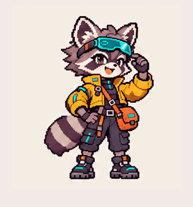</picture></a><br>
<strong>Raccoon courier · goggle salute</strong><br>1.92 s · 16 frames<br>
Drawn poses<br><a href="../examples/anime-pixel/character-previews-batch2/README.md">Source &amp; method</a> · <a href="../examples/anime-pixel/character-previews-batch2/frames/raccoon-courier/00.png">First pose</a><br>
<small>Generated-pose preview; face/outline drift.</small>
</td>
</tr>
<tr>
<td align="center" valign="top">
<a href="../examples/anime-pixel/character-previews-batch2/coral-astronaut.gif"><picture><source media="(prefers-reduced-motion: reduce)" srcset="../examples/anime-pixel/character-previews-batch2/frames/coral-astronaut/00.png">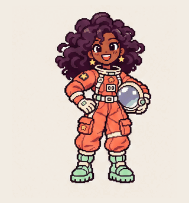</picture></a><br>
<strong>Coral astronaut · hand wave</strong><br>1.92 s · 16 frames<br>
Drawn poses<br><a href="../examples/anime-pixel/character-previews-batch2/README.md">Source &amp; method</a> · <a href="../examples/anime-pixel/character-previews-batch2/frames/coral-astronaut/00.png">First pose</a><br>
<small>Generated-pose preview; face/outline drift.</small>
</td>
<td align="center" valign="top">
<a href="../examples/anime-pixel/character-previews-batch3/violinist.gif"><picture><source media="(prefers-reduced-motion: reduce)" srcset="../examples/anime-pixel/character-previews-batch3/frames/violinist/00.png">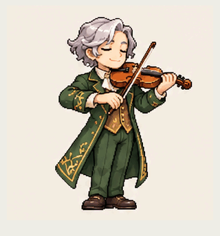</picture></a><br>
<strong>Violinist · bow gesture</strong><br>1.92 s · 16 frames<br>
Drawn poses<br><a href="../examples/anime-pixel/character-previews-batch3/README.md">Source &amp; method</a> · <a href="../examples/anime-pixel/character-previews-batch3/frames/violinist/00.png">First pose</a><br>
<small>Generated-pose preview; face/outline drift.</small>
</td>
<td align="center" valign="top">
<a href="../examples/anime-pixel/character-previews-batch3/blacksmith.gif"><picture><source media="(prefers-reduced-motion: reduce)" srcset="../examples/anime-pixel/character-previews-batch3/frames/blacksmith/00.png">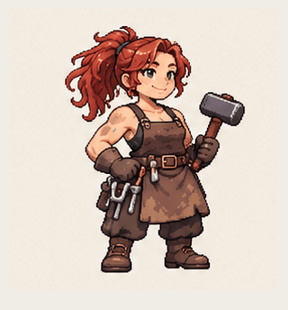</picture></a><br>
<strong>Blacksmith · hammer inspection</strong><br>1.92 s · 16 frames<br>
Drawn poses<br><a href="../examples/anime-pixel/character-previews-batch3/README.md">Source &amp; method</a> · <a href="../examples/anime-pixel/character-previews-batch3/frames/blacksmith/00.png">First pose</a><br>
<small>Generated-pose preview; face/outline drift.</small>
</td>
</tr>
<tr>
<td align="center" valign="top">
<a href="../examples/anime-pixel/catalog-100/herbalist.gif"><picture><source media="(prefers-reduced-motion: reduce)" srcset="../examples/anime-pixel/catalog-100/posters/herbalist.png">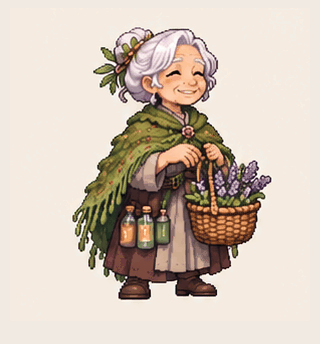</picture></a><br>
<strong>Herbalist · lavender offering</strong><br>1.92 s · 16 frames<br>
Drawn poses<br><a href="../examples/anime-pixel/catalog-100/README.md">Source &amp; method</a> · <a href="../examples/anime-pixel/catalog-100/posters/herbalist.png">First pose</a><br>
<small>Generated-pose preview. Residual face/outline drift; opaque ivory background; short 1.92 s loop, not a 15 s narrative or finished acting animation.</small>
</td>
<td align="center" valign="top">
<a href="../examples/anime-pixel/catalog-100/magician.gif"><picture><source media="(prefers-reduced-motion: reduce)" srcset="../examples/anime-pixel/catalog-100/posters/magician.png">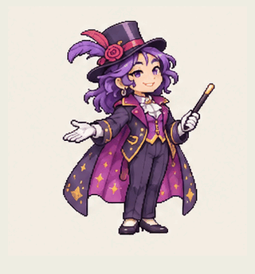</picture></a><br>
<strong>Magician · wand flourish</strong><br>1.92 s · 16 frames<br>
Drawn poses<br><a href="../examples/anime-pixel/catalog-100/README.md">Source &amp; method</a> · <a href="../examples/anime-pixel/catalog-100/posters/magician.png">First pose</a><br>
<small>Generated-pose preview. Residual face/outline drift; opaque ivory background; short 1.92 s loop, not a 15 s narrative or finished acting animation.</small>
</td>
<td align="center" valign="top">
<a href="../examples/anime-pixel/catalog-100/baker.gif"><picture><source media="(prefers-reduced-motion: reduce)" srcset="../examples/anime-pixel/catalog-100/posters/baker.png">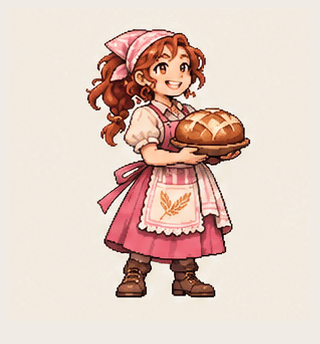</picture></a><br>
<strong>Baker · bread presentation</strong><br>1.92 s · 16 frames<br>
Drawn poses<br><a href="../examples/anime-pixel/catalog-100/README.md">Source &amp; method</a> · <a href="../examples/anime-pixel/catalog-100/posters/baker.png">First pose</a><br>
<small>Generated-pose preview. Residual face/outline drift; opaque ivory background; short 1.92 s loop, not a 15 s narrative or finished acting animation.</small>
</td>
</tr>
<tr>
<td align="center" valign="top">
<a href="../examples/anime-pixel/catalog-100/lantern-sailor.gif"><picture><source media="(prefers-reduced-motion: reduce)" srcset="../examples/anime-pixel/catalog-100/posters/lantern-sailor.png">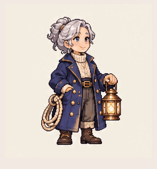</picture></a><br>
<strong>Lantern sailor · lantern lift</strong><br>1.92 s · 16 frames<br>
Drawn poses<br><a href="../examples/anime-pixel/catalog-100/README.md">Source &amp; method</a> · <a href="../examples/anime-pixel/catalog-100/posters/lantern-sailor.png">First pose</a><br>
<small>Generated-pose preview. Residual face/outline drift; opaque ivory background; short 1.92 s loop, not a 15 s narrative or finished acting animation.</small>
</td>
<td align="center" valign="top">
<a href="../examples/anime-pixel/catalog-100/botanist.gif"><picture><source media="(prefers-reduced-motion: reduce)" srcset="../examples/anime-pixel/catalog-100/posters/botanist.png">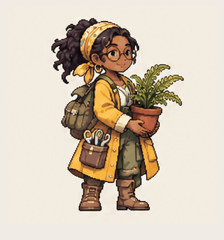</picture></a><br>
<strong>Botanist · plant inspection</strong><br>1.92 s · 16 frames<br>
Drawn poses<br><a href="../examples/anime-pixel/catalog-100/README.md">Source &amp; method</a> · <a href="../examples/anime-pixel/catalog-100/posters/botanist.png">First pose</a><br>
<small>Generated-pose preview. Residual face/outline drift; opaque ivory background; short 1.92 s loop, not a 15 s narrative or finished acting animation.</small>
</td>
<td align="center" valign="top">
<a href="../examples/anime-pixel/catalog-100/dancer.gif"><picture><source media="(prefers-reduced-motion: reduce)" srcset="../examples/anime-pixel/catalog-100/posters/dancer.png">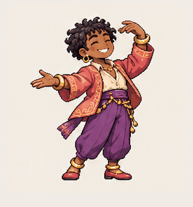</picture></a><br>
<strong>Dancer · arm flourish</strong><br>1.92 s · 16 frames<br>
Drawn poses<br><a href="../examples/anime-pixel/catalog-100/README.md">Source &amp; method</a> · <a href="../examples/anime-pixel/catalog-100/posters/dancer.png">First pose</a><br>
<small>Generated-pose preview. Residual face/outline drift; opaque ivory background; short 1.92 s loop, not a 15 s narrative or finished acting animation.</small>
</td>
</tr>
<tr>
<td align="center" valign="top">
<a href="../examples/anime-pixel/catalog-100/mechanic.gif"><picture><source media="(prefers-reduced-motion: reduce)" srcset="../examples/anime-pixel/catalog-100/posters/mechanic.png">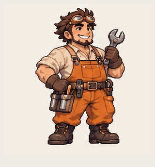</picture></a><br>
<strong>Mechanic · wrench inspection</strong><br>1.92 s · 16 frames<br>
Drawn poses<br><a href="../examples/anime-pixel/catalog-100/README.md">Source &amp; method</a> · <a href="../examples/anime-pixel/catalog-100/posters/mechanic.png">First pose</a><br>
<small>Generated-pose preview. Residual face/outline drift; opaque ivory background; short 1.92 s loop, not a 15 s narrative or finished acting animation.</small>
</td>
<td align="center" valign="top">
<a href="../examples/anime-pixel/catalog-100/detective.gif"><picture><source media="(prefers-reduced-motion: reduce)" srcset="../examples/anime-pixel/catalog-100/posters/detective.png">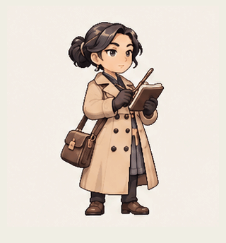</picture></a><br>
<strong>Detective · notebook idle</strong><br>1.92 s · 16 frames<br>
Drawn poses<br><a href="../examples/anime-pixel/catalog-100/README.md">Source &amp; method</a> · <a href="../examples/anime-pixel/catalog-100/posters/detective.png">First pose</a><br>
<small>Generated-pose preview. Residual face/outline drift; opaque ivory background; short 1.92 s loop, not a 15 s narrative or finished acting animation.</small>
</td>
<td align="center" valign="top">
<a href="../examples/anime-pixel/catalog-100/potter.gif"><picture><source media="(prefers-reduced-motion: reduce)" srcset="../examples/anime-pixel/catalog-100/posters/potter.png"></picture></a><br>
<strong>Potter · bowl inspection</strong><br>1.92 s · 16 frames<br>
Drawn poses<br><a href="../examples/anime-pixel/catalog-100/README.md">Source &amp; method</a> · <a href="../examples/anime-pixel/catalog-100/posters/potter.png">First pose</a><br>
<small>Generated-pose preview. Residual face/outline drift; opaque ivory background; short 1.92 s loop, not a 15 s narrative or finished acting animation.</small>
</td>
</tr>
<tr>
<td align="center" valign="top">
<a href="../examples/anime-pixel/catalog-100/tea-merchant.gif"><picture><source media="(prefers-reduced-motion: reduce)" srcset="../examples/anime-pixel/catalog-100/posters/tea-merchant.png">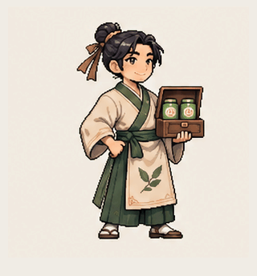</picture></a><br>
<strong>Tea merchant · presentation</strong><br>1.92 s · 16 frames<br>
Drawn poses<br><a href="../examples/anime-pixel/catalog-100/README.md">Source &amp; method</a> · <a href="../examples/anime-pixel/catalog-100/posters/tea-merchant.png">First pose</a><br>
<small>Generated-pose preview. Residual face/outline drift; opaque ivory background; short 1.92 s loop, not a 15 s narrative or finished acting animation.</small>
</td>
<td align="center" valign="top">
<a href="../examples/anime-pixel/catalog-100/silver-knight.gif"><picture><source media="(prefers-reduced-motion: reduce)" srcset="../examples/anime-pixel/catalog-100/posters/silver-knight.png">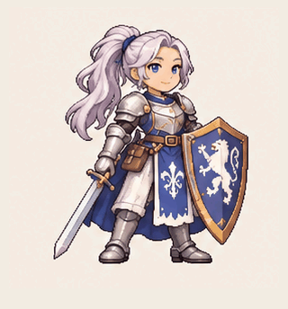</picture></a><br>
<strong>Silver knight · sword gesture</strong><br>1.92 s · 16 frames<br>
Drawn poses<br><a href="../examples/anime-pixel/catalog-100/README.md">Source &amp; method</a> · <a href="../examples/anime-pixel/catalog-100/posters/silver-knight.png">First pose</a><br>
<small>Generated-pose preview. Residual face/outline drift; opaque ivory background; short 1.92 s loop, not a 15 s narrative or finished acting animation.</small>
</td>
<td align="center" valign="top">
<a href="../examples/anime-pixel/catalog-100/cartographer.gif"><picture><source media="(prefers-reduced-motion: reduce)" srcset="../examples/anime-pixel/catalog-100/posters/cartographer.png">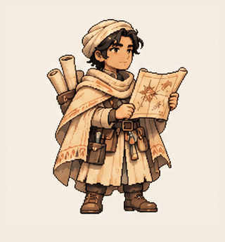</picture></a><br>
<strong>Cartographer · map study</strong><br>1.92 s · 16 frames<br>
Drawn poses<br><a href="../examples/anime-pixel/catalog-100/README.md">Source &amp; method</a> · <a href="../examples/anime-pixel/catalog-100/posters/cartographer.png">First pose</a><br>
<small>Generated-pose preview. Residual face/outline drift; opaque ivory background; short 1.92 s loop, not a 15 s narrative or finished acting animation.</small>
</td>
</tr>
<tr>
<td align="center" valign="top">
<a href="../examples/anime-pixel/catalog-100/aviator.gif"><picture><source media="(prefers-reduced-motion: reduce)" srcset="../examples/anime-pixel/catalog-100/posters/aviator.png">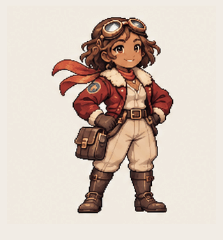</picture></a><br>
<strong>Aviator · goggles salute</strong><br>1.92 s · 16 frames<br>
Drawn poses<br><a href="../examples/anime-pixel/catalog-100/README.md">Source &amp; method</a> · <a href="../examples/anime-pixel/catalog-100/posters/aviator.png">First pose</a><br>
<small>Generated-pose preview. Residual face/outline drift; opaque ivory background; short 1.92 s loop, not a 15 s narrative or finished acting animation.</small>
</td>
<td align="center" valign="top">
<a href="../examples/anime-pixel/catalog-100/polar-traveler.gif"><picture><source media="(prefers-reduced-motion: reduce)" srcset="../examples/anime-pixel/catalog-100/posters/polar-traveler.png">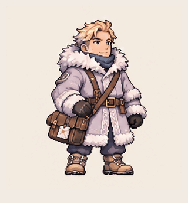</picture></a><br>
<strong>Polar traveler · scarf adjustment</strong><br>1.92 s · 16 frames<br>
Drawn poses<br><a href="../examples/anime-pixel/catalog-100/README.md">Source &amp; method</a> · <a href="../examples/anime-pixel/catalog-100/posters/polar-traveler.png">First pose</a><br>
<small>Generated-pose preview. Residual face/outline drift; opaque ivory background; short 1.92 s loop, not a 15 s narrative or finished acting animation.</small>
</td>
<td align="center" valign="top">
<a href="../examples/anime-pixel/catalog-100/professor.gif"><picture><source media="(prefers-reduced-motion: reduce)" srcset="../examples/anime-pixel/catalog-100/posters/professor.png">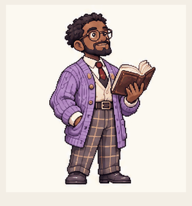</picture></a><br>
<strong>Professor · adjusts glasses</strong><br>1.92 s · 16 frames<br>
Drawn poses<br><a href="../examples/anime-pixel/catalog-100/README.md">Source &amp; method</a> · <a href="../examples/anime-pixel/catalog-100/posters/professor.png">First pose</a><br>
<small>Generated-pose preview. Residual face/outline drift; opaque ivory background; short 1.92 s loop, not a 15 s narrative or finished acting animation.</small>
</td>
</tr>
<tr>
<td align="center" valign="top">
<a href="../examples/anime-pixel/catalog-100/mountain-climber.gif"><picture><source media="(prefers-reduced-motion: reduce)" srcset="../examples/anime-pixel/catalog-100/posters/mountain-climber.png">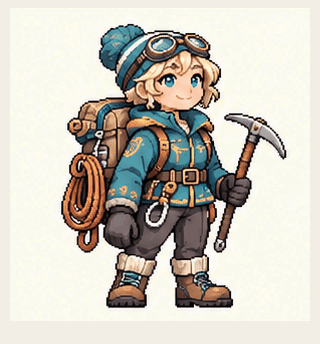</picture></a><br>
<strong>Mountain climber · strap gesture</strong><br>1.92 s · 16 frames<br>
Drawn poses<br><a href="../examples/anime-pixel/catalog-100/README.md">Source &amp; method</a> · <a href="../examples/anime-pixel/catalog-100/posters/mountain-climber.png">First pose</a><br>
<small>Generated-pose preview. Residual face/outline drift; opaque ivory background; short 1.92 s loop, not a 15 s narrative or finished acting animation.</small>
</td>
<td align="center" valign="top">
<a href="../examples/anime-pixel/catalog-100/forest-courier.gif"><picture><source media="(prefers-reduced-motion: reduce)" srcset="../examples/anime-pixel/catalog-100/posters/forest-courier.png">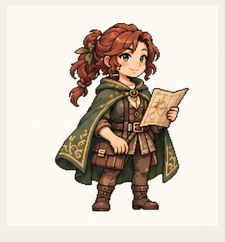</picture></a><br>
<strong>Forest courier · map gesture</strong><br>1.92 s · 16 frames<br>
Drawn poses<br><a href="../examples/anime-pixel/catalog-100/README.md">Source &amp; method</a> · <a href="../examples/anime-pixel/catalog-100/posters/forest-courier.png">First pose</a><br>
<small>Generated-pose preview. Residual face/outline drift; opaque ivory background; short 1.92 s loop, not a 15 s narrative or finished acting animation.</small>
</td>
<td align="center" valign="top">
<a href="../examples/anime-pixel/catalog-100/innkeeper.gif"><picture><source media="(prefers-reduced-motion: reduce)" srcset="../examples/anime-pixel/catalog-100/posters/innkeeper.png">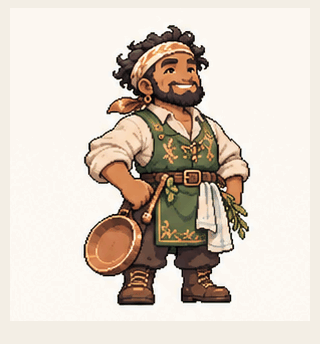</picture></a><br>
<strong>Innkeeper · welcome gesture</strong><br>1.92 s · 16 frames<br>
Drawn poses<br><a href="../examples/anime-pixel/catalog-100/README.md">Source &amp; method</a> · <a href="../examples/anime-pixel/catalog-100/posters/innkeeper.png">First pose</a><br>
<small>Generated-pose preview. Residual face/outline drift; opaque ivory background; short 1.92 s loop, not a 15 s narrative or finished acting animation.</small>
</td>
</tr>
<tr>
<td align="center" valign="top">
<a href="../examples/anime-pixel/catalog-100/astronomer.gif"><picture><source media="(prefers-reduced-motion: reduce)" srcset="../examples/anime-pixel/catalog-100/posters/astronomer.png">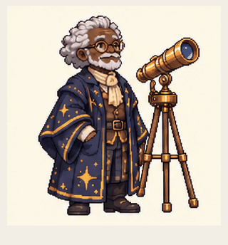</picture></a><br>
<strong>Astronomer · glasses adjustment</strong><br>1.92 s · 16 frames<br>
Drawn poses<br><a href="../examples/anime-pixel/catalog-100/README.md">Source &amp; method</a> · <a href="../examples/anime-pixel/catalog-100/posters/astronomer.png">First pose</a><br>
<small>Generated-pose preview. Residual face/outline drift; opaque ivory background; short 1.92 s loop, not a 15 s narrative or finished acting animation.</small>
</td>
<td align="center" valign="top">
<a href="../examples/anime-pixel/catalog-100/fisherman.gif"><picture><source media="(prefers-reduced-motion: reduce)" srcset="../examples/anime-pixel/catalog-100/posters/fisherman.png">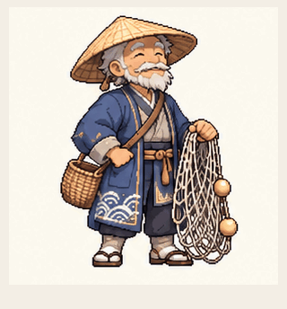</picture></a><br>
<strong>Fisherman · net lift</strong><br>1.92 s · 16 frames<br>
Drawn poses<br><a href="../examples/anime-pixel/catalog-100/README.md">Source &amp; method</a> · <a href="../examples/anime-pixel/catalog-100/posters/fisherman.png">First pose</a><br>
<small>Generated-pose preview. Residual face/outline drift; opaque ivory background; short 1.92 s loop, not a 15 s narrative or finished acting animation.</small>
</td>
<td align="center" valign="top">
<a href="../examples/anime-pixel/catalog-100/trumpeter.gif"><picture><source media="(prefers-reduced-motion: reduce)" srcset="../examples/anime-pixel/catalog-100/posters/trumpeter.png">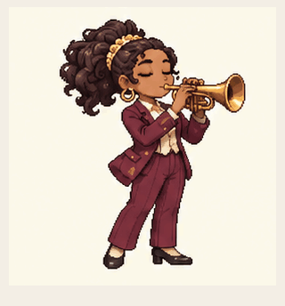</picture></a><br>
<strong>Trumpeter · subtle performance idle</strong><br>1.92 s · 16 frames<br>
Drawn poses<br><a href="../examples/anime-pixel/catalog-100/README.md">Source &amp; method</a> · <a href="../examples/anime-pixel/catalog-100/posters/trumpeter.png">First pose</a><br>
<small>Generated-pose preview. Residual face/outline drift; opaque ivory background; short 1.92 s loop, not a 15 s narrative or finished acting animation. Very subtle finger/elbow changes; some variation is generative drift, not validated musical performance.</small>
</td>
</tr>
<tr>
<td align="center" valign="top">
<a href="../examples/anime-pixel/catalog-100/toolbox-mechanic.gif"><picture><source media="(prefers-reduced-motion: reduce)" srcset="../examples/anime-pixel/catalog-100/posters/toolbox-mechanic.png">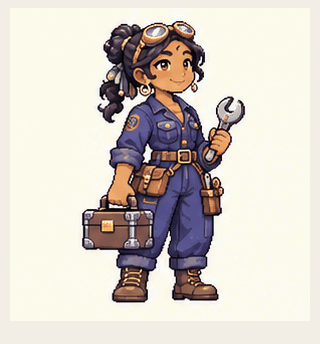</picture></a><br>
<strong>Toolbox mechanic · wrench lift</strong><br>1.92 s · 16 frames<br>
Drawn poses<br><a href="../examples/anime-pixel/catalog-100/README.md">Source &amp; method</a> · <a href="../examples/anime-pixel/catalog-100/posters/toolbox-mechanic.png">First pose</a><br>
<small>Generated-pose preview. Residual face/outline drift; opaque ivory background; short 1.92 s loop, not a 15 s narrative or finished acting animation.</small>
</td>
<td align="center" valign="top">
<a href="../examples/anime-pixel/catalog-100/martial-artist.gif"><picture><source media="(prefers-reduced-motion: reduce)" srcset="../examples/anime-pixel/catalog-100/posters/martial-artist.png">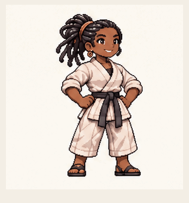</picture></a><br>
<strong>Martial artist · palm block</strong><br>1.92 s · 16 frames<br>
Drawn poses<br><a href="../examples/anime-pixel/catalog-100/README.md">Source &amp; method</a> · <a href="../examples/anime-pixel/catalog-100/posters/martial-artist.png">First pose</a><br>
<small>Generated-pose preview. Residual face/outline drift; opaque ivory background; short 1.92 s loop, not a 15 s narrative or finished acting animation.</small>
</td>
<td align="center" valign="top">
<a href="../examples/anime-pixel/catalog-100/bicycle-courier.gif"><picture><source media="(prefers-reduced-motion: reduce)" srcset="../examples/anime-pixel/catalog-100/posters/bicycle-courier.png">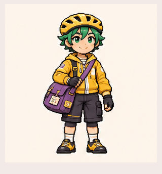</picture></a><br>
<strong>Bicycle courier · wave</strong><br>1.92 s · 16 frames<br>
Drawn poses<br><a href="../examples/anime-pixel/catalog-100/README.md">Source &amp; method</a> · <a href="../examples/anime-pixel/catalog-100/posters/bicycle-courier.png">First pose</a><br>
<small>Generated-pose preview. Residual face/outline drift; opaque ivory background; short 1.92 s loop, not a 15 s narrative or finished acting animation.</small>
</td>
</tr>
<tr>
<td align="center" valign="top">
<a href="../examples/anime-pixel/catalog-100/conductor.gif"><picture><source media="(prefers-reduced-motion: reduce)" srcset="../examples/anime-pixel/catalog-100/posters/conductor.png">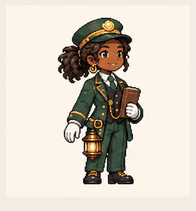</picture></a><br>
<strong>Conductor · salute</strong><br>1.92 s · 16 frames<br>
Drawn poses<br><a href="../examples/anime-pixel/catalog-100/README.md">Source &amp; method</a> · <a href="../examples/anime-pixel/catalog-100/posters/conductor.png">First pose</a><br>
<small>Generated-pose preview. Residual face/outline drift; opaque ivory background; short 1.92 s loop, not a 15 s narrative or finished acting animation.</small>
</td>
<td align="center" valign="top">
<a href="../examples/anime-pixel/catalog-100/gardener.gif"><picture><source media="(prefers-reduced-motion: reduce)" srcset="../examples/anime-pixel/catalog-100/posters/gardener.png">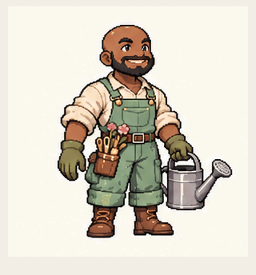</picture></a><br>
<strong>Gardener · wave</strong><br>1.92 s · 16 frames<br>
Drawn poses<br><a href="../examples/anime-pixel/catalog-100/README.md">Source &amp; method</a> · <a href="../examples/anime-pixel/catalog-100/posters/gardener.png">First pose</a><br>
<small>Generated-pose preview. Residual face/outline drift; opaque ivory background; short 1.92 s loop, not a 15 s narrative or finished acting animation.</small>
</td>
<td align="center" valign="top">
<a href="../examples/anime-pixel/catalog-100/pastry-chef.gif"><picture><source media="(prefers-reduced-motion: reduce)" srcset="../examples/anime-pixel/catalog-100/posters/pastry-chef.png"></picture></a><br>
<strong>Pastry chef · presentation</strong><br>1.92 s · 16 frames<br>
Drawn poses<br><a href="../examples/anime-pixel/catalog-100/README.md">Source &amp; method</a> · <a href="../examples/anime-pixel/catalog-100/posters/pastry-chef.png">First pose</a><br>
<small>Generated-pose preview. Residual face/outline drift; opaque ivory background; short 1.92 s loop, not a 15 s narrative or finished acting animation.</small>
</td>
</tr>
<tr>
<td align="center" valign="top">
<a href="../examples/anime-pixel/catalog-100/armorer.gif"><picture><source media="(prefers-reduced-motion: reduce)" srcset="../examples/anime-pixel/catalog-100/posters/armorer.png">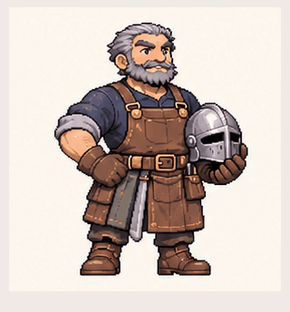</picture></a><br>
<strong>Armorer · hand gesture</strong><br>1.92 s · 16 frames<br>
Drawn poses<br><a href="../examples/anime-pixel/catalog-100/README.md">Source &amp; method</a> · <a href="../examples/anime-pixel/catalog-100/posters/armorer.png">First pose</a><br>
<small>Generated-pose preview. Residual face/outline drift; opaque ivory background; short 1.92 s loop, not a 15 s narrative or finished acting animation.</small>
</td>
<td align="center" valign="top">
<a href="../examples/anime-pixel/catalog-100/archaeologist.gif"><picture><source media="(prefers-reduced-motion: reduce)" srcset="../examples/anime-pixel/catalog-100/posters/archaeologist.png">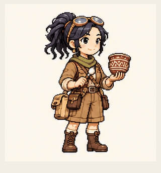</picture></a><br>
<strong>Archaeologist · brush inspection</strong><br>1.92 s · 16 frames<br>
Drawn poses<br><a href="../examples/anime-pixel/catalog-100/README.md">Source &amp; method</a> · <a href="../examples/anime-pixel/catalog-100/posters/archaeologist.png">First pose</a><br>
<small>Generated-pose preview. Residual face/outline drift; opaque ivory background; short 1.92 s loop, not a 15 s narrative or finished acting animation.</small>
</td>
<td align="center" valign="top">
<a href="../examples/anime-pixel/catalog-100/rope-sailor.gif"><picture><source media="(prefers-reduced-motion: reduce)" srcset="../examples/anime-pixel/catalog-100/posters/rope-sailor.png">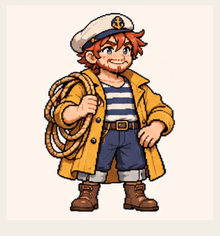</picture></a><br>
<strong>Rope sailor · salute</strong><br>1.92 s · 16 frames<br>
Drawn poses<br><a href="../examples/anime-pixel/catalog-100/README.md">Source &amp; method</a> · <a href="../examples/anime-pixel/catalog-100/posters/rope-sailor.png">First pose</a><br>
<small>Generated-pose preview. Residual face/outline drift; opaque ivory background; short 1.92 s loop, not a 15 s narrative or finished acting animation.</small>
</td>
</tr>
<tr>
<td align="center" valign="top">
<a href="../examples/anime-pixel/catalog-100/moon-wizard.gif"><picture><source media="(prefers-reduced-motion: reduce)" srcset="../examples/anime-pixel/catalog-100/posters/moon-wizard.png">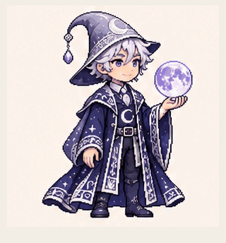</picture></a><br>
<strong>Moon wizard · conjuring gesture</strong><br>1.92 s · 16 frames<br>
Drawn poses<br><a href="../examples/anime-pixel/catalog-100/README.md">Source &amp; method</a> · <a href="../examples/anime-pixel/catalog-100/posters/moon-wizard.png">First pose</a><br>
<small>Generated-pose preview. Residual face/outline drift; opaque ivory background; short 1.92 s loop, not a 15 s narrative or finished acting animation.</small>
</td>
<td align="center" valign="top">
<a href="../examples/anime-pixel/catalog-100/falconer.gif"><picture><source media="(prefers-reduced-motion: reduce)" srcset="../examples/anime-pixel/catalog-100/posters/falconer.png">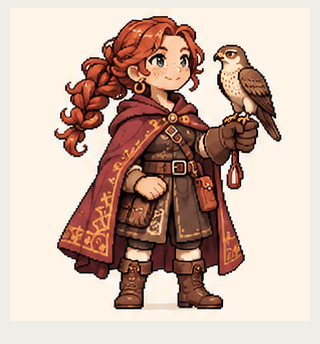</picture></a><br>
<strong>Falconer · greeting</strong><br>1.92 s · 16 frames<br>
Drawn poses<br><a href="../examples/anime-pixel/catalog-100/README.md">Source &amp; method</a> · <a href="../examples/anime-pixel/catalog-100/posters/falconer.png">First pose</a><br>
<small>Generated-pose preview. Residual face/outline drift; opaque ivory background; short 1.92 s loop, not a 15 s narrative or finished acting animation.</small>
</td>
<td align="center" valign="top">
<a href="../examples/anime-pixel/catalog-100/beekeeper.gif"><picture><source media="(prefers-reduced-motion: reduce)" srcset="../examples/anime-pixel/catalog-100/posters/beekeeper.png">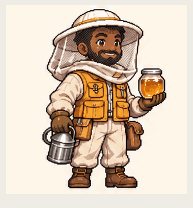</picture></a><br>
<strong>Beekeeper · honey presentation</strong><br>1.92 s · 16 frames<br>
Drawn poses<br><a href="../examples/anime-pixel/catalog-100/README.md">Source &amp; method</a> · <a href="../examples/anime-pixel/catalog-100/posters/beekeeper.png">First pose</a><br>
<small>Generated-pose preview. Residual face/outline drift; opaque ivory background; short 1.92 s loop, not a 15 s narrative or finished acting animation.</small>
</td>
</tr>
<tr>
<td align="center" valign="top">
<a href="../examples/anime-pixel/catalog-100/mushroom-picker.gif"><picture><source media="(prefers-reduced-motion: reduce)" srcset="../examples/anime-pixel/catalog-100/posters/mushroom-picker.png">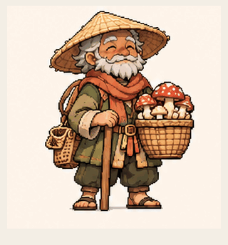</picture></a><br>
<strong>Mushroom picker · basket offering</strong><br>1.92 s · 16 frames<br>
Drawn poses<br><a href="../examples/anime-pixel/catalog-100/README.md">Source &amp; method</a> · <a href="../examples/anime-pixel/catalog-100/posters/mushroom-picker.png">First pose</a><br>
<small>Generated-pose preview. Residual face/outline drift; opaque ivory background; short 1.92 s loop, not a 15 s narrative or finished acting animation.</small>
</td>
<td align="center" valign="top">
<a href="../examples/anime-pixel/catalog-100/ice-sorceress.gif"><picture><source media="(prefers-reduced-motion: reduce)" srcset="../examples/anime-pixel/catalog-100/posters/ice-sorceress.png">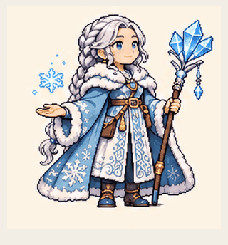</picture></a><br>
<strong>Ice sorceress · spell gesture</strong><br>1.92 s · 16 frames<br>
Drawn poses<br><a href="../examples/anime-pixel/catalog-100/README.md">Source &amp; method</a> · <a href="../examples/anime-pixel/catalog-100/posters/ice-sorceress.png">First pose</a><br>
<small>Generated-pose preview. Residual face/outline drift; opaque ivory background; short 1.92 s loop, not a 15 s narrative or finished acting animation.</small>
</td>
<td align="center" valign="top">
<a href="../examples/anime-pixel/catalog-100/pirate.gif"><picture><source media="(prefers-reduced-motion: reduce)" srcset="../examples/anime-pixel/catalog-100/posters/pirate.png">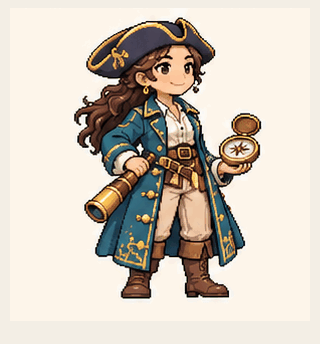</picture></a><br>
<strong>Pirate · compass gesture</strong><br>1.92 s · 16 frames<br>
Drawn poses<br><a href="../examples/anime-pixel/catalog-100/README.md">Source &amp; method</a> · <a href="../examples/anime-pixel/catalog-100/posters/pirate.png">First pose</a><br>
<small>Generated-pose preview. Residual face/outline drift; opaque ivory background; short 1.92 s loop, not a 15 s narrative or finished acting animation.</small>
</td>
</tr>
<tr>
<td align="center" valign="top">
<a href="../examples/anime-pixel/catalog-100/quilter.gif"><picture><source media="(prefers-reduced-motion: reduce)" srcset="../examples/anime-pixel/catalog-100/posters/quilter.png">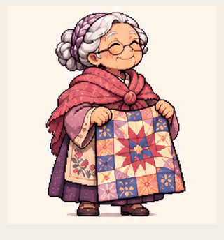</picture></a><br>
<strong>Quilter · showing quilt</strong><br>1.92 s · 16 frames<br>
Drawn poses<br><a href="../examples/anime-pixel/catalog-100/README.md">Source &amp; method</a> · <a href="../examples/anime-pixel/catalog-100/posters/quilter.png">First pose</a><br>
<small>Generated-pose preview. Residual face/outline drift; opaque ivory background; short 1.92 s loop, not a 15 s narrative or finished acting animation.</small>
</td>
<td align="center" valign="top">
<a href="../examples/anime-pixel/catalog-100/drummer.gif"><picture><source media="(prefers-reduced-motion: reduce)" srcset="../examples/anime-pixel/catalog-100/posters/drummer.png"></picture></a><br>
<strong>Drummer · alternating hands</strong><br>1.92 s · 16 frames<br>
Drawn poses<br><a href="../examples/anime-pixel/catalog-100/README.md">Source &amp; method</a> · <a href="../examples/anime-pixel/catalog-100/posters/drummer.png">First pose</a><br>
<small>Generated-pose preview. Residual face/outline drift; opaque ivory background; short 1.92 s loop, not a 15 s narrative or finished acting animation.</small>
</td>
<td align="center" valign="top">
<a href="../examples/anime-pixel/catalog-100/lute-player.gif"><picture><source media="(prefers-reduced-motion: reduce)" srcset="../examples/anime-pixel/catalog-100/posters/lute-player.png">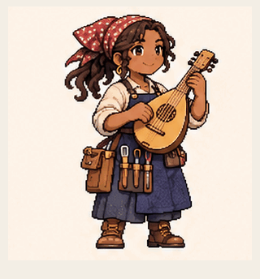</picture></a><br>
<strong>Lute player · strum gesture</strong><br>1.92 s · 16 frames<br>
Drawn poses<br><a href="../examples/anime-pixel/catalog-100/README.md">Source &amp; method</a> · <a href="../examples/anime-pixel/catalog-100/posters/lute-player.png">First pose</a><br>
<small>Generated-pose preview. Residual face/outline drift; opaque ivory background; short 1.92 s loop, not a 15 s narrative or finished acting animation.</small>
</td>
</tr>
<tr>
<td align="center" valign="top">
<a href="../examples/anime-pixel/catalog-100/cellist.gif"><picture><source media="(prefers-reduced-motion: reduce)" srcset="../examples/anime-pixel/catalog-100/posters/cellist.png">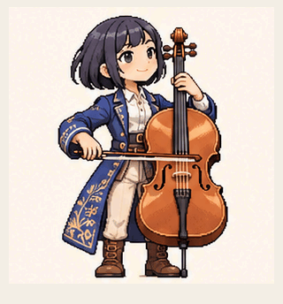</picture></a><br>
<strong>Cellist · bow stroke</strong><br>1.92 s · 16 frames<br>
Drawn poses<br><a href="../examples/anime-pixel/catalog-100/README.md">Source &amp; method</a> · <a href="../examples/anime-pixel/catalog-100/posters/cellist.png">First pose</a><br>
<small>Generated-pose preview. Residual face/outline drift; opaque ivory background; short 1.92 s loop, not a 15 s narrative or finished acting animation.</small>
</td>
<td align="center" valign="top">
<a href="../examples/anime-pixel/catalog-100/stage-technician.gif"><picture><source media="(prefers-reduced-motion: reduce)" srcset="../examples/anime-pixel/catalog-100/posters/stage-technician.png">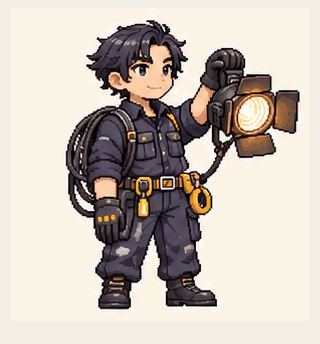</picture></a><br>
<strong>Stage technician · lamp adjustment</strong><br>1.92 s · 16 frames<br>
Drawn poses<br><a href="../examples/anime-pixel/catalog-100/README.md">Source &amp; method</a> · <a href="../examples/anime-pixel/catalog-100/posters/stage-technician.png">First pose</a><br>
<small>Generated-pose preview. Residual face/outline drift; opaque ivory background; short 1.92 s loop, not a 15 s narrative or finished acting animation.</small>
</td>
<td align="center" valign="top">
<a href="../examples/anime-pixel/catalog-100/flutist.gif"><picture><source media="(prefers-reduced-motion: reduce)" srcset="../examples/anime-pixel/catalog-100/posters/flutist.png">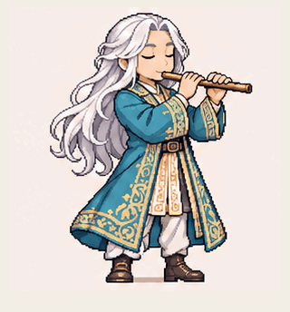</picture></a><br>
<strong>Flutist · finger gesture</strong><br>1.92 s · 16 frames<br>
Drawn poses<br><a href="../examples/anime-pixel/catalog-100/README.md">Source &amp; method</a> · <a href="../examples/anime-pixel/catalog-100/posters/flutist.png">First pose</a><br>
<small>Generated-pose preview. Residual face/outline drift; opaque ivory background; short 1.92 s loop, not a 15 s narrative or finished acting animation.</small>
</td>
</tr>
<tr>
<td align="center" valign="top">
<a href="../examples/anime-pixel/catalog-100/calligrapher.gif"><picture><source media="(prefers-reduced-motion: reduce)" srcset="../examples/anime-pixel/catalog-100/posters/calligrapher.png">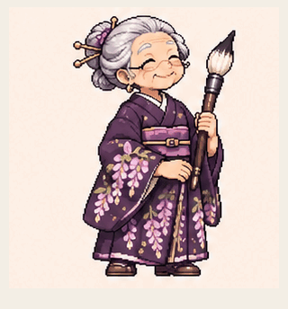</picture></a><br>
<strong>Calligrapher · collar gesture</strong><br>1.92 s · 16 frames<br>
Drawn poses<br><a href="../examples/anime-pixel/catalog-100/README.md">Source &amp; method</a> · <a href="../examples/anime-pixel/catalog-100/posters/calligrapher.png">First pose</a><br>
<small>Generated-pose preview. Residual face/outline drift; opaque ivory background; short 1.92 s loop, not a 15 s narrative or finished acting animation.</small>
</td>
<td align="center" valign="top">
<a href="../examples/anime-pixel/catalog-100/cyclops-robot.gif"><picture><source media="(prefers-reduced-motion: reduce)" srcset="../examples/anime-pixel/catalog-100/posters/cyclops-robot.png">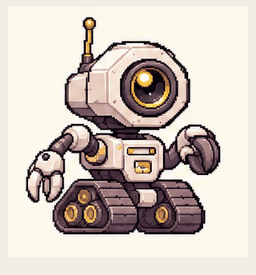</picture></a><br>
<strong>Cyclops robot · claw articulation</strong><br>1.92 s · 16 frames<br>
Drawn poses<br><a href="../examples/anime-pixel/catalog-100/README.md">Source &amp; method</a> · <a href="../examples/anime-pixel/catalog-100/posters/cyclops-robot.png">First pose</a><br>
<small>Generated-pose preview. Residual face/outline drift; opaque ivory background; short 1.92 s loop, not a 15 s narrative or finished acting animation.</small>
</td>
<td align="center" valign="top">
<a href="../examples/anime-pixel/catalog-100/penguin-admiral.gif"><picture><source media="(prefers-reduced-motion: reduce)" srcset="../examples/anime-pixel/catalog-100/posters/penguin-admiral.png">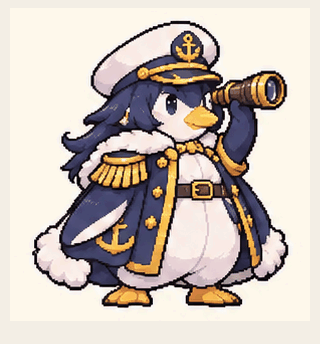</picture></a><br>
<strong>Penguin admiral · flipper wave</strong><br>1.92 s · 16 frames<br>
Drawn poses<br><a href="../examples/anime-pixel/catalog-100/README.md">Source &amp; method</a> · <a href="../examples/anime-pixel/catalog-100/posters/penguin-admiral.png">First pose</a><br>
<small>Generated-pose preview. Residual face/outline drift; opaque ivory background; short 1.92 s loop, not a 15 s narrative or finished acting animation.</small>
</td>
</tr>
<tr>
<td align="center" valign="top">
<a href="../examples/anime-pixel/catalog-100/lobster-boxer.gif"><picture><source media="(prefers-reduced-motion: reduce)" srcset="../examples/anime-pixel/catalog-100/posters/lobster-boxer.png">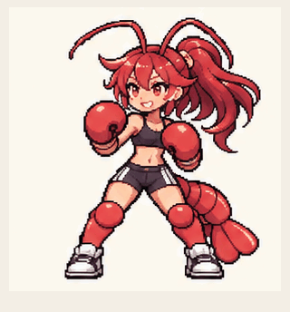</picture></a><br>
<strong>Lobster boxer · jab gestures</strong><br>1.92 s · 16 frames<br>
Drawn poses<br><a href="../examples/anime-pixel/catalog-100/README.md">Source &amp; method</a> · <a href="../examples/anime-pixel/catalog-100/posters/lobster-boxer.png">First pose</a><br>
<small>Generated-pose preview. Residual face/outline drift; opaque ivory background; short 1.92 s loop, not a 15 s narrative or finished acting animation.</small>
</td>
<td align="center" valign="top">
<a href="../examples/anime-pixel/catalog-100/wolf-detective.gif"><picture><source media="(prefers-reduced-motion: reduce)" srcset="../examples/anime-pixel/catalog-100/posters/wolf-detective.png">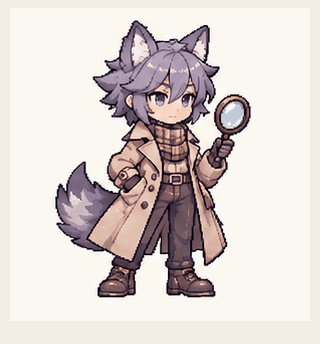</picture></a><br>
<strong>Wolf detective · lens inspection</strong><br>1.92 s · 16 frames<br>
Drawn poses<br><a href="../examples/anime-pixel/catalog-100/README.md">Source &amp; method</a> · <a href="../examples/anime-pixel/catalog-100/posters/wolf-detective.png">First pose</a><br>
<small>Generated-pose preview. Residual face/outline drift; opaque ivory background; short 1.92 s loop, not a 15 s narrative or finished acting animation.</small>
</td>
<td align="center" valign="top">
<a href="../examples/anime-pixel/catalog-100/shark-mechanic.gif"><picture><source media="(prefers-reduced-motion: reduce)" srcset="../examples/anime-pixel/catalog-100/posters/shark-mechanic.png">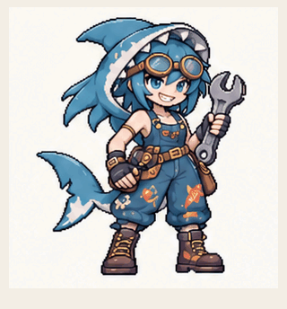</picture></a><br>
<strong>Shark mechanic · goggles adjustment</strong><br>1.92 s · 16 frames<br>
Drawn poses<br><a href="../examples/anime-pixel/catalog-100/README.md">Source &amp; method</a> · <a href="../examples/anime-pixel/catalog-100/posters/shark-mechanic.png">First pose</a><br>
<small>Generated-pose preview. Residual face/outline drift; opaque ivory background; short 1.92 s loop, not a 15 s narrative or finished acting animation. Initial sheet rejected for disappearing glove; corrected glove remains present. Goggles end slightly higher than start; hair, tool and tail detail drift.</small>
</td>
</tr>
<tr>
<td align="center" valign="top">
<a href="../examples/anime-pixel/catalog-100/raven-queen.gif"><picture><source media="(prefers-reduced-motion: reduce)" srcset="../examples/anime-pixel/catalog-100/posters/raven-queen.png"></picture></a><br>
<strong>Raven queen · head tilt and blink</strong><br>1.92 s · 16 frames<br>
Drawn poses<br><a href="../examples/anime-pixel/catalog-100/README.md">Source &amp; method</a> · <a href="../examples/anime-pixel/catalog-100/posters/raven-queen.png">First pose</a><br>
<small>Generated-pose preview. Residual face/outline drift; opaque ivory background; short 1.92 s loop, not a 15 s narrative or finished acting animation. Subtle head tilt/blink; bird briefly opens beak, does not fly. Hair, crown and feather detail drift.</small>
</td>
<td align="center" valign="top">
<a href="../examples/anime-pixel/catalog-100/moth-witch.gif"><picture><source media="(prefers-reduced-motion: reduce)" srcset="../examples/anime-pixel/catalog-100/posters/moth-witch.png"></picture></a><br>
<strong>Moth witch · wing folding</strong><br>1.92 s · 16 frames<br>
Drawn poses<br><a href="../examples/anime-pixel/catalog-100/README.md">Source &amp; method</a> · <a href="../examples/anime-pixel/catalog-100/posters/moth-witch.png">First pose</a><br>
<small>Generated-pose preview. Residual face/outline drift; opaque ivory background; short 1.92 s loop, not a 15 s narrative or finished acting animation. Wing patterns and dress trim drift; antennae end angle differs slightly; wing fold is not flight.</small>
</td>
<td align="center" valign="top">
<a href="../examples/anime-pixel/catalog-100/axolotl-alchemist.gif"><picture><source media="(prefers-reduced-motion: reduce)" srcset="../examples/anime-pixel/catalog-100/posters/axolotl-alchemist.png"></picture></a><br>
<strong>Axolotl alchemist · flask tilt</strong><br>1.92 s · 16 frames<br>
Drawn poses<br><a href="../examples/anime-pixel/catalog-100/README.md">Source &amp; method</a> · <a href="../examples/anime-pixel/catalog-100/posters/axolotl-alchemist.png">First pose</a><br>
<small>Generated-pose preview. Residual face/outline drift; opaque ivory background; short 1.92 s loop, not a 15 s narrative or finished acting animation. Flask tilts with approximate liquid behavior, not physically simulated mixing. Tail and gill outlines drift; outfit remains same.</small>
</td>
</tr>
<tr>
<td align="center" valign="top">
<a href="../examples/anime-pixel/catalog-100/jellyfish-princess.gif"><picture><source media="(prefers-reduced-motion: reduce)" srcset="../examples/anime-pixel/catalog-100/posters/jellyfish-princess.png"></picture></a><br>
<strong>Jellyfish princess · cap pulse</strong><br>1.92 s · 16 frames<br>
Drawn poses<br><a href="../examples/anime-pixel/catalog-100/README.md">Source &amp; method</a> · <a href="../examples/anime-pixel/catalog-100/posters/jellyfish-princess.png">First pose</a><br>
<small>Generated-pose preview. Residual face/outline drift; opaque ivory background; short 1.92 s loop, not a 15 s narrative or finished acting animation. Visible cap compression and ribbon sway; bubbles/hem detail drift. Not swimming or physical jellyfish simulation.</small>
</td>
<td align="center" valign="top">
<a href="../examples/anime-pixel/catalog-100/steampunk-librarian.gif"><picture><source media="(prefers-reduced-motion: reduce)" srcset="../examples/anime-pixel/catalog-100/posters/steampunk-librarian.png"></picture></a><br>
<strong>Steampunk librarian · reading and page flutter</strong><br>1.92 s · 16 frames<br>
Drawn poses<br><a href="../examples/anime-pixel/catalog-100/README.md">Source &amp; method</a> · <a href="../examples/anime-pixel/catalog-100/posters/steampunk-librarian.png">First pose</a><br>
<small>Generated-pose preview. Residual face/outline drift; opaque ivory background; short 1.92 s loop, not a 15 s narrative or finished acting animation. Reading head/eye motion and short page lift; page drops abruptly at frame9, not a smooth complete page turn. Book stack differs from reference but remains consistent within clip.</small>
</td>
<td align="center" valign="top">
<a href="../examples/anime-pixel/catalog-100/rabbit-samurai.gif"><picture><source media="(prefers-reduced-motion: reduce)" srcset="../examples/anime-pixel/catalog-100/posters/rabbit-samurai.png"></picture></a><br>
<strong>Rabbit samurai · ceremonial bow</strong><br>1.92 s · 16 frames<br>
Drawn poses<br><a href="../examples/anime-pixel/catalog-100/README.md">Source &amp; method</a> · <a href="../examples/anime-pixel/catalog-100/posters/rabbit-samurai.png">First pose</a><br>
<small>Generated-pose preview. Residual face/outline drift; opaque ivory background; short 1.92 s loop, not a 15 s narrative or finished acting animation. Ceremonial bow, sword stays sheathed. Floral pattern and ear angles drift; minor feet registration variation. No sword fighting.</small>
</td>
</tr>
<tr>
<td align="center" valign="top">
<a href="../examples/anime-pixel/catalog-100/dragon-aviator.gif"><picture><source media="(prefers-reduced-motion: reduce)" srcset="../examples/anime-pixel/catalog-100/posters/dragon-aviator.png"></picture></a><br>
<strong>Dragon aviator · grounded wingbeats</strong><br>1.92 s · 16 frames<br>
Drawn poses<br><a href="../examples/anime-pixel/catalog-100/README.md">Source &amp; method</a> · <a href="../examples/anime-pixel/catalog-100/posters/dragon-aviator.png">First pose</a><br>
<small>Generated-pose preview. Residual face/outline drift; opaque ivory background; short 1.92 s loop, not a 15 s narrative or finished acting animation. Two grounded wing sweeps, not flight. Wing membrane and tail shape drift, slightly uneven timing.</small>
</td>
<td align="center" valign="top">
<a href="../examples/anime-pixel/catalog-100/slime-bard.gif"><picture><source media="(prefers-reduced-motion: reduce)" srcset="../examples/anime-pixel/catalog-100/posters/slime-bard.png"></picture></a><br>
<strong>Slime bard · singing expression and strum</strong><br>1.92 s · 16 frames<br>
Drawn poses<br><a href="../examples/anime-pixel/catalog-100/README.md">Source &amp; method</a> · <a href="../examples/anime-pixel/catalog-100/posters/slime-bard.png">First pose</a><br>
<small>Generated-pose preview. Residual face/outline drift; opaque ivory background; short 1.92 s loop, not a 15 s narrative or finished acting animation. Singing-like facial expressions and small strum, silent GIF not lip synced. Lute contour/strings drift and slime squash is subtle, not fluid simulation.</small>
</td>
<td align="center" valign="top">
<a href="../examples/anime-pixel/catalog-100/horned-gardener.gif"><picture><source media="(prefers-reduced-motion: reduce)" srcset="../examples/anime-pixel/catalog-100/posters/horned-gardener.png"></picture></a><br>
<strong>Horned gardener · watering</strong><br>1.92 s · 16 frames<br>
Drawn poses<br><a href="../examples/anime-pixel/catalog-100/README.md">Source &amp; method</a> · <a href="../examples/anime-pixel/catalog-100/posters/horned-gardener.png">First pose</a><br>
<small>Generated-pose preview. Residual face/outline drift; opaque ivory background; short 1.92 s loop, not a 15 s narrative or finished acting animation. Watering-can tilt and drawn stream; splash is stylized not simulated. Apron/basket pattern drifts; slight can-angle mismatch at wrap.</small>
</td>
</tr>
<tr>
<td align="center" valign="top">
<a href="../examples/anime-pixel/catalog-100/moon-knight.gif"><picture><source media="(prefers-reduced-motion: reduce)" srcset="../examples/anime-pixel/catalog-100/posters/moon-knight.png"></picture></a><br>
<strong>Moon knight · shield guard</strong><br>1.92 s · 16 frames<br>
Drawn poses<br><a href="../examples/anime-pixel/catalog-100/README.md">Source &amp; method</a> · <a href="../examples/anime-pixel/catalog-100/posters/moon-knight.png">First pose</a><br>
<small>Generated-pose preview. Residual face/outline drift; opaque ivory background; short 1.92 s loop, not a 15 s narrative or finished acting animation. Shield raising and crouch; sword is visibly drawn throughout despite initial prompt asking sheathed. No unsheathing action. Sword shape and cape-stars drift.</small>
</td>
<td align="center" valign="top">
<a href="../examples/anime-pixel/catalog-100/mushroom-druid.gif"><picture><source media="(prefers-reduced-motion: reduce)" srcset="../examples/anime-pixel/catalog-100/posters/mushroom-druid.png"></picture></a><br>
<strong>Mushroom druid · bell swing</strong><br>1.92 s · 16 frames<br>
Drawn poses<br><a href="../examples/anime-pixel/catalog-100/README.md">Source &amp; method</a> · <a href="../examples/anime-pixel/catalog-100/posters/mushroom-druid.png">First pose</a><br>
<small>Generated-pose preview. Residual face/outline drift; opaque ivory background; short 1.92 s loop, not a 15 s narrative or finished acting animation. Small bell swing and head/blink motion, silent GIF. Bell attachment and robe decoration drift; short uneven pendulum poses not physical simulation.</small>
</td>
<td align="center" valign="top">
<a href="../examples/anime-pixel/catalog-100/cyber-violinist.gif"><picture><source media="(prefers-reduced-motion: reduce)" srcset="../examples/anime-pixel/catalog-100/posters/cyber-violinist.png"></picture></a><br>
<strong>Cyber violinist · bow gesture</strong><br>1.92 s · 16 frames<br>
Drawn poses<br><a href="../examples/anime-pixel/catalog-100/README.md">Source &amp; method</a> · <a href="../examples/anime-pixel/catalog-100/posters/cyber-violinist.png">First pose</a><br>
<small>Generated-pose preview. Residual face/outline drift; opaque ivory background; short 1.92 s loop, not a 15 s narrative or finished acting animation. Bow gesture rather than anatomically accurate violin performance: bow angle/length and contact vary. Hair and coat detail drift.</small>
</td>
</tr>
<tr>
<td align="center" valign="top">
<a href="../examples/anime-pixel/catalog-100/bat-courier.gif"><picture><source media="(prefers-reduced-motion: reduce)" srcset="../examples/anime-pixel/catalog-100/posters/bat-courier.png"></picture></a><br>
<strong>Bat courier · inspecting envelope</strong><br>1.92 s · 16 frames<br>
Drawn poses<br><a href="../examples/anime-pixel/catalog-100/README.md">Source &amp; method</a> · <a href="../examples/anime-pixel/catalog-100/posters/bat-courier.png">First pose</a><br>
<small>Generated-pose preview. Residual face/outline drift; opaque ivory background; short 1.92 s loop, not a 15 s narrative or finished acting animation. Inspects closed envelope, not actually reading its contents. Wing/bag outlines drift; subtle head and wrist registration mismatch.</small>
</td>
<td align="center" valign="top">
<a href="../examples/anime-pixel/catalog-100/robot-wolf.gif"><picture><source media="(prefers-reduced-motion: reduce)" srcset="../examples/anime-pixel/catalog-100/posters/robot-wolf.png"></picture></a><br>
<strong>Robot wolf · head tilt and tail wag</strong><br>1.92 s · 16 frames<br>
Drawn poses<br><a href="../examples/anime-pixel/catalog-100/README.md">Source &amp; method</a> · <a href="../examples/anime-pixel/catalog-100/posters/robot-wolf.png">First pose</a><br>
<small>Generated-pose preview. Residual face/outline drift; opaque ivory background; short 1.92 s loop, not a 15 s narrative or finished acting animation. Seated head tilt and tail wag, not walking. Face turns somewhat abruptly at frame7; armor and tail silhouette drift.</small>
</td>
<td align="center" valign="top">
<a href="../examples/anime-pixel/catalog-100/owl-cartographer.gif"><picture><source media="(prefers-reduced-motion: reduce)" srcset="../examples/anime-pixel/catalog-100/posters/owl-cartographer.png"></picture></a><br>
<strong>Owl cartographer · looking around</strong><br>1.92 s · 16 frames<br>
Drawn poses<br><a href="../examples/anime-pixel/catalog-100/README.md">Source &amp; method</a> · <a href="../examples/anime-pixel/catalog-100/posters/owl-cartographer.png">First pose</a><br>
<small>Generated-pose preview. Residual face/outline drift; opaque ivory background; short 1.92 s loop, not a 15 s narrative or finished acting animation. Looks around while holding map, not clearly reading it. Map markings/feathers change subtly; no actual navigation.</small>
</td>
</tr>
<tr>
<td align="center" valign="top">
<a href="../examples/anime-pixel/catalog-100/red-panda-host.gif"><picture><source media="(prefers-reduced-motion: reduce)" srcset="../examples/anime-pixel/catalog-100/posters/red-panda-host.png"></picture></a><br>
<strong>Red panda host · cooling tea</strong><br>1.92 s · 16 frames<br>
Drawn poses<br><a href="../examples/anime-pixel/catalog-100/README.md">Source &amp; method</a> · <a href="../examples/anime-pixel/catalog-100/posters/red-panda-host.png">First pose</a><br>
<small>Generated-pose preview. Residual face/outline drift; opaque ivory background; short 1.92 s loop, not a 15 s narrative or finished acting animation. Pursed mouth/head lean and steam curls. Steam is stylized, not physically responding to breath; hat/robe details drift. Minor wrap head/tray registration mismatch.</small>
</td>
<td align="center" valign="top">
<a href="../examples/anime-pixel/catalog-100/crystal-golem.gif"><picture><source media="(prefers-reduced-motion: reduce)" srcset="../examples/anime-pixel/catalog-100/posters/crystal-golem.png"></picture></a><br>
<strong>Crystal golem · opening palm</strong><br>1.92 s · 16 frames<br>
Drawn poses<br><a href="../examples/anime-pixel/catalog-100/README.md">Source &amp; method</a> · <a href="../examples/anime-pixel/catalog-100/posters/crystal-golem.png">First pose</a><br>
<small>Generated-pose preview. Residual face/outline drift; opaque ivory background; short 1.92 s loop, not a 15 s narrative or finished acting animation. Palm opens/closes and head looks down. Finger/knuckle shape drifts; closing at9-to10 faster than opening. Minor shoulder/facet mismatch at wrap.</small>
</td>
<td align="center" valign="top">
<a href="../examples/anime-pixel/catalog-100/polar-bear-smith.gif"><picture><source media="(prefers-reduced-motion: reduce)" srcset="../examples/anime-pixel/catalog-100/posters/polar-bear-smith.png"></picture></a><br>
<strong>Polar bear smith · yawn</strong><br>1.92 s · 16 frames<br>
Drawn poses<br><a href="../examples/anime-pixel/catalog-100/README.md">Source &amp; method</a> · <a href="../examples/anime-pixel/catalog-100/posters/polar-bear-smith.png">First pose</a><br>
<small>Generated-pose preview. Residual face/outline drift; opaque ivory background; short 1.92 s loop, not a 15 s narrative or finished acting animation. Yawn with paw-to-chest gesture; hammer stays held. Mouth recovery9-to10 is quicker; apron/fur/hammer facets drift and minor wrist wrap mismatch.</small>
</td>
</tr>
<tr>
<td align="center" valign="top">
<a href="../examples/anime-pixel/catalog-100/chameleon-rogue.gif"><picture><source media="(prefers-reduced-motion: reduce)" srcset="../examples/anime-pixel/catalog-100/posters/chameleon-rogue.png"></picture></a><br>
<strong>Chameleon rogue · wary glance</strong><br>1.92 s · 16 frames<br>
Drawn poses<br><a href="../examples/anime-pixel/catalog-100/README.md">Source &amp; method</a> · <a href="../examples/anime-pixel/catalog-100/posters/chameleon-rogue.png">First pose</a><br>
<small>Generated-pose preview. Residual face/outline drift; opaque ivory background; short 1.92 s loop, not a 15 s narrative or finished acting animation. Subtle head/eye scan with tail curl; independent eye movement not clearly achieved. Tail/hood contour drift and residual seam offset.</small>
</td>
<td align="center" valign="top">
<a href="../examples/anime-pixel/catalog-100/bee-honeykeeper.gif"><picture><source media="(prefers-reduced-motion: reduce)" srcset="../examples/anime-pixel/catalog-100/posters/bee-honeykeeper.png"></picture></a><br>
<strong>Bee honeykeeper · admiring jar</strong><br>1.92 s · 16 frames<br>
Drawn poses<br><a href="../examples/anime-pixel/catalog-100/README.md">Source &amp; method</a> · <a href="../examples/anime-pixel/catalog-100/posters/bee-honeykeeper.png">First pose</a><br>
<small>Generated-pose preview. Residual face/outline drift; opaque ivory background; short 1.92 s loop, not a 15 s narrative or finished acting animation. Raises and admires closed honey jar; not actually tasting/smelling honey. Wing/flower/hand details drift.</small>
</td>
<td align="center" valign="top">
<a href="../examples/anime-pixel/catalog-100/turtle-paladin.gif"><picture><source media="(prefers-reduced-motion: reduce)" srcset="../examples/anime-pixel/catalog-100/posters/turtle-paladin.png"></picture></a><br>
<strong>Turtle paladin · sleepy nod</strong><br>1.92 s · 16 frames<br>
Drawn poses<br><a href="../examples/anime-pixel/catalog-100/README.md">Source &amp; method</a> · <a href="../examples/anime-pixel/catalog-100/posters/turtle-paladin.png">First pose</a><br>
<small>Generated-pose preview. Residual face/outline drift; opaque ivory background; short 1.92 s loop, not a 15 s narrative or finished acting animation. Small head nod and blink rather than full neck retraction; armor/trident outlines drift and head rises quickly around frame 11.</small>
</td>
</tr>
<tr>
<td align="center" valign="top">
<a href="../examples/anime-pixel/catalog-100/snail-postwoman.gif"><picture><source media="(prefers-reduced-motion: reduce)" srcset="../examples/anime-pixel/catalog-100/posters/snail-postwoman.png"></picture></a><br>
<strong>Snail postwoman · cherished letter</strong><br>1.92 s · 16 frames<br>
Drawn poses<br><a href="../examples/anime-pixel/catalog-100/README.md">Source &amp; method</a> · <a href="../examples/anime-pixel/catalog-100/posters/snail-postwoman.png">First pose</a><br>
<small>Generated-pose preview. Residual face/outline drift; opaque ivory background; short 1.92 s loop, not a 15 s narrative or finished acting animation. Envelope-to-cheek gesture and closed-eye smile; letter and cap details drift slightly, no letter opening or locomotion.</small>
</td>
<td align="center" valign="top">
<a href="../examples/anime-pixel/catalog-100/salamander-firefighter.gif"><picture><source media="(prefers-reduced-motion: reduce)" srcset="../examples/anime-pixel/catalog-100/posters/salamander-firefighter.png"></picture></a><br>
<strong>Salamander firefighter · nozzle drill</strong><br>1.92 s · 16 frames<br>
Drawn poses<br><a href="../examples/anime-pixel/catalog-100/README.md">Source &amp; method</a> · <a href="../examples/anime-pixel/catalog-100/posters/salamander-firefighter.png">First pose</a><br>
<small>Generated-pose preview. Residual face/outline drift; opaque ivory background; short 1.92 s loop, not a 15 s narrative or finished acting animation. Nozzle lowering and raising with blink, no water simulation. Nozzle length and tail spots drift slightly.</small>
</td>
<td align="center" valign="top">
<a href="../examples/anime-pixel/catalog-100/vampire-librarian.gif"><picture><source media="(prefers-reduced-motion: reduce)" srcset="../examples/anime-pixel/catalog-100/posters/vampire-librarian.png"></picture></a><br>
<strong>Vampire librarian · reading</strong><br>1.92 s · 16 frames<br>
Drawn poses<br><a href="../examples/anime-pixel/catalog-100/README.md">Source &amp; method</a> · <a href="../examples/anime-pixel/catalog-100/posters/vampire-librarian.png">First pose</a><br>
<small>Generated-pose preview. Residual face/outline drift; opaque ivory background; short 1.92 s loop, not a 15 s narrative or finished acting animation. Head dips toward book; finger gesture is small and not a clear line trace. Finger rest differs slightly at wrap; page markings drift.</small>
</td>
</tr>
<tr>
<td align="center" valign="top">
<a href="../examples/anime-pixel/catalog-100/phoenix-drummer.gif"><picture><source media="(prefers-reduced-motion: reduce)" srcset="../examples/anime-pixel/catalog-100/posters/phoenix-drummer.png"></picture></a><br>
<strong>Phoenix drummer · stick flourish</strong><br>1.92 s · 16 frames<br>
Drawn poses<br><a href="../examples/anime-pixel/catalog-100/README.md">Source &amp; method</a> · <a href="../examples/anime-pixel/catalog-100/posters/phoenix-drummer.png">First pose</a><br>
<small>Generated-pose preview. Residual face/outline drift; opaque ivory background; short 1.92 s loop, not a 15 s narrative or finished acting animation. Stick flourish only: generated poses do not clearly show drumhead contact or alternating strikes. Feather, drum trim and stick details drift. Silent.</small>
</td>
<td align="center" valign="top">
<a href="../examples/anime-pixel/catalog-100/lightning-mage.gif"><picture><source media="(prefers-reduced-motion: reduce)" srcset="../examples/anime-pixel/catalog-100/posters/lightning-mage.png"></picture></a><br>
<strong>Lightning mage · palm spark</strong><br>1.92 s · 16 frames<br>
Drawn poses<br><a href="../examples/anime-pixel/catalog-100/README.md">Source &amp; method</a> · <a href="../examples/anime-pixel/catalog-100/posters/lightning-mage.png">First pose</a><br>
<small>Generated-pose preview. Residual face/outline drift; opaque ivory background; short 1.92 s loop, not a 15 s narrative or finished acting animation. Palm opens with spark; hand closes quickly around frame 13. Hair tips and staff details drift.</small>
</td>
<td align="center" valign="top">
<a href="../examples/anime-pixel/catalog-100/rose-duelist.gif"><picture><source media="(prefers-reduced-motion: reduce)" srcset="../examples/anime-pixel/catalog-100/posters/rose-duelist.png"></picture></a><br>
<strong>Rose duelist · flower scent</strong><br>1.92 s · 16 frames<br>
Drawn poses<br><a href="../examples/anime-pixel/catalog-100/README.md">Source &amp; method</a> · <a href="../examples/anime-pixel/catalog-100/posters/rose-duelist.png">First pose</a><br>
<small>Generated-pose preview. Residual face/outline drift; opaque ivory background; short 1.92 s loop, not a 15 s narrative or finished acting animation. Rose-to-face gesture with closed eyes. Sword guard, rose petals and dress trim drift slightly.</small>
</td>
</tr>
<tr>
<td align="center" valign="top">
<a href="../examples/anime-pixel/catalog-100/beetle-knight.gif"><picture><source media="(prefers-reduced-motion: reduce)" srcset="../examples/anime-pixel/catalog-100/posters/beetle-knight.png"></picture></a><br>
<strong>Beetle knight · shield guard</strong><br>1.92 s · 16 frames<br>
Drawn poses<br><a href="../examples/anime-pixel/catalog-100/README.md">Source &amp; method</a> · <a href="../examples/anime-pixel/catalog-100/posters/beetle-knight.png">First pose</a><br>
<small>Generated-pose preview. Residual face/outline drift; opaque ivory background; short 1.92 s loop, not a 15 s narrative or finished acting animation. Shield guard and knee bend. Helmet horns and shield crest drift; recovery around frame 9 is relatively fast.</small>
</td>
<td align="center" valign="top">
<a href="../examples/anime-pixel/catalog-100/star-witch.gif"><picture><source media="(prefers-reduced-motion: reduce)" srcset="../examples/anime-pixel/catalog-100/posters/star-witch.png"></picture></a><br>
<strong>Star witch · wand sweep</strong><br>1.92 s · 16 frames<br>
Drawn poses<br><a href="../examples/anime-pixel/catalog-100/README.md">Source &amp; method</a> · <a href="../examples/anime-pixel/catalog-100/posters/star-witch.png">First pose</a><br>
<small>Generated-pose preview. Residual face/outline drift; opaque ivory background; short 1.92 s loop, not a 15 s narrative or finished acting animation. Wand sweep with fading stars. Long near-hold around frames10-15, hand/hat decorations drift slightly.</small>
</td>
<td align="center" valign="top">
<a href="../examples/anime-pixel/catalog-100/whale-conductor.gif"><picture><source media="(prefers-reduced-motion: reduce)" srcset="../examples/anime-pixel/catalog-100/posters/whale-conductor.png"></picture></a><br>
<strong>Whale conductor · downbeat</strong><br>1.92 s · 16 frames<br>
Drawn poses<br><a href="../examples/anime-pixel/catalog-100/README.md">Source &amp; method</a> · <a href="../examples/anime-pixel/catalog-100/posters/whale-conductor.png">First pose</a><br>
<small>Generated-pose preview. Residual face/outline drift; opaque ivory background; short 1.92 s loop, not a 15 s narrative or finished acting animation. Baton downbeat and blink, silent and not synchronized to music. Baton angle and jacket trim drift at wrap.</small>
</td>
</tr>
<tr>
<td align="center" valign="top">
<a href="../examples/anime-pixel/catalog-100/ice-elf-archer.gif"><picture><source media="(prefers-reduced-motion: reduce)" srcset="../examples/anime-pixel/catalog-100/posters/ice-elf-archer.png"></picture></a><br>
<strong>Ice elf archer · collar adjustment</strong><br>1.92 s · 16 frames<br>
Drawn poses<br><a href="../examples/anime-pixel/catalog-100/README.md">Source &amp; method</a> · <a href="../examples/anime-pixel/catalog-100/posters/ice-elf-archer.png">First pose</a><br>
<small>Generated-pose preview. Residual face/outline drift; opaque ivory background; short 1.92 s loop, not a 15 s narrative or finished acting animation. Collar adjustment and blink, no bow draw or shot. Bow string and fur edges drift; fingers schematic.</small>
</td>
<td align="center" valign="top">
<a href="../examples/anime-pixel/catalog-100/cactus-cowboy.gif"><picture><source media="(prefers-reduced-motion: reduce)" srcset="../examples/anime-pixel/catalog-100/posters/cactus-cowboy.png"></picture></a><br>
<strong>Cactus cowboy · hat tip</strong><br>1.92 s · 16 frames<br>
Drawn poses<br><a href="../examples/anime-pixel/catalog-100/README.md">Source &amp; method</a> · <a href="../examples/anime-pixel/catalog-100/posters/cactus-cowboy.png">First pose</a><br>
<small>Generated-pose preview. Residual face/outline drift; opaque ivory background; short 1.92 s loop, not a 15 s narrative or finished acting animation. Hat tip and wink. Hat flower/spines and toy nozzle details drift slightly; no shooting.</small>
</td>
<td align="center" valign="top">
<a href="../examples/anime-pixel/catalog-100/fox-shrine-maiden.gif"><picture><source media="(prefers-reduced-motion: reduce)" srcset="../examples/anime-pixel/catalog-100/posters/fox-shrine-maiden.png"></picture></a><br>
<strong>Fox shrine maiden · lantern lift</strong><br>1.92 s · 16 frames<br>
Drawn poses<br><a href="../examples/anime-pixel/catalog-100/README.md">Source &amp; method</a> · <a href="../examples/anime-pixel/catalog-100/posters/fox-shrine-maiden.png">First pose</a><br>
<small>Generated-pose preview. Residual face/outline drift; opaque ivory background; short 1.92 s loop, not a 15 s narrative or finished acting animation. Lantern lift/head tilt. Tail curls overlap so exact nine-tail count is not visually verifiable; lantern trim and hem drift. Smaller subject from landscape sheet, no upscale.</small>
</td>
</tr>
<tr>
<td align="center" valign="top">
<a href="../examples/anime-pixel/catalog-100/ghost-gardener.gif"><picture><source media="(prefers-reduced-motion: reduce)" srcset="../examples/anime-pixel/catalog-100/posters/ghost-gardener.png"></picture></a><br>
<strong>Ghost gardener · watering</strong><br>1.92 s · 16 frames<br>
Drawn poses<br><a href="../examples/anime-pixel/catalog-100/README.md">Source &amp; method</a> · <a href="../examples/anime-pixel/catalog-100/posters/ghost-gardener.png">First pose</a><br>
<small>Generated-pose preview. Residual face/outline drift; opaque ivory background; short 1.92 s loop, not a 15 s narrative or finished acting animation. Watering-can tilt and drawn stream, not fluid simulation. Pot/leaves and dress trim drift slightly; opaque background, not transparent ghost asset.</small>
</td>
<td align="center" valign="top">
<a href="../examples/anime-pixel/catalog-100/roller-postgirl.gif"><picture><source media="(prefers-reduced-motion: reduce)" srcset="../examples/anime-pixel/catalog-100/posters/roller-postgirl.png"></picture></a><br>
<strong>Roller postgirl · letter presentation</strong><br>1.92 s · 16 frames<br>
Drawn poses<br><a href="../examples/anime-pixel/catalog-100/README.md">Source &amp; method</a> · <a href="../examples/anime-pixel/catalog-100/posters/roller-postgirl.png">First pose</a><br>
<small>Generated-pose preview. Residual face/outline drift; opaque ivory background; short 1.92 s loop, not a 15 s narrative or finished acting animation. Envelope presentation while stationary, not skating. Eyes remain cheerfully closed; wheel/braid details drift.</small>
</td>
<td align="center" valign="top">
<a href="../examples/anime-pixel/catalog-100/clockwork-ballerina.gif"><picture><source media="(prefers-reduced-motion: reduce)" srcset="../examples/anime-pixel/catalog-100/posters/clockwork-ballerina.png"></picture></a><br>
<strong>Clockwork ballerina · plie</strong><br>1.44 s · 12 frames<br>
Drawn poses<br><a href="../examples/anime-pixel/catalog-100/README.md">Source &amp; method</a> · <a href="../examples/anime-pixel/catalog-100/posters/clockwork-ballerina.png">First pose</a><br>
<small>Generated-pose preview. Residual face/outline drift; opaque ivory background; short 1.44 s loop, not a 15 s narrative or finished acting animation. 12-pose 1.44s plie preview. Source frames13-16 start another movement and were excluded to close first cycle. Joint/tutu detail drift; stylized, not verified ballet technique.</small>
</td>
</tr>
<tr>
<td align="center" valign="top">
<a href="../examples/anime-pixel/catalog-100/lantern-ranger.gif"><picture><source media="(prefers-reduced-motion: reduce)" srcset="../examples/anime-pixel/catalog-100/posters/lantern-ranger.png"></picture></a><br>
<strong>Lantern ranger · lookout</strong><br>1.92 s · 16 frames<br>
Drawn poses<br><a href="../examples/anime-pixel/catalog-100/README.md">Source &amp; method</a> · <a href="../examples/anime-pixel/catalog-100/posters/lantern-ranger.png">First pose</a><br>
<small>Generated-pose preview. Residual face/outline drift; opaque ivory background; short 1.92 s loop, not a 15 s narrative or finished acting animation. Hand-to-brow lookout. Cloak embroidery, hair and lantern details drift; fingers simplified.</small>
</td>
<td align="center" valign="top">
<a href="../examples/anime-pixel/catalog-100/painter.gif"><picture><source media="(prefers-reduced-motion: reduce)" srcset="../examples/anime-pixel/catalog-100/posters/painter.png"></picture></a><br>
<strong>Painter · palette glance</strong><br>1.92 s · 16 frames<br>
Drawn poses<br><a href="../examples/anime-pixel/catalog-100/README.md">Source &amp; method</a> · <a href="../examples/anime-pixel/catalog-100/posters/painter.png">First pose</a><br>
<small>Generated-pose preview. Residual face/outline drift; opaque ivory background; short 1.92 s loop, not a 15 s narrative or finished acting animation. Head tilt/blink with brush held upright consistently; not a painting stroke. Palette spots, smock stains and hair drift. Replaces earlier rejected brush-flip attempt.</small>
</td>
<td align="center" valign="top">
<a href="../examples/anime-pixel/catalog-100/clockmaker.gif"><picture><source media="(prefers-reduced-motion: reduce)" srcset="../examples/anime-pixel/catalog-100/posters/clockmaker.png"></picture></a><br>
<strong>Clockmaker · watch inspection</strong><br>1.92 s · 16 frames<br>
Drawn poses<br><a href="../examples/anime-pixel/catalog-100/README.md">Source &amp; method</a> · <a href="../examples/anime-pixel/catalog-100/posters/clockmaker.png">First pose</a><br>
<small>Generated-pose preview. Residual face/outline drift; opaque ivory background; short 1.92 s loop, not a 15 s narrative or finished acting animation. Watch inspection head dip. Watch height/hand differs slightly at wrap; dial marks and skirt grid drift. Not mechanically accurate watch animation. New source replaces earlier hold.</small>
</td>
</tr>
<tr>
<td align="center" valign="top">
<a href="../examples/anime-pixel/catalog-100/giraffe-astronomer.gif"><picture><source media="(prefers-reduced-motion: reduce)" srcset="../examples/anime-pixel/catalog-100/posters/giraffe-astronomer.png"></picture></a><br>
<strong>Giraffe astronomer · discovery gesture</strong><br>1.92 s · 16 frames<br>
Drawn poses<br><a href="../examples/anime-pixel/catalog-100/README.md">Source &amp; method</a> · <a href="../examples/anime-pixel/catalog-100/posters/giraffe-astronomer.png">First pose</a><br>
<small>Generated-pose preview. Residual face/outline drift; opaque ivory background; short 1.92 s loop, not a 15 s narrative or finished acting animation. Raised index discovery gesture beside telescope, not looking through it. Telescope rings and fingers drift; hand ends lower than first pose. New source replaces earlier rejected telescope action.</small>
</td>
<td align="center" valign="top">
<a href="../examples/anime-pixel/catalog-100/desert-dancer.gif"><picture><source media="(prefers-reduced-motion: reduce)" srcset="../examples/anime-pixel/catalog-100/posters/desert-dancer.png"></picture></a><br>
<strong>Desert dancer · wrist gesture</strong><br>1.92 s · 16 frames<br>
Drawn poses<br><a href="../examples/anime-pixel/catalog-100/README.md">Source &amp; method</a> · <a href="../examples/anime-pixel/catalog-100/posters/desert-dancer.png">First pose</a><br>
<small>Generated-pose preview. Residual face/outline drift; opaque ivory background; short 1.92 s loop, not a 15 s narrative or finished acting animation. Stationary wrist gesture and blink, not full dance. Two grounded feet preserved; veil/jewelry/fingers drift. New source replaces earlier extra-foot hold.</small>
</td>
<td align="center" valign="top">
<a href="../examples/anime-pixel/catalog-100/rabbit-baker.gif"><picture><source media="(prefers-reduced-motion: reduce)" srcset="../examples/anime-pixel/catalog-100/posters/rabbit-baker.png"></picture></a><br>
<strong>Rabbit baker · ear dip</strong><br>1.92 s · 16 frames<br>
Drawn poses<br><a href="../examples/anime-pixel/catalog-100/README.md">Source &amp; method</a> · <a href="../examples/anime-pixel/catalog-100/posters/rabbit-baker.png">First pose</a><br>
<small>Generated-pose preview. Residual face/outline drift; opaque ivory background; short 1.92 s loop, not a 15 s narrative or finished acting animation. Gentle ear lowering and head tilt, not baking. Tray and basket remain held; bread and apron detail drift. New source replaces old wrap-jump hold.</small>
</td>
</tr>
<tr>
<td align="center" valign="top">
<a href="../examples/anime-pixel/catalog-100/octopus-scientist.gif"><picture><source media="(prefers-reduced-motion: reduce)" srcset="../examples/anime-pixel/catalog-100/posters/octopus-scientist.png"></picture></a><br>
<strong>Octopus scientist · blink</strong><br>1.92 s · 16 frames<br>
Drawn poses<br><a href="../examples/anime-pixel/catalog-100/README.md">Source &amp; method</a> · <a href="../examples/anime-pixel/catalog-100/posters/octopus-scientist.png">First pose</a><br>
<small>Generated-pose preview. Residual face/outline drift; opaque ivory background; short 1.92 s loop, not a 15 s narrative or finished acting animation. Head tilt and blink only, not pouring. Flask stays held by a purple appendage, not a sleeved arm; no sleeve transformation. Tentacle edges and glasses drift.</small>
</td>
<td align="center" valign="top">
<a href="../examples/anime-pixel/catalog-100/glassworker.gif"><picture><source media="(prefers-reduced-motion: reduce)" srcset="../examples/anime-pixel/catalog-100/posters/glassworker.png"></picture></a><br>
<strong>Glassworker · vase inspection</strong><br>1.92 s · 16 frames<br>
Drawn poses<br><a href="../examples/anime-pixel/catalog-100/README.md">Source &amp; method</a> · <a href="../examples/anime-pixel/catalog-100/posters/glassworker.png">First pose</a><br>
<small>Generated-pose preview. Residual face/outline drift; opaque ivory background; short 1.92 s loop, not a 15 s narrative or finished acting animation. Vase inspection nod and blink, not glassblowing. Rod stays diagonal; vase markings, glasses and hair drift.</small>
</td>
<td align="center" valign="top">
<a href="../examples/anime-pixel/catalog-100/sun-priestess.gif"><picture><source media="(prefers-reduced-motion: reduce)" srcset="../examples/anime-pixel/catalog-100/posters/sun-priestess.png"></picture></a><br>
<strong>Sun priestess · bow</strong><br>1.92 s · 16 frames<br>
Drawn poses<br><a href="../examples/anime-pixel/catalog-100/README.md">Source &amp; method</a> · <a href="../examples/anime-pixel/catalog-100/posters/sun-priestess.png">First pose</a><br>
<small>Generated-pose preview. Residual face/outline drift; opaque ivory background; short 1.92 s loop, not a 15 s narrative or finished acting animation. Small reverent bow and blink, not a spellcast. Two hands remain stable; crown, fingers and robe embroidery drift.</small>
</td>
</tr>
<tr>
<td align="center" valign="top">
<a href="../examples/anime-pixel/catalog-100/solar-priestess.gif"><picture><source media="(prefers-reduced-motion: reduce)" srcset="../examples/anime-pixel/catalog-100/posters/solar-priestess.png"></picture></a><br>
<strong>Solar priestess · blink</strong><br>1.92 s · 16 frames<br>
Drawn poses<br><a href="../examples/anime-pixel/catalog-100/README.md">Source &amp; method</a> · <a href="../examples/anime-pixel/catalog-100/posters/solar-priestess.png">First pose</a><br>
<small>Generated-pose preview. Residual face/outline drift; opaque ivory background; short 1.92 s loop, not a 15 s narrative or finished acting animation. Head turn and single blink; arms remain posed, not a hand spell. Same two hands, no third chest hand. Halo and facial details drift; final gaze slightly more front-facing than first.</small>
</td>
<td align="center" valign="top">
<a href="../examples/anime-pixel/outfit-poses/casual.gif"><picture><source media="(prefers-reduced-motion: reduce)" srcset="../examples/anime-pixel/outfit-poses/casual-poster.png"></picture></a><br>
<strong>Cream jacket</strong><br>2.56 s · 32 frames<br>
Drawn poses<br><a href="../examples/anime-pixel/outfit-poses/README.md">Source &amp; method</a> · <a href="../examples/anime-pixel/outfit-poses/casual/00.png">First pose</a><br>
<small>Pose study; visible drawing shifts at joins.</small>
</td>
<td align="center" valign="top">
<a href="../examples/anime-pixel/outfit-poses/traveler.gif"><picture><source media="(prefers-reduced-motion: reduce)" srcset="../examples/anime-pixel/outfit-poses/traveler-poster.png"></picture></a><br>
<strong>Jade traveler</strong><br>2.56 s · 32 frames<br>
Drawn poses<br><a href="../examples/anime-pixel/outfit-poses/README.md">Source &amp; method</a> · <a href="../examples/anime-pixel/outfit-poses/traveler/00.png">First pose</a><br>
<small>Pose study; visible drawing shifts at joins.</small>
</td>
</tr>
<tr>
<td align="center" valign="top">
<a href="../examples/anime-pixel/outfit-poses/festival.gif"><picture><source media="(prefers-reduced-motion: reduce)" srcset="../examples/anime-pixel/outfit-poses/festival-poster.png"></picture></a><br>
<strong>Coral festival</strong><br>2.56 s · 32 frames<br>
Drawn poses<br><a href="../examples/anime-pixel/outfit-poses/README.md">Source &amp; method</a> · <a href="../examples/anime-pixel/outfit-poses/festival/00.png">First pose</a><br>
<small>Pose study; visible drawing shifts at joins.</small>
</td>
</tr>
</table>

[Character sources & method](../examples/anime-pixel/character-previews/README.md) · [Measured facts](../examples/anime-pixel/character-previews/verification.json) · [Outfit source frames](../examples/anime-pixel/outfit-poses/README.md)

## Character stories

<a href="EXAMPLES.md#2-titled-story-a-small-gif-to-share"><picture></picture></a>


- [Original direct GIF](RECIPES.md#one-prompt-one-gif): historical paper-cut astronaut result, 9 drawings at 200 ms, 1.80 seconds. A new request needs supported access, billing and an authorized budget.
- [Three bundled actions](EXAMPLES.md#the-actual-three-shot-story): 16 drawings at 160 ms each, 2.56 seconds per take. Wide → close → wide framing and details still differ. These are not three separate art styles.
- [Titled story](EXAMPLES.md#2-titled-story-a-small-gif-to-share): the same actions plus a 2-second local title. MP4 is 9.68 seconds; the committed play-once GIF is 9.70 seconds at 320 px and 10 fps. Titles do not create new poses.

```bash
python -m gif_cinema render examples/film.json --dry-run --max-api-calls 0
python -m gif_cinema render examples/film.json --execute --max-api-calls 0 --out output/my-film
```

[Editable storyboard](../.agents/skills/gif-cinema/assets/example/storyboard.json) · [Exact title/GIF recipe](EXAMPLES.md#2-titled-story-a-small-gif-to-share) · [Story pages](STORYTELLING-SKILL.md).

## Local motion

<table>
<tr>
<td align="center" valign="top"><a href="STROKE-REVEAL.md"><picture></picture></a><br><strong>Draw, pause, finish</strong><br><a href="STROKE-REVEAL.md">Editable strokes</a></td>
<td align="center" valign="top"><a href="GIF-LAYERS.md"><picture></picture></a><br><strong>Action beside typography</strong><br><a href="GIF-LAYERS.md">GIF and graphic layers</a></td>
</tr>
</table>


The two examples in the table below were rendered with the public local layered-scene CLI from unchanged scene JSON in this repository. No model, API, downloaded artwork or Blender render was used.

| Example | Actual GIF | Source and method |
| --- | --- | --- |
| Independent layers | 320 × 180, 25 rendered samples → 24 encoded drawings, 1.00-second loop | [Scene](../examples/layered-shapes.json), [experimental layer format](MULTILAYER-POC.md) |
| Vertical motion | 540 × 960, 160 drawings at 20 ms, 3.20-second loop | [Scene](../examples/vertical-motion.json), [composition and margins](VERTICAL-MOTION-EXAMPLE.md) |

```bash
python -m gif_cinema.layers render examples/layered-shapes.json --out output/my-layers --dry-run
python -m gif_cinema.layers render examples/layered-shapes.json --out output/my-layers
python -m gif_cinema.layers render examples/vertical-motion.json --out output/my-vertical
```

The small shape GIF combines one equal pair into a longer hold; its total timing stays 1.00 second. Use new output directories. These are composition studies, not a general rigging engine. Static text stays editable in the source, and glyph/font limits apply. Exported final frames precede the conceptual endpoint; inspect actual playback. [Whole-image motion](STANDALONE-MOTION.md) transforms a complete existing image rather than articulating its subjects.

## Sprites and review

The [source examples](EXAMPLES.md#the-actual-three-shot-story) show the original takes and an existing first/middle/last storyboard sheet. They are real footage and samples, not newly generated sprite artwork or a complete all-frame review. Run the actual tools for the complete output pack:

```bash
python -m gif_cinema sprites pack .agents/skills/gif-cinema/assets/example/shot-01.gif --columns 4 --out output/my-sprites --dry-run
python -m gif_cinema sprites pack .agents/skills/gif-cinema/assets/example/shot-01.gif --columns 4 --out output/my-sprites
python .agents/skills/gif-cinema/scripts/review_gif.py extract .agents/skills/gif-cinema/assets/example/shot-01.gif output/my-review --focus 80 60 370 330
```

The sprite example uses all 16 existing drawings and produces a shared-coordinate atlas, individual RGBA frames, a palette-limited preview and timing manifest. This opaque source remains opaque; no background removal or pose generation is claimed.

Open the review pack's local index.html. Step through every native frame and the seam, then record what you actually inspected. Its review record starts pending; neither frame counts nor a contact sheet manufacture approval. [Sprite contract](SPRITES.md) · [Review workflow](GIF-REVIEW.md).

GIF previews have palette/binary-alpha limits. Shared trimming preserves source alignment; it cannot repair inconsistent source drawings. Runtime coordinates are explicit, not an engine-compatibility claim. The current source skill includes helper/guidance for these workflows; install its pinned runtime separately.

## Finishing studies

[Cat, dog and astronaut comparisons](SHOWCASE.md) retain their original public media. Each small GIF is a 2.24-second excerpt; the linked comparison covers the full selected sequence. Its thumbnail reset is not a cut in the complete film.

Right-hand panels use private finishing tools outside the public CLI. Cat changes include compositing and framing cleanup as well as selective interpolation. More playback frames cannot repair missing props, bad contact or anatomy. The [57.2-second cat film](assets/showcase/cat-film.mp4) is assembled from short takes and locally finished, not one long model request.

## Archived 3D study

<table>
<tr>
<td align="center" valign="top"><a href="../examples/blender-form-01/README.md"><picture></picture></a><br><strong>FORM / 01</strong><br><a href="../examples/blender-form-01/README.md">Scene and source</a></td>
<td align="center" valign="top"><a href="MOTION-DESIGN.md"><picture><source media="(prefers-reduced-motion: reduce)" srcset="assets/motion-elements/poster.png"></picture></a><br><strong>Chrome Trefoil</strong><br><a href="MOTION-DESIGN.md">Method and provenance</a></td>
</tr>
</table>

These are standalone Blender scenes, not a Cinema rendering backend.


[Chrome Trefoil](MOTION-DESIGN.md) is one original Blender EEVEE study: 512 × 512, 80 unique frames at 40 ms, 3.20 seconds, silent and repeating. Original GIF/MP4 bytes remain unchanged. It is not native API output, a core generator feature or evidence of six completed variations. The public API workflow does not require Blender.

## Asset facts and rights

[New local GIF facts](assets/catalog/manifest.json) pin the exact Git blobs and source recipes, dimensions, frame counts and total timing. Earlier [media hashes](assets/identity/manifest.json), [finishing facts](assets/showcase/asset-manifest.json) and [3D receipt](assets/motion-elements/manifest.json) preserve their provenance.

No upstream artwork, characters, fonts or exporter code is copied. GIF Factory's gallery-first organization and linked methods informed the presentation. The [source-available evaluation license](../LICENSE) is unchanged. New provider generation and sharing private inputs still need appropriate authorization.
