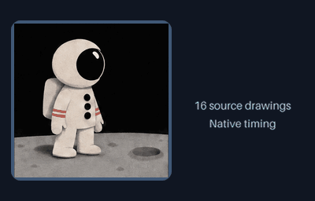

# Compose existing GIF animation into a scene

Put an existing GIF on its own animated layer beside titles, shapes and drawn
strokes. Each GIF keeps its source drawings and native delay intervals. Position,
scale, rotation and opacity remain independently editable. Nothing is sent to a
provider, and no new poses or transparent backgrounds are generated.



[MP4](assets/gif-layer/preview.mp4) · [Editable scene](../examples/gif-layer/scene.json) ·
[Frame samples](assets/gif-layer/contact-sheet.png) · [Verification](assets/gif-layer/verification.json)

This **3.20-second, 400 × 256, 50 fps, silent, play-once** example reuses the
bundled astronaut take's **16 drawings with 160 ms holds**. The source plays once
for 2.56 seconds; its final drawing then holds through the end. The independently
animated text and accent are local graphics. The GIF's existing background stays
in the picture. This composition is not a new character action or a long cartoon.

## Run it

Use a checkout containing GIF-layer support with Python 3.10+, Pillow 10.1+,
FFmpeg and ffprobe. Skill package 0.3.0 and its pinned runtime include a
self-contained [installed workflow](../.agents/skills/gif-cinema/references/layers.md)
and an example reusing its existing GIF asset. Earlier skill/runtime pins do not
include this layer type; do not replace a working installation automatically.

```sh
python -m gif_cinema.layers render examples/gif-layer/scene.json --out output/gif-layer --dry-run
python -m gif_cinema.layers render examples/gif-layer/scene.json --out output/gif-layer
python tools/verify_layered_scene.py output/gif-layer
```

The plan is offline and writes nothing. Rendering requires a fresh directory.
The output contains GIF/MP4, every PNG frame, isolated previews, an editable
portable scene with hash-pinned source files, and a verification receipt. Reopen
verification checks the complete inventory, including each unique GIF asset.
Original scenes, GIFs and previously accepted takes are never replaced.

## GIF layer fields

```json
{
  "id": "actor",
  "type": "gif",
  "source": "assets/actor.gif",
  "size": [240, 240],
  "playback": "once",
  "in_ms": 400,
  "out_ms": 3200,
  "keyframes": [
    {"at": 0, "x": 0.25, "y": 0.5, "easing": "ease-in-out"},
    {"at": 1, "x": 0.75}
  ]
}
```

- `source` is a local GIF path relative to the scene. URL, traversal and escaping
  symlink inputs are rejected. Optional `sha256` pins the exact source bytes.
- `size` is the same aspect-preserving pixel box used by image layers. Every
  drawing receives the same fit and anchor, never a per-frame crop. Existing
  opaque backgrounds stay opaque; GIF transparency/disposal is decoded as stored.
- `playback` is `once` (default) or `loop`. Once holds the final drawing after its
  native duration. Loop wraps at the exact source duration. The source file's
  loop extension is recorded but **does not override this author choice**.
- The source clock starts at the layer's `in_ms`, regardless of other layers.
  The layer disappears at `out_ms`. A shorter active interval intentionally cuts
  off the remaining source action. The scene's own loop flag is separate.
- Standard transform keyframes and easing work as usual. They change placement
  and appearance, not the timing of the source drawings. No speed control,
  frame interpolation or reverse mode is supplied. A newer checkout can select
  an explicit native-time interval with [source_range_ms](SOURCE-TRIMS.md);
  omitted ranges continue to play the complete source.

Two layers may reuse the same source file with independent clocks, positions and
playback modes. Source bytes and decoded drawings are shared; their resized
premultiplied caches are budgeted separately. Portable saves store one unique
content-addressed copy. A source cannot be both a still-image and GIF layer.
Existing `image` layers continue to reject animation instead of silently playing
or flattening it.

## Timing you can inspect

At each output timestamp, the renderer selects the drawing whose original delay
interval contains that timestamp. Exact boundaries select the next drawing.
At 50 fps, export timestamps are 20 ms apart. At 25 fps, they are 40 ms apart,
which can skip a source drawing held for only 20 ms. No timing rescale is hidden.

The dry-run and receipt include `gif_timing` for each GIF layer: native delays,
source drawing count, duration, original loop metadata, explicit playback mode,
sampled source indices and **omitted_source_drawings**. Each rendered sample also
records the selected `source_index`. Those indices describe temporal sampling,
not visibility through overlapping layers or automatic visual acceptance.

Use the plan to see whether a short action is skipped at your chosen export FPS
or cut off by the active interval. High export FPS does not create more drawings.
GIF/MP4 output is flattened against the scene matte; lossless PNGs retain alpha.
Palette reduction can still alter the final GIF's fine edges and colors.

## Safety limits

Each GIF is limited to 16 MiB of encoded bytes, 256 drawings, 4,194,304 pixels per
drawing, and 120 seconds. Each native delay must be 20..60000 ms. GIF descriptors
are scanned before decoding, and every drawing must stay within the logical
canvas. Malformed headers, canvas expansion and oversized decoded inputs fail
before raster preparation.

All unique still/GIF inputs together are limited to 32 MiB of source bytes and
16,777,216 decoded pixels, counting **every GIF drawing**, not just its first
frame. Cached GIF variants across all layers additionally have a conservative
33,554,432-pixel limit, computed from each requested box times its drawing count
before allocation. Existing layer, output-frame and compositing budgets still
apply. These are separate workload ceilings, not a promise about total process
memory.

Sources are snapshotted, saved with SHA-256, and checked again before publishing
the export. A failed encode, missing or changed source, bad hash, or incomplete
output inventory does not count as a completed result. Verification is consistency
checking, not receipt authentication, character continuity approval or a user's
acceptance of the artwork.
