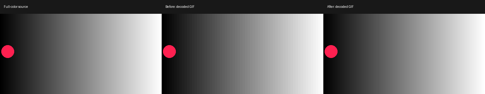

# Preserve represented colors in GIF export

The native `motion` and experimental `layers` exporters share one palette across
each clip. This fix preserves colors already in that palette, including in frames
with more than 256 source colors. It also stores the shared color table once.
It does not add drawings, interpolation, dithering or a new generation service.



This is an original **diagnostic gradient**, not a new artwork showcase. The decoded
comparison visibly reduces gray banding. General motion quality, anatomy, artistic
quality and user acceptance remain separate review tasks.

[Before GIF](assets/palette-export/gradient-before.gif) ·
[After GIF](assets/palette-export/gradient-after.gif) ·
[Machine-readable results](assets/palette-export/results.json)

## The defect and bounded fix

Pillow's fixed-palette RGB conversion uses a coarse lookup cache. Even when a
palette contains all 256 gray values, adding a single non-gray pixel makes the
old high-color conversion reduce the represented ramp to 64 values. The old
exact-index path applied only when **every** frame color already fit the palette.

The new conversion keeps that fast path. Otherwise it applies the existing
no-dither conversion, then restores every exact palette match in one pixel pass.
Unrepresented colors keep the existing approximation. Only pixels that can be
restored exactly change, so their RGB error cannot increase. The lookup contains
at most 256 entries; there is no source-sized Python color dictionary. The pass
uses temporary byte buffers proportional to one already-bounded frame.

The shared color table is passed explicitly to the GIF writer. Existing changed
rectangles, merged identical holds, disposal and loop behavior remain intact.
Removing repeated color tables preserves the decoded timeline exactly. Full-color
PNG frames and MP4 encoding do not change.

Both writers also provide an explicit delay list. On the minimum supported Pillow
10.1, scalar delay input loses the accumulated hold when every frame is identical.
That pre-existing behavior made export fail timing verification. The delay list
preserves the full hold, including clips encoded as a single drawing. It does not
change the authored timeline or weaken the verification check.

## Measured outputs

On Python 3.12.14, Pillow 13.0.0 and FFmpeg 7.1.5, using the same full-color inputs:

| Case | Before → after size | Before → after RGB MSE | Timing |
|---|---:|---:|---|
| Original moving gradient/accent, 512 × 256 | 68,139 → 58,180 bytes, 14.6% smaller | 3.46494 → 0.03466 | 40 drawings, 1.60 s, 25 fps |
| Existing layered-shapes example, 320 × 180 | 88,204 → 76,275 bytes, 13.5% smaller | 1.42524 → 0.12937 | 24 encoded drawings, 1.00 s, 25 playback samples |

The first case retains **255 of 256 exact gray levels instead of 64**. The red
accent and grays exceed GIF's 256-color limit, so one gray still needs reduction.
The second case has one merged identical hold. Both GIFs still loop indefinitely.

[Layered shapes before](assets/palette-export/shapes-before.gif) ·
[Layered shapes after](assets/palette-export/shapes-after.gif)

Fidelity alone can increase compressed size: the diagnostic with exact colors but
repeated tables is 88,132 bytes. One global table brings it to 58,180 bytes. These
two examples do not establish a universal size saving. More faithful pixels may
compress less well on other artwork.

The corrective pixel pass also costs CPU. In this small local run, palette mapping
and GIF writing took approximately 0.02 → 0.49 seconds for the gradient and
0.01 → 0.18 seconds for the shapes, excluding palette training. Those timings are
machine-dependent, not performance guarantees. Low-color frames wholly contained
in the palette retain the existing fast route.

## FFmpeg and GIF Factory comparison

[FFmpeg's official palettegen documentation](https://ffmpeg.org/ffmpeg-filters.html#palettegen)
describes whole-stream palette training, optional changed-region statistics and a
reserved transparent slot. Its
[paletteuse documentation](https://ffmpeg.org/ffmpeg-filters.html#paletteuse)
provides no-dither, ordered Bayer and error-diffusion choices. A changed-rectangle
mode can restrict processing and help temporal stability with error diffusion.

The benchmark also runs `palettegen=stats_mode=full:reserve_transparent=0`, then
`paletteuse` with no dithering and Bayer scale 2, both with rectangle processing.
FFmpeg no-dither yields lower RGB MSE here: 0.00391 on the gradient and 0.03492 on
the shapes. This fix does **not** claim to outperform it or replace the runtime
encoder. A broader backend change needs its own timing, transparency and
cross-version compatibility review.

Bayer's measured RGB error and size are higher for these mostly flat fixtures.
That is not a general judgment against dithering: perceptual gradient appearance
and pixelwise error are different measures. Dithering remains a deliberate choice
for a future export mode, not a silent default change.

The inspected [GIF Factory pack exporter at fbbb6c3](https://github.com/WoYun520/gif-factory/blob/fbbb6c31f150d5cd28c04e005d1da936016daf3e/scripts/export_pack.py)
also trains a shared Pillow palette and uses no dithering, with a reserved
transparent index and background disposal for its sticker route. That is a
different alpha/delivery contract from these opaque motion previews. No GIF Factory
code, artwork or fonts were copied, and no provider API was invoked.

## Reproduce and verify

Use a new output directory from the checkout with Pillow and installed FFmpeg:

```bash
python tools/benchmark_palette_export.py --out output/palette-comparison
python -m unittest discover -s tests -p test_palette_export.py -v
python -m unittest discover -s tests -v
```

The benchmark writes original full-color input frames, before/after GIFs, the
exact-colors-only intermediate, FFmpeg comparisons, decoded contact comparison
and hashes/timing/errors in `results.json`. The committed subset above contains
the before/after files, comparison image and complete measurement report.
The baseline reproduces `68cef9d`'s quantization and writing choices. Results can
change with Pillow/FFmpeg versions; do not assume byte-identical exports elsewhere.

Regression checks cover more-than-256-color frames, mixed represented/unrepresented
colors, duplicate palette entries, source/palette immutability, all 256 color
indices, changed rectangles, merged holds, loop metadata, and both real export
commands with network/provider entry points blocked. Final visual review is still
required for each delivered animation.
