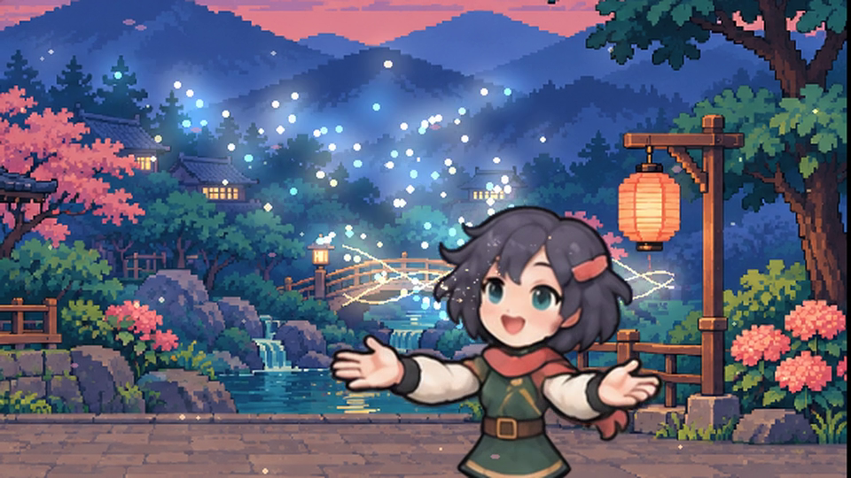

# Lantern Echo

[Download the full film with sound](https://raw.githubusercontent.com/antropos17/chatgpt-gif-cinema/8844c1a04a01566bcb3bd8308ee9e16d15f67825/docs/assets/lantern-echo/lantern-echo.mp4) ·
[Download the MP4](https://raw.githubusercontent.com/antropos17/chatgpt-gif-cinema/8844c1a04a01566bcb3bd8308ee9e16d15f67825/docs/assets/lantern-echo/lantern-echo.mp4) ·
[Back to the workshop](../README.md)

An anime traveler sends a small light toward a courier. He holds his beret as it
circles overhead. She catches the returning light and opens her hands; ribbons
and stars spread through the garden and reach its lanterns. He greets her, she
bows, and the film ends on both characters in the illuminated garden.

## Film and preview

| Asset | Measured format | Playback |
| --- | --- | --- |
| [Full film](assets/lantern-echo/lantern-echo.mp4) | 20.80 s, 960 × 540, 520 frames at 25 fps | Stereo AAC; plays once in a video player |
| [README preview](assets/lantern-echo/preview.gif) | 6.40 s, 480 × 270, 160 frames at 25 fps | Silent looping excerpt from 7.52–13.92 s |
| [Poster](assets/lantern-echo/poster.png) | 960 × 540 | Still from 9.80 s; reduced-motion fallback |

The MP4 preserves the reviewed delivery bytes. The smaller GIF is a separately
quantized excerpt, not the complete film or its soundtrack. The README download points
to the exact reviewed bytes at an immutable commit. Open the MP4 in your video
player; GitHub's file page does not preview this 7.87 MB video.

## How it was made

The character designs and garden originate in the existing
[anime-pixel example](../examples/anime-pixel/README.md). New transparent sprite
atlases were created with a built-in image-generation tool: casting, catching,
releasing, the courier's reaction/greeting, and two breathing/blinking cycles.
The previous local revision supplied the bow drawings. Together the selected
sequences contain 144 source cells, including settling and loop endpoints.

The drawings were sliced and anchored at the feet. An installed **RIFE v4.6**
backend generated 4× intermediate samples with spatial and temporal TTA; all
native key images were verified unchanged. The final film samples these
sequences at 25 fps. This is interpolated animation, not 25 new hand-drawn poses
per second. Mild softness in some interpolated outlines remains.

An authored local compositor supplied camera coverage, palm-linked light paths,
trails, impact rings, three ribbons, a star canopy, lantern arrivals and petals.
The canopy is behind the characters so it cannot wash out their faces. The
soundtrack consists of locally synthesized pads, chimes and stereo whooshes.

This is an authored showcase with additional drawings and external local
finishing, not a single public CLI command or native text-to-video API output.
The final media and a review receipt are bundled here; the generation tool,
RIFE backend and production compositor are not bundled by this example. The
[zero-key astronaut quickstart](../README.md#make-your-first-film) remains the
reproducible public CLI example. No new provider requests are needed to view or
inspect this delivered film.

## Review

The exact delivered movie was decoded completely; all 520 frame timestamps and
the stereo audio stream passed verification. Visual review covered every frame
on contact sheets, selected native-resolution hand/face/bow/endpoint images,
and all nine outgoing/incoming camera-cut pairs. Every cut was played at half
speed; the final full-speed run reached 20.80 seconds with 520 presented frames,
zero dropped frames and zero media errors.

Contact-sheet coverage is not native-size anatomical inspection of every frame.
Audio presence and complete decode were checked; a subjective listening review
is not claimed. These are the author's review observations, not proof that
interpolation always preserves anatomy or that every viewer will accept the
artistic result.

[Asset hashes and review scope](assets/lantern-echo/verification.json)
