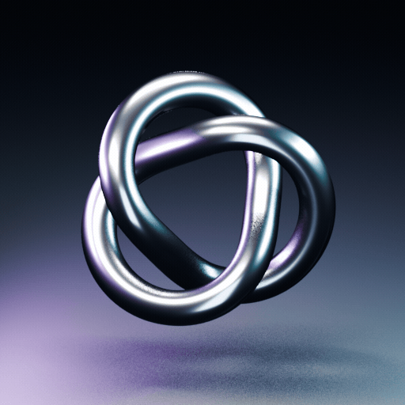

# Chrome Trefoil: an archived 3D study

[](assets/motion-elements/chrome.gif)

**Blender reference. Not native API output.** This is one original procedural 3D
loop preserved from the project's visual exploration. It is not evidence that
GIF Cinema or an image model generated this animation. Blender is not a dependency
of the public GIF Cinema CLI.

**3.2 seconds · 512 × 512 · 80 unique rendered frames · 25 fps · silent · repeating.**

[Original GIF](assets/motion-elements/chrome.gif) ·
[MP4 master](assets/motion-elements/chrome.mp4) ·
[Decoded phases](assets/motion-elements/decoded-phases.png) ·
[Technical receipt](assets/motion-elements/manifest.json)

## What this example contains

A continuous tubular knot rotates under a neutral softbox and cyan/violet studio
lights. The geometry and scene were authored procedurally and rendered in Blender
EEVEE. FFmpeg encoded the rendered frames, with one global GIF palette. No paid API
calls, generated footage, third-party character art or downloaded 3D models were
used. The source below contains only this chrome study, not a six-animation pack.

The GIF is opaque and loops indefinitely. GIF's 256-color palette can show
quantization or dithering in the specular gradients; the H.264 MP4 retains fuller
gradients. It is a finished visual reference, not a transparent compositing asset
or proof of the quality achievable through native GIF generation.

The repository's unchanged [source-available evaluation license](../LICENSE)
applies. This is not a freely redistributable stock-animation pack or an
OSI-approved open-source release.

## Reproduce the separate Blender study

The optional scripts are in [`tools/motion_elements/render_studio.py`](../tools/motion_elements/render_studio.py).
They are ordinary art-production source, separate from the runtime and skill.
Use Blender 4.3 with a working EEVEE graphics backend, Python 3.10+, Pillow,
FFmpeg and ffprobe. A headless Blender installation without EEVEE support will
not render this scene. Different Blender/FFmpeg versions can change the pixels;
reproduction is not a promise of byte-identical media.

Run from the repository root, using new output folders:

```bash
blender -b -t 16 --python tools/motion_elements/render_studio.py -- \
  --out output/chrome-frames --study chrome --size 512 --samples 16 --frames 80

python tools/motion_elements/package_study.py output/chrome-frames \
  --out output/chrome --dither bayer:bayer_scale=3
```

The renderer uses phase `index / frame_count`, with a full rotation and periodic
tilt. It excludes the duplicated endpoint. The last frame precedes the first by
one normal frame step; no dissolve, reversal or added still hides the seam.

The packager checks the source frame dimensions and count, fully decodes the GIF
and MP4, checks timing and unique frames, and writes hashes. Its four-phase sheet
comes from the decoded GIF so palette artifacts remain visible. Pixel differences
are diagnostics, not a guarantee of visual quality or seamlessness.

## Use the existing GIF in GIF Cinema

The public CLI can assemble this already-made local GIF just as it can any other
reviewed source. That assembly does not turn the Blender render into native output:

```bash
python -m gif_cinema render tools/motion_elements/source-film.json --dry-run --max-api-calls 0
python -m gif_cinema render tools/motion_elements/source-film.json --execute --max-api-calls 0 --out output/chrome-source-film
```

The source recipe plays the original once, preserving its 80 holds of 40 ms.
No generation request is made. The original files remain unchanged.

## Production references

- [Blender area lights](https://docs.blender.org/manual/en/latest/render/lights/light_object.html)
- [Blender color management](https://docs.blender.org/manual/en/4.0/render/color_management.html)
- [FFmpeg palette generation and use](https://ffmpeg.org/ffmpeg-filters.html#paletteuse)

These informed the rendering and encoding workflow. No GIF Factory art, renders
or source files are included in this archive.
