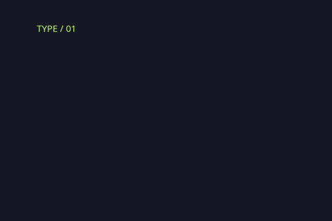
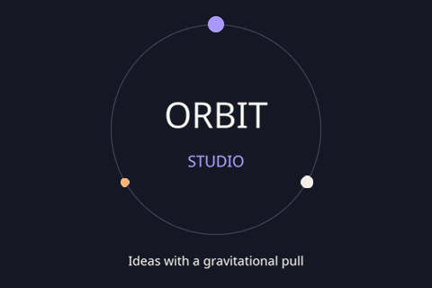
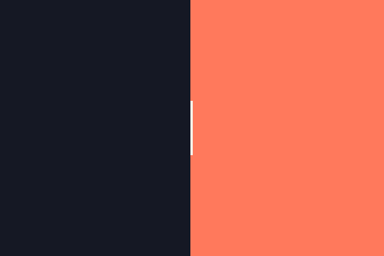
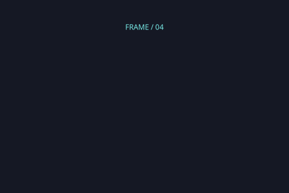

# Four ways to give an idea rhythm

Original graphic loops made with **GIF Cinema's own layer compositor**.
Choose a motion, change the words, keep the editable scene.

<table>
<tr>
<td width="50%"><a href="assets/motion-presets/stagger-title/preview.gif"></a><br><b>01 / Stagger title</b><br>Two lines arrive on different beats, overshoot gently, then settle for reading.</td>
<td width="50%"><a href="assets/motion-presets/orbit-badge/preview.gif"></a><br><b>02 / Orbit badge</b><br>A steady wordmark with three satellites. Continuous graphic motion around readable type.</td>
</tr>
<tr>
<td><a href="assets/motion-presets/split-stage/preview.gif"></a><br><b>03 / Split stage</b><br>Two curtains open with a slow start and finish. The title holds, then the panels close.</td>
<td><a href="assets/motion-presets/focus-card/preview.gif"></a><br><b>04 / Focus card</b><br>Corner marks converge in sequence while two lines settle into a clean editorial frame.</td>
</tr>
</table>

**Each: 480 × 320 · 3.2 seconds · 25 fps sampling · silent · infinite loop.**
These are real locally rendered GIFs, with animated text and primitive shapes.
They contain no AI-generated character action, paid requests or borrowed GIF Factory art.
The repository's [evaluation license](../LICENSE) applies.

## Make one yours

From a checkout with Python 3.10+ and the project dependencies installed:

```bash
python -m gif_cinema.presets stagger-title --out output/my-title \
  --headline "YOUR NEXT" --second-line "IDEA" \
  --caption "A new story starts here" --accent "#b9f36b"

python -m gif_cinema.layers render output/my-title/scene.json \
  --out output/my-title-render --dry-run
python -m gif_cinema.layers render output/my-title/scene.json \
  --out output/my-title-render
```

Choose `stagger-title`, `orbit-badge`, `split-stage`, or `focus-card`.
Use a fresh destination. Copy that exceeds its composition or the packaged font's
glyph coverage fails before the scene is written. The packaged Noto Sans supports
Russian and Azerbaijani; font bytes are recorded in each scene.
The palette and text are editable; there is no automatic contrast adjustment.

Creating a scene and the dry run need Pillow only. The standard layer renderer
also needs FFmpeg/ffprobe and exports verified GIF, MP4, transparent PNG frames,
isolated layers, an editable bundle and a receipt. All commands above make zero
provider calls. Saved scenes bind their Pillow/FreeType versions: generate a fresh
preset in your environment, or use the recorded versions when reopening the
committed gallery scenes. See [the layer contract](MULTILAYER-POC.md).

## Direct the beat

| Preset | Motion and reading time | Useful for |
| --- | --- | --- |
| Stagger title | Main line begins at 192 ms; second line follows 192 ms later. Settle before the central hold; fade begins at 2528 ms. | Chapter cards, a two-part announcement |
| Orbit badge | Satellites complete one turn in 3200 ms; words stay still. 24 linear segments per circle, rather than a physically exact circular path. | A studio badge, an activity indicator |
| Split stage | Panels open from 256–1024 ms, hold until 2432 ms, then close by 3072 ms. | A reveal, event name, product headline |
| Focus card | Corner pairs follow at 64 ms intervals; headline and second line have separate entrances. All type is steady for the middle reading hold. | A principle, quote heading, tutorial step |

Times above describe authored keyframes; exported samples lie on the 40 ms grid.
Open a saved `scene.json` to change individual keys. Layer order runs back to front.
The easing on a key controls the segment that follows it. `smootherstep` eases the
panels; explicit overshoot keys give the titles their small spring and settle.
The closed endpoint is diagnostic and is never exported as a duplicate frame.

## Inspect the actual files

[Technical manifest](assets/motion-presets/manifest.json) records hashes, actual
decoded holds, dimensions, unique drawings, font identity and seam diagnostics.
At 25 fps each clip samples 80 times; identical reading holds merge in GIF, so
stored drawing counts differ. No additional character drawings are synthesized.

| Editable scene | Decoded GIF phases |
| --- | --- |
| [Stagger title](assets/motion-presets/stagger-title/scene.json) | [Six phases](assets/motion-presets/stagger-title/decoded-phases.png) |
| [Orbit badge](assets/motion-presets/orbit-badge/scene.json) | [Six phases](assets/motion-presets/orbit-badge/decoded-phases.png) |
| [Split stage](assets/motion-presets/split-stage/scene.json) | [Six phases](assets/motion-presets/split-stage/decoded-phases.png) |
| [Focus card](assets/motion-presets/focus-card/scene.json) | [Six phases](assets/motion-presets/focus-card/decoded-phases.png) |

To rebuild the GIF-only gallery without FFmpeg:

```bash
python tools/build_motion_presets.py --out output/my-preset-gallery
python -m unittest discover -s tests -p test_motion_presets.py -v
```

The builder uses the real `gif_cinema.layers.render_at` function and samples
contact sheets by the decoded GIF delays, including merged holds. It preserves
source recipes and refuses an existing destination. Technical checks and matching
endpoint pixels do not establish visual acceptance. The manifest leaves playback
review and user acceptance pending; decoded phase samples have been inspected for
composition and text fit. GIF quantization can affect antialiased edges.

The presentation was informed by GIF Factory's
[type-linked](https://github.com/WoYun520/gif-factory/blob/main/styles/type-linked/STYLE.md)
and [comic-fusion](https://github.com/WoYun520/gif-factory/blob/main/styles/comic-fusion/STYLE.md)
style pages: show a real effect beside a repeatable method, and distinguish
graphic motion from generated action. These four recipes, lettering and rendered
files were authored independently for GIF Cinema.
