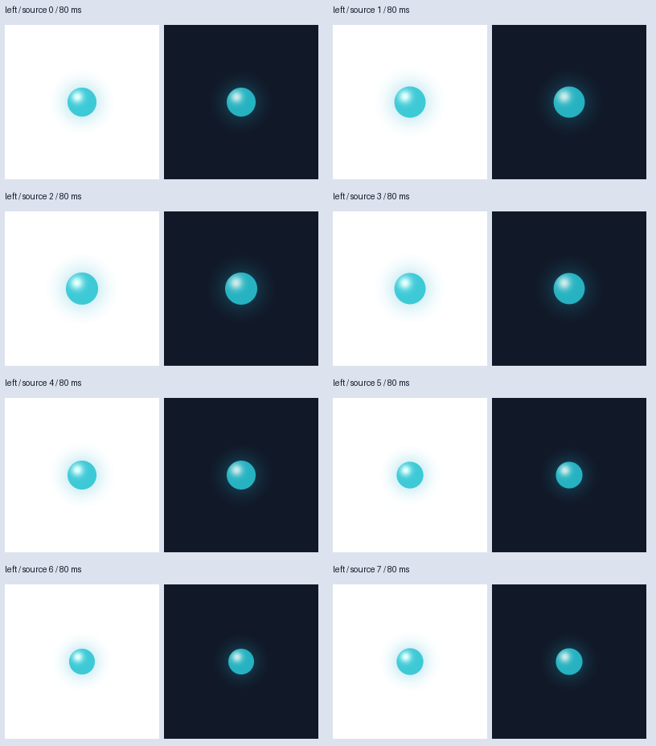
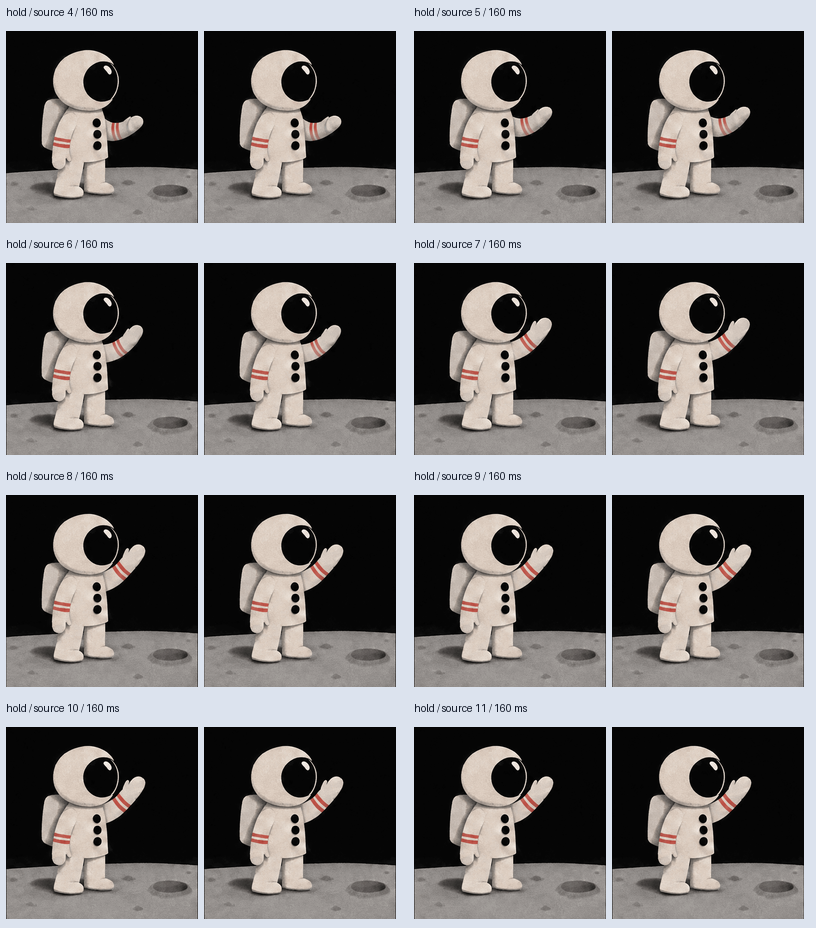

# Review every selected native drawing

A few evenly spaced scene screenshots can miss an entire action or keep sampling
the same phase of a loop. This separate offline helper shows **every selected
source drawing** from each GIF or PNG sprite layer, at its native pixel size and
with its actual included hold. It never accepts artwork or changes the render.



The [atlas example](SPRITE-LAYERS.md) repeats every 640 ms. Its five evenly spaced
scene samples can therefore show nearly the same phase. The native-drawing sheet
above includes all eight authored cels, including repeated poses, with their
80 ms holds. Each pair is the **same RGBA drawing** over white and dark blue.
These are thumbnail navigation aids; inspect the full native PNGs for defects.

## Use it with a completed layered export

Use a checkout containing this helper and its supporting runtime. Earlier skill
packages, including 0.3, do not include it. Python 3.10+ and Pillow 10.1+ suffice
to extract/check an existing render; FFmpeg is needed only to create that render.

```sh
python -m gif_cinema.layers render examples/sprite-layer/scene.json --out output/atlas-render
python tools/review_layer_sources.py extract output/atlas-render output/atlas-review --dry-run
python tools/review_layer_sources.py extract output/atlas-render output/atlas-review
python tools/review_layer_sources.py check output/atlas-render output/atlas-review
```

Open `output/atlas-review/index.html` locally. It starts paused, selects layers,
steps through original source indices, shows each drawing on light/dark backgrounds,
and offers native display size and direct PNG links. Preview looping follows the
layer's explicit playback setting but can be changed for inspection. No server,
network assets, model, key, browser extension or paid service is used.

The dry-run writes nothing, but it still fully verifies the existing export and
decodes its bounded sources. It is not merely a header check. Every extraction
requires a new review directory, so an earlier review cannot be replaced.

## What is verified before extraction

The helper reuses `tools/verify_layered_scene.py`. It requires the complete saved
export inventory, checks every recorded file hash, reopens the portable scene and
rerenders **every timeline PNG** before inspecting native sources. Missing media,
incomplete receipts or changed render pixels prevent review preparation.

The source set comes from that verified editable scene, not a loose list of files.
For GIFs, full disposal-composited RGBA drawings are used. For sprites, original
PNG rectangles are cropped directly, without a GIF round trip, fitting, independent
recentering or alpha threshold. Repeated cels and separate layers remain separate
review entries even when some pixels are identical.

For [source-time selections](SOURCE-TRIMS.md), all selected native indices are
shown, including partial first/last holds. A drawing marked **NOT sampled in
export** belongs to the author's range but was missed by the output grid or a
short active scene interval. This distinction helps explain a missing pose.



This [trim example](SOURCE-TRIMS.md) selects indices 4..11 for its hold and loop
layers. The entire composition's native review contains 32 entries: 16 for the
full layer, plus eight for each selected layer. The [verification record](assets/native-layer-review/trim-verification.json)
checks all 32 drawings and 37 artifacts. The [atlas record](assets/native-layer-review/atlas-verification.json)
checks 16 drawings across two layers and 19 artifacts. Visual review and user
acceptance remain pending in both.

## Review files and checker

- `drawings/0000.png`, etc.: every selected native RGBA drawing, in layer/source
  order. Files keep original dimensions, colors and alpha, including RGB values
  hidden under zero alpha. No scene transforms or opacity are applied.
- `sheets/LAYER-000.png`, etc.: at most eight paired light/dark thumbnails per
  page. Each label includes the layer ID, original source index and included hold.
- `index.html`: a local, paused native-drawing player. Browser scheduling and
  decode performance are not proof of timing quality; step through the frames.
- `manifest.json`: written last as the completion marker. It binds the source
  scene, full render receipt and final GIF/MP4 hashes, selected ranges and native
  holds, source/drawing hashes, exact artifact inventory and Pillow version.

`check` requires both the current layered export and review directory. Moving
them is fine when their contents remain unchanged. The checker repeats complete
export verification, derives expected source facts and artifact names, compares
every native PNG and thumbnail against its source, and requires the exact generated
player. Rehashing a changed PNG or HTML does not make it valid. Unexpected PNG
metadata, including EXIF orientation, gamma and ICC profiles, is rejected because
it can change display even when decoded RGBA is identical. JSON facts retain
strict number/boolean types.

The sheet renderer is version-bound. Use the recorded Pillow version to check an
existing pack, or extract a **new** pack with a different version; do not overwrite
the old one. A text-bearing saved scene may also require its original text-renderer
environment, as with normal layered-scene verification.

## Scope and limits

This supplements [final delivered GIF review](GIF-REVIEW.md); it does not replace
it. Native source inspection cannot show scene transforms, overlays, occlusion,
cut timing, output sampling, GIF palette reduction, MP4 artifacts or final loop
quality. Watch the completed movie/GIF and use the existing full-frame review
workflow for its recorded visual decisions. This helper deliberately has no
approval-writing command: a successful check still says `visual_review: pending`
and `user_acceptance: pending`.

Limits are 512 selected drawings and 67,108,864 native pixel-frames across all
layers, counting duplicate entries. Those checks precede review crop allocation.
Each sheet is at most 816 × 928 pixels. Total review output, **including the
manifest**, is limited to 512 MiB; manifest JSON is limited to 2 MiB. Existing
source and render limits continue to apply. Oversized input is rejected, never
silently reduced to a representative subset. Choose a smaller scene or explicit
source range when needed.

Original export files are only read. Output and ancestor identities are checked
across long verification and between writes; existing filenames are created
exclusively, never overwritten. Unexpected directory replacement aborts and
retains partial files rather than recursively deleting paths another process may
own. A failed extraction is not a successful preparation: retained files, or even
the mere presence of a manifest, do not prove completeness. Use the checker and
retry into a new directory rather than overwriting partial output.
These checks detect ordinary replacement; they are **not a filesystem sandbox
against a hostile process racing each system call**. Such a process can still
redirect a new-file write in the small gap between an identity check and open,
although exclusive creation prevents overwriting an existing file.

Hashes and receipts establish internal consistency, not who inspected the file,
ownership of artwork, character continuity or the truth of a visual judgment.
