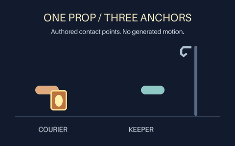

# Reusable prop anchors and holder changes

Keep one prop layer attached to a moving hand, then transfer it to another hand
or a stationary hook. This is a reusable feature of the local layer renderer,
not a new character-animation model or a hardcoded example script.



[Editable scene](../examples/prop-anchors/scene.json) ·
[MP4](assets/prop-anchors/preview.mp4) ·
[Sampled frames](assets/prop-anchors/contact-sheet.png) ·
[Technical evidence](../examples/prop-anchors/verification.json)

The example is deliberately a **schematic contact study**, not a finished cartoon.
Two colored pads represent authored hand layers. One lantern moves from courier
to keeper to hook over 6 seconds. The two holder changes have zero mathematical
anchor gap. This does not establish believable hands, anatomy, physical grip,
smooth velocity, or user acceptance. The earlier
[lantern prototype](HANDOFF-PROTOTYPE.md) remains unchanged.

## Try it locally

Install the current checkout with Python 3.10+, Pillow 10.1+, FFmpeg and ffprobe.
The previously pinned skill runtime does not include this new source feature;
no new skill release is claimed.

```sh
python -m gif_cinema.layers render examples/prop-anchors/scene.json --out output/anchor-study --dry-run
python -m gif_cinema.layers render examples/prop-anchors/scene.json --out output/anchor-study
python tools/verify_layered_scene.py output/anchor-study
```

Dry-run has no output files or encoder requirement and reports both holder changes
before rendering. Export needs a new directory. It includes the original-resolution
RGBA PNGs, GIF, MP4, contact sheet, portable editable scene and per-frame states.
The GIF is play-once; some viewers override that flag. MP4/GIF are viewing copies,
not substitutes for the source PNGs. No API key, network, JavaScript or paid request
is used.

## Data contract

Any existing layer type can declare an `attachments` list:

```json
"anchor": [0.5, 0.0],
"attachments": [
  {"start_ms": 0, "end_ms": 2400, "parent": "courier-hand", "point": [1.0, 0.5]},
  {"start_ms": 2400, "end_ms": 4800, "parent": "keeper-hand", "point": [0.0, 0.5]},
  {"start_ms": 4800, "end_ms": 6000, "parent": "hook", "point": [0.56, 0.68]}
]
```

- The child's `anchor` is pinned to `point` in the parent's **actual fitted raster**,
  not its requested size box. Both are normalized coordinate pairs in 0..1.
  Image letterboxing/aspect fit and noncentral anchors are respected.
- The parent point follows the parent's position, clockwise rotation and uniform
  zoom. The child keeps its own rotation, zoom, opacity, reveal and native animation
  clock. These are point attachments, not full transform parenting or skeletons.
- Child x/y keyframes must stay at their neutral default `[0.5, 0.5]`. Omit x/y;
  animate the parent instead. Non-neutral values fail rather than being ignored.
- `start_ms` is inclusive and `end_ms` exclusive, in **scene milliseconds**.
  At a switch the new segment owns that frame. The scene's closing endpoint is
  diagnostic only and uses the final segment; it is not added to the film.
- There must be 1..32 sorted, contiguous segments covering the child's complete
  `in_ms..out_ms` interval. Each boundary must align with the existing 25/50 fps
  output grid. Gaps, overlaps, unknown fields, booleans masquerading as numbers,
  non-finite coordinates, unknown parents and case-mismatched IDs fail preflight.
- The named parent must be active throughout each segment. Opacity is independent:
  an invisible guide can drive an attachment, but that is not visible contact.
- Parents can appear before or after the child in the layer list. Paint order is
  unchanged. Chains are supported, but the complete parent graph must be acyclic,
  including edges used at different times. Self-parenting is forbidden.

Use a stationary authored guide layer for a free/resting position. Changing the
parent does not automatically preserve position, insert an in-between drawing,
move a hand to meet a prop, change layer order, or hide an unwanted jump.

A point on an animated GIF or sprite is still a fixed point on that raster. It
**does not track a depicted hand moving inside the image**. Use separate prepared
hand/prop layers and reviewed drawings where needed. Existing source pixels and
native source timing remain unchanged.

## Review every transfer

`attachment_review` in the dry-run and export receipt lists attachment-layer IDs,
all holder/point changes, exact before/after scene positions and `anchor_gap_px`.
It also reports descendant jumps caused by an ancestor's holder change. The
reported maximum never turns a result into visual approval: status remains
`human-review-required`, even at zero.

Positions are evaluated on both sides at the same authored switch timestamp,
including a parent's ending pose when that parent disappears at the boundary
and the outgoing held pose of a `step` keyframe.
This separates a position mismatch from ordinary motion between sampled frames.
The report does not measure velocity, acceleration, pixel contact, collisions,
keyframe discontinuities away from holder switches, or prop count in the artwork.
Inspect actual adjacent exported frames and playback as well.

Each exported frame's layer state records its resolved x/y and active parent/point.
The saved-scene verifier rerenders every PNG and checks the attachment report and
layer states as well as file hashes. Checks establish reproducibility, not whether
an author chose a meaningful contact point. A deliberately edited scene and all
its receipts are not cryptographically authenticated evidence.

## Continue into a longer film

Use a short layer scene for each intentional action. Preserve accepted drawings,
export each scene, then import the resulting GIFs into the ordinary film script.
Carry final prop/character facts into the next action with the
[authored story-state ledger](STORY-STATE.md), and review actual first/last frames
at both cuts. Attachment tracks operate within one scene; they do not automatically
transfer a rig or state to another scene or infer missing story events.

The example's 150 output samples describe local geometric motion with deliberate
holds. They are not 150 newly generated character drawings. Adding meaningful
story events and suitable poses remains the author's job.
