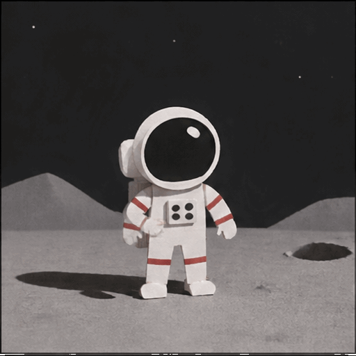

# Make it, inspect it, repeat it

[Back to GIF Cinema](../README.md)

Three small recipes with different promises: repeat an old generation **request**,
rebuild an exact edit from bundled media, or add a local title. Start with the
[README setup](../README.md#make-your-first-film). Run commands from the repository root
with its virtual environment activated. No browser-based provider workflow is needed.

## One prompt, one GIF



**Actual stored result:** 512 × 512, 9 drawings, 200 ms per drawing, 1.80 seconds,
infinite GIF loop, silent. This is the existing original provider GIF, unchanged.
The [original request record](assets/first-live-render.json) and
[decoded timing](assets/first-live-render-inspect.json) are public.

The exact historical prompt:

> A tiny paper-cut astronaut waves once on the Moon, locked camera, matte monochrome background, clear silhouette, smooth loop, no text

The historical request used `gpt-image-2.6-flare`, `output_format="gif"`,
`frame_count=9`, `frame_duration_ms=200`, `size="auto"`, `quality="low"`, and
`complexity="low"`.

**Before a new run:** check that your OpenAI account has this model's animated-GIF
access and review its current billing. Configure your own `OPENAI_API_KEY` privately
in the local environment; never commit it. Historical success does not establish
availability for another account or date. No new paid generation was run to make
this README, and the output below is not guaranteed to repeat pixel-for-pixel.

The following command makes a paid API request immediately; it is not a dry-run:

```bash
python -m gif_cinema generate \
  "A tiny paper-cut astronaut waves once on the Moon, locked camera, matte monochrome background, clear silhouette, smooth loop, no text" \
  --model gpt-image-2.6-flare --frames 9 --duration 200 \
  --size auto --quality low --complexity low \
  --output output/my-astronaut.gif
```

Inspect the returned file before accepting it:

```bash
python -m gif_cinema inspect output/my-astronaut.gif
python -m gif_cinema endpoints output/my-astronaut.gif --output output/my-astronaut-frames
```

Check the full playback, hand geometry and final-to-first reset. The stored example
is visibly stepped. “Smooth loop” in a prompt does not prove a smooth or seamless
result. Do not silently interpolate, reverse, retime or substitute another provider's
output and call it the original native GIF. Use a new name for a deliberate retake.

## Three takes, one film

The [source script](../examples/film.json) selects three bundled,
reference-conditioned astronaut GIFs. These are different source takes from the
single-GIF example above. Their files and hashes are listed in the
[README asset manifest](assets/identity/manifest.json).

```bash
python -m gif_cinema render examples/film.json --dry-run --max-api-calls 0
python -m gif_cinema render examples/film.json --execute --max-api-calls 0 --out output/my-first-film
```

**Actual result:** `output/my-first-film/film.mp4`, 7.68 seconds, 512 × 512, H.264,
192 playback frames at 25 fps, silent. Each take has 16 original drawings held for
160 ms; the MP4 preserves those holds. It does not invent more character poses.

You also receive `contact-sheet.png`, six first/last PNGs, `continuity-report.json`,
`captions.srt`, the render manifest and a verification receipt. Continuity remains
human-review-required. Run the second command again to verify zero-call resume.

[Watch the published exact CLI output](https://github.com/user-attachments/assets/c4dc8c9b-1e97-4f1a-9632-e285d9b969e0)

## Add a title and export a GIF

This recipe uses the [bundled editable storyboard](../.agents/skills/gif-cinema/assets/example/storyboard.json).
It adds a once-only local title entrance to those same three takes. It needs no key
and performs no generation. Use a new project directory; the compiler refuses to
clobber an existing project.

```bash
python .agents/skills/gif-cinema/scripts/story_project.py compile \
  .agents/skills/gif-cinema/assets/example/storyboard.json \
  --out output/my-title-project
python -m gif_cinema render output/my-title-project/film.json --dry-run --max-api-calls 0
python -m gif_cinema render output/my-title-project/film.json --execute --max-api-calls 0 --out output/my-title-render
python .agents/skills/gif-cinema/scripts/story_project.py export-gif \
  output/my-title-render/film.mp4 --out output/my-title-story.gif --width 320 --fps 10
```

**Actual result:** a 9.68-second, 512 × 512 MP4 at 25 fps and a 9.70-second,
320 × 320 GIF at 10 fps. The GIF is silent and play-once; some viewers override loop
behavior. Add `--repeat` to the export command only if you want the whole film to loop.
The 0.02-second difference is GIF frame-grid rounding, not additional story action.

The title occupies the first 2 seconds. It is local typography, not generated text
or an overlay on the astronaut. The project contains an editable storyboard, shot
list, source files, title GIF and runtime script. Change the storyboard's title and
subtitle, then compile into a new directory to create your own opening.

For longer completed stories, [export whole-shot GIF chapters](STORYTELLING-SKILL.md#deliver-longer-stories-as-gif-chapters)
without splitting a source action. A longer story still needs additional real actions;
repeating these three clips does not make new scenes.

## What makes the next result better?

- **Make the action smaller and clearer.** One visible change per take is easier to
  review than a prompt asking a character to walk, pick up a prop, turn and speak.
- **Preserve the visual anchors.** Use an accepted character still and the actual
  outgoing frame when the API supports references. Keep props and screen direction
  explicit. References guide a result; they do not guarantee it.
- **Inspect before expanding.** Check every drawing, normal-speed playback and both
  neighboring cuts. Reject a bad hand or disappearing object rather than hiding it.
- **Retake the weak shot.** Keep accepted source bytes and hash-bound selection notes;
  authorize only the missing take. Review changed joins again.
- **Keep delivery honest.** New edits, local titles, API-generated action and private
  finishing are different operations. Label them separately.

[Story workflow](STORYTELLING-SKILL.md) · [Production controls](PRODUCTION.md) · [Finishing experiments](SHOWCASE.md)
