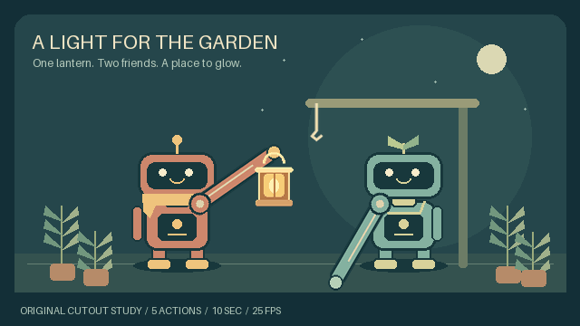

# Carry a stage through several actions

Turn a single editable stage into several connected scenes without manually
copying every final pose, prop position or holder into the next JSON file.
`sequence` carries authored layer state, renders each action, assembles a silent
film and keeps the shared project plus every source PNG for review.

This page describes the fixed-stage layer contract. For scheduled sprite
performances, changing camera coverage, authored lighting and stereo events, see
the separate [native shot project contract](NATIVE-SHOTS.md). Both use
`sequence build` and `sequence verify`; their schemas and receipts remain distinct.



[Watch MP4](assets/scene-sequence/preview.mp4) ·
[Editable five-scene example](../examples/scene-sequence/README.md) ·
[Source frames at the cuts](assets/scene-sequence/contact-sheet.png)

The example contains **five distinct authored actions, 10 seconds and 250 output
samples**. One lantern passes from courier to keeper to hook. Its four joins match
both the preceding held frame and the carried endpoint pixel-for-pixel. The robots
are original mechanical cutouts, not generated anatomical performances. The GIF
coalesces repeated holds into 206 stored drawings. Full-motion artistic acceptance
remains unestablished; [the example records its actual review scope and limits](../examples/scene-sequence/README.md#provenance-and-limitations).

## Preserve the original frames in one lossless master

After building a sequence, assemble **the original RGBA PNG samples**, not the
palette-reduced GIF previews, into a single FFV1/Matroska archive:

```sh
python -m pip install ".[lossless]"
python -m gif_cinema sequence master output/garden --out output/garden-master
```

This first rerenders and verifies the portable source sequence, then decodes the
completed master and checks **every RGBA pixel, timestamp and frame hold**, including
the first/last sample of each action. Identical held samples remain separate frames;
no scene loops are added, no frames are interpolated or dropped. The command is
strictly local with zero provider calls, and refuses existing output directories.

`master.mkv` retains alpha and colors before GIF quantization. `master-receipt.json`
records ordered shot/frame identities, pixel hashes, exact centisecond timing,
source receipt identity and verification results. Keep the source sequence bundle
alongside it for editable provenance. The existing MP4 remains a lossy viewing copy;
FFV1 is an archival file, not a browser/README preview. A passing technical check does
**not** establish natural motion, good storytelling or visual equivalence to GIF
Factory. A 15-second master requires 15 seconds of authored source actions, not an
automatically lengthened short loop.

## Build and verify

Use the current checkout with Python 3.10+, Pillow 10.1+, FFmpeg and ffprobe. This
source feature is newer than the skill package's pinned runtime; it is not a new
published skill release. No key, provider, JavaScript or network is required.

```sh
python -m gif_cinema sequence build examples/scene-sequence/sequence.json --out output/garden --dry-run
python -m gif_cinema sequence build examples/scene-sequence/sequence.json --out output/garden
python -m gif_cinema sequence verify output/garden
```

The equivalent standalone entry point is `python -m gif_cinema.sequence`.
Dry-run writes nothing and needs no encoder. Output revisions must be new;
`--resume` may continue the same checkpointed revision. There is no overwrite, force,
paid-execution or provider-budget option.
The build stages and verifies the entire result before publishing its completion
receipt. Originals are never rewritten. Editing inputs during a build prevents
publication under the old source identity.
If final file publication fails, partial output is retained rather than deleting
paths another writer may have edited or replaced. A failed build is not a completed
export. For a checkpointed build, repeat with `--resume`; changed partial files
are preserved and cause an explicit error. Legacy builds without checkpoints
require a new destination.

Open `output/garden/film/film.mp4`. The bundle includes:

- `sequence.json` and `stage/`: the portable project and fixed shared artwork.
- `shots/ID/`: each action's GIF, MP4, every RGBA PNG, editable layer scene and receipt.
- `film.json`: a normal source-only film script, with relative paths and action captions.
- `film/`: the assembled MP4, subtitle sidecar, imported source cache and cut diagnostics.
- `joins/`: actual last-stored / carried-endpoint / next-first PNG triples.
- `sequence-receipt.json`: timing, propagated transforms, holder states, source identities,
  all-frame proof and complete file hashes. Technical status is never visual approval.

Move the complete bundle and verify it again. To revise an action, edit a copy of
its portable `sequence.json` and build a new version. Later scenes will start from
the revised result, so review every affected downstream action and both adjoining
cuts. Earlier exported work remains available.

## Project format

```json
{
  "format": "gif-cinema-layer-sequence",
  "schema_version": 1,
  "title": "Carry and hang",
  "stage": "stage.json",
  "shots": [
    {
      "id": "01-carry",
      "action": "Carry the lantern to the hook.",
      "duration_ms": 2400,
      "tracks": {
        "keeper-arm": {"keyframes": [{"at": 0}, {"at": 0.8, "rotation": 225}, {"at": 1}]}
      }
    },
    {
      "id": "02-release",
      "action": "Leave the lantern on the hook and withdraw the hand.",
      "duration_ms": 2000,
      "tracks": {
        "lantern": {
          "attachments": [{"start_ms": 0, "end_ms": 2000, "parent": "hook", "point": [0.5, 0.5]}]
        }
      }
    }
  ]
}
```

This is a format illustration, not a complete stage. The named hand and hook must
actually meet. Use the complete checked-in example for runnable inputs.

The stage is a normal [layer scene](MULTILAYER-POC.md), with one static seed pose:
all keyframe transform values are equal, all layers span its full duration, and
any initial attachment has exactly one segment. `rect`, `ellipse`, `text`, `image`
and `stroke` layers are supported. Sprite layers also work with explicit
[authored pose keys](AUTHORED-POSES.md): all seed keys must select one starting
drawing. Native GIF/sprite clocks are deliberately rejected here: silently
resetting them at every new scene could break the depicted pose. Ordinary GIF-film and layer workflows still
handle those sources separately.

The stage fixes dimensions, FPS, layer order, identities, artwork, anchor points,
font environment and stroke paths across the sequence. This version cannot change
camera, costume, set, layer count or source artwork between shots. It is a continuous
fixed-stage action workflow, not a general editor for unrelated camera setups.

Each shot has a unique portable `id`, a one-line `action`, `duration_ms`, and optional
`tracks`. Track keys must name existing layer IDs exactly. A track accepts only:

- `keyframes`: the existing 2–32 keyframe format, including 0 and 1 endpoints.
  Begin with `{"at": 0}` to inherit the carried pose, then specify action targets.
  Omitted properties inherit normally. An omitted track holds its preceding result.
- `pose_keys`: sprite-only stepped selection of existing atlas drawings. The first
  key may omit `frame` to inherit the previous conceptual endpoint. Omit the track
  to hold that drawing; an explicit boundary reset is rejected. See
  [pose timing, source-first workflow and pixel-art limits](AUTHORED-POSES.md).
- `attachments`: an explicit, complete [prop-anchor schedule](PROP-ANCHORS.md), in
  local scene milliseconds. Omit it to retain the final holder/point for the new
  scene. Set it to `null` to detach at the carried world position.

Position, rotation, zoom, opacity and stroke reveal carry forward. Attached layers
keep neutral local x/y and derive world position from their parent; their own
rotation, zoom and opacity remain independent. A holder can change at a boundary
only if the resolved first pose still matches the carried state. Position and
other numeric pose fields use a 1e-7 absolute tolerance in their native units.
A mismatch fails preflight with the scene, layer and property. The compiler never
moves a hand to hide the mismatch or invents a transition. Within-scene attachment
switches keep the ordinary renderer's explicit gap diagnostics and require review.

## Timing and the actual cut

A scene exports `0, frame_period, ... duration-frame_period`. The next scene starts
from the previous **conceptual endpoint at duration**, not its last stored frame.
This advances a continuous authored motion by one normal frame period instead of
quietly repeating a held pose. The endpoint is not appended as an extra frame.

For a deliberate still cut, author an ending hold. The demonstration does this,
so all three images in each join sheet match. Without a hold, last-stored pixels
may differ from next-first pixels even when the conceptual endpoint is identical.
The receipt reports both comparisons. Matching coordinates/pixels do not measure
velocity, acceleration, body mechanics, prop contact, causality or viewer comfort.

A fully static authored action remains a timed hold. Local film/import/review now
accepts a one-drawing GIF with a valid delay; it is not expanded into fake new
artwork. Generation responses still require at least two drawings. GIF and MP4
are lossy/quantized viewing routes; exact source RGBA PNGs remain available.

## Verification scope and limits

Verification recompiles the portable project, checks its carried timeline and
saved scene recipes, rerenders **every** source PNG and compares every recorded
layer state. It requires complete scene export inventories, checks file hashes,
recreates the join sheets, checks source cache identities, and probes/decodes the
assembled H.264 movie. No provider call is possible through this workflow.

This establishes reproducibility of the authored PNG sequence and the stated
media structure. It does not compare every lossy MP4/GIF pixel to a source PNG,
authenticate an intentionally rewritten project/receipt, or approve the story.
Unchanged artwork is not proof of natural character motion. Captions describe
what the author intended and are a separate subtitle sidecar, not image analysis.

Inputs are bounded to 512 KiB project JSON; the existing stage/asset limits still
apply. There are 1–64 actions, each within the renderer's 30-second/1,500-frame
limit. The entire sequence is limited to five minutes, 7,500 output samples,
335,544,320 canvas pixel-samples, 10,000 files, 128 MiB per file and 512 MiB total
output, whichever bound is reached first. For example, the pixel bound permits
less duration at 640 × 360 than at 320 × 180. The reduced aspect-ratio numerator
and denominator must each fit 1–99 for the ordinary film script contract.
Existing layer/raster compositing budgets and 25/50 fps grids also apply. Paths
must be local, confined, portable and free of symlinks. Split a larger production
into reviewed sequences, then assemble accepted exports with the film tools.

For narrative facts that are not transform coordinates, continue using the
[authored story-state ledger](STORY-STATE.md). Neither system infers facts or
creates missing events. Increase story length by adding meaningful actions,
not by repeating the same clip or stretching a result hold.


## Incremental revisions and interruption recovery

Create a checkpointed first version:

```sh
python -m gif_cinema sequence build project/sequence.json --out output/v1 --resume
```

After editing the authored project, plan a separate revision and build it:

```sh
python -m gif_cinema sequence build project/sequence.json --out output/v2 --reuse-from output/v1 --dry-run
python -m gif_cinema sequence build project/sequence.json --out output/v2 --reuse-from output/v1 --resume
```

Repeat the exact build command after interruption. `output/v1` is never modified.
`--reuse-from` automatically enables checkpoints, even without `--resume`; add
`--resume` on restart. Keep the previous version available until the new revision
is complete, and supply the same reuse source when continuing uncopied scenes.
A completed revision can be reverified with its original command and `--resume`.

The compiler compares each normalized compiled scene, asset hashes and renderer
source/Pillow identity. Changes in a carried endpoint or prop holder propagate
through subsequent compiled scenes until state converges. Unchanged scene exports
are copied byte-for-byte, without scene encoding. Whole-film assembly and full
frame verification still run for each new revision. A changed action label also
changes the saved scene identity. Changing only the overall title reuses footage.

`review-required.json` lists each scene's encoding decision, direct or carried-state
change, shifted start time, removed scenes/joins and adjacent cuts requiring review.
New adjacency and either changed neighbor require a cut review. Review flags never
assert artistic acceptance. Dry-run plans reuse without decoding the old movie;
execution fully verifies the previous bundle before copying anything.

Completed scene exports and durable `checkpoint.json` live beside the destination
in `OUTPUT.sequence-work`. Checkpoints pin the exact input snapshot and engine.
Changed inputs or renderer versions require a new output version. Corrupt or edited
cached files fail explicitly; no existing output is replaced. A verified publication
snapshot is retained so an interrupted final copy can finish with the exact same
bytes. Existing partial files must match it; conflicting files remain untouched.
File fsync and atomic checkpoint replacement are mandatory; directory sync is
best-effort where unsupported (not exposed by Python on Windows).

The existing 512 MiB/10,000-file budget also bounds the retained workspace, including
unreferenced interrupted exports and the final publication snapshot. An interrupted
scene without a committed checkpoint may be rendered again; completed checkpointed
scenes are reused. The workspace is recovery data, not an automatically expiring
cache. Keep it until the final version is independently verified and recovery is no
longer needed. No automatic cleanup, paid requests or provider retry is introduced.
