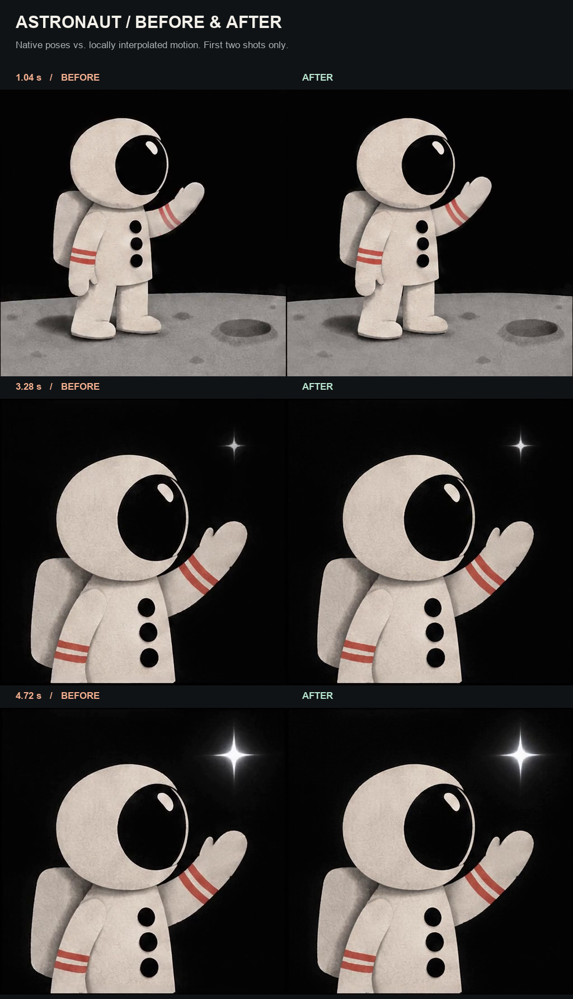
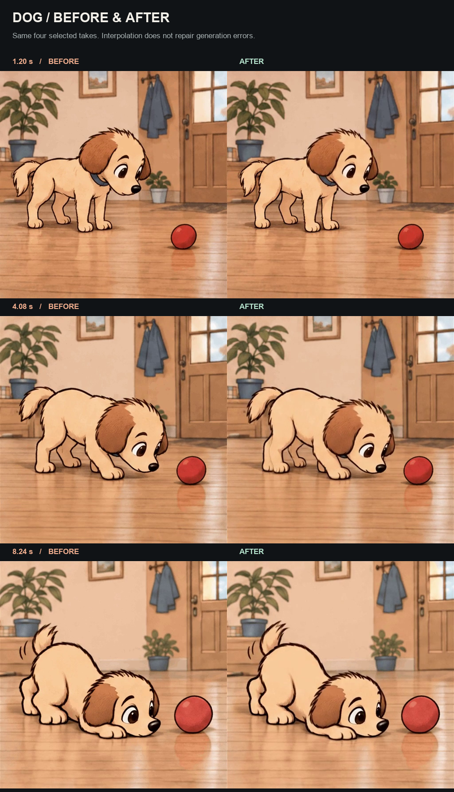
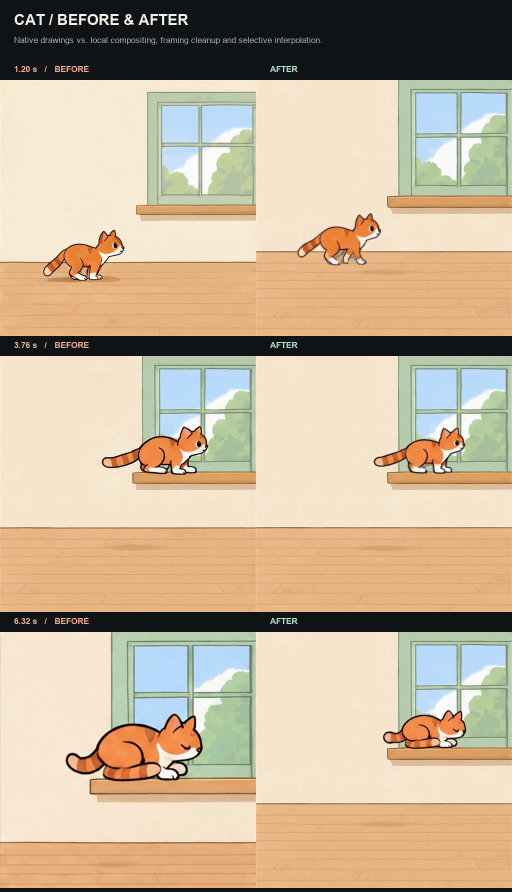

# Showcase: generated GIFs and local finishing

These are selected development experiments. Each comparison pairs existing generated
footage with local postprocessing. No new model requests were made to prepare the
comparison assets. Public skill capabilities and private finishing are described
separately so the examples can be assessed fairly.

## Astronaut — two shots, one exchange

- Length: 5.12 seconds, first two reference-conditioned shots only.
- Before: native timing from the selected GPT GIF takes.
- After: existing locally interpolated version of those same two takes.
- Frame samples: 1.04, 3.28 and 4.72 seconds, chosen between native pose times.
- The third shot is excluded because its finished ending was deliberately retimed.

[Watch comparison](assets/showcase/astronaut-comparison.mp4). The runnable
[three-shot script](../examples/film.json) assembles the included native GIFs into
7.68 seconds without API requests; it does not apply the private interpolation step.
[Watch that exact public-toolkit export](assets/showcase/astronaut-native-film.mp4).

## Dog — the same four takes

- Length: 10.24 seconds; the same four selected takes in both panels.
- Before: native GIF timing, 16 generated drawings per take.
- After: existing local interpolation. No new scene generation for this comparison.
- Frame samples: 1.20, 4.08 and 8.24 seconds.
- 50 fps is the comparison's presentation grid, not native model output cadence.

[Watch comparison](assets/showcase/dog-comparison.mp4). The displayed source action
still has limitations. Intermediate frames do not repair a disappearing prop,
incorrect contact or a malformed paw; those require review and a different take.

## Cat — walk, jump, curl up

- Length: 7.68 seconds; the same three generated WALK, JUMP and CURL takes.
- Before: original native GIF sequence, 16 drawings at 160 ms per scene.
- After: existing local compositing, framing cleanup and selective interpolation.
- Frame samples: 1.20, 3.76 and 6.32 seconds.
- Fixed framing and background compositing account for visible scale/room changes;
  those are not solely an interpolation improvement.

[Watch comparison](assets/showcase/cat-comparison.mp4) or the
[complete 57.2-second silent cat film](assets/showcase/cat-film.mp4).
Selected contact intervals retain native pose cadence. Other beats also retain
stepped source drawings, and small matte/shading differences remain.

## How to read the assets

The PNG sheets are actual decoded frames from matching timeline positions, with
BEFORE on the left and AFTER on the right. Static frames help inspect geometry and
artifacts; motion differences are clearer in the linked comparison videos.

The small animated previews loop a 2.24-second excerpt from 0.32 seconds. Their loop
reset is a preview reset, not an edit in the full comparison. All panels retain their
original playback speed. Presentation encoding is lossy; it does not introduce new
AI-generated poses.

The public toolkit includes generation, still references, endpoint extraction,
explicit retakes and GIF-to-MP4 assembly. It does not include the private Studio UI,
RIFE backend or the additional compositing logic used in these finished experiments.
The full cat film is assembled and processed, not a single minute-long GPT request.

The downloadable media have been checked for personal paths, author comments and
embedded personal metadata. Dog/full-cat metadata-only remuxes preserve identical
decoded frames. [Asset hashes and technical facts](assets/showcase/asset-manifest.json)
identify the exact public comparison files without private request logs or prompts.
