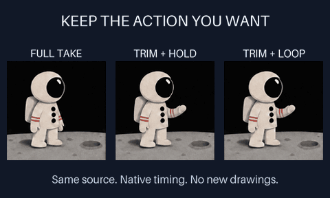

# Select the useful part of an animated layer

Skip an unwanted lead-in or ending without modifying the original animation.
Both GIF and PNG sprite layers accept an explicit source-time interval. Placement,
source selection, final hold and looping remain separate author choices.



[MP4](assets/source-trims/preview.mp4) ·
[Editable example](../examples/gif-layer/trimmed-scene.json) ·
[Verification](assets/source-trims/verification.json)

This **3.20-second, 480 × 288, 50 fps, silent, play-once** composition reuses one
existing astronaut take. Left: all 16 original drawings, followed by final hold.
Middle: native **640..1920 ms**, source indices **4..11**, then the last included
drawing holds. Right: that same 1.28-second interval loops. The original source
drawings each last 160 ms. These are three edits of one action, not three new
actions; an arbitrary selected loop may visibly jump. User acceptance is pending.

## Run it

Use a checkout with source-range support, Python 3.10+, Pillow 10.1+, FFmpeg and
ffprobe. Earlier skill/runtime pins, including skill 0.3, predate this feature.

```sh
python -m gif_cinema.layers render examples/gif-layer/trimmed-scene.json --out output/selected-action --dry-run
python -m gif_cinema.layers render examples/gif-layer/trimmed-scene.json --out output/selected-action
python tools/verify_layered_scene.py output/selected-action
```

The plan is offline and writes nothing. Rendering needs a new directory. No
provider, API key, generation, retiming or background removal is involved.

## Source time versus scene time

```json
{
  "id": "actor",
  "type": "gif",
  "source": "actor.gif",
  "size": [240, 240],
  "source_range_ms": [640, 1920],
  "playback": "once",
  "in_ms": 400,
  "out_ms": 3200
}
```

- `source_range_ms` is an optional **[inclusive start, exclusive end]** in the
  original source's milliseconds. It works identically for `gif` and `sprites`.
  Omitting it keeps the entire source and all existing playback behavior.
- Both bounds are integers in 10 ms units, between 0 and 120000. Select at least
  20 ms, start before end, and never beyond the actual native source duration.
  Still images, shapes, strokes and text reject this field.
- `in_ms` and `out_ms` remain scene-time visibility bounds on the output grid.
  When this layer appears at scene time 400 ms, it begins at source time 640 ms.
  Transform keyframes still span its active scene interval, not the trim duration.
- `once` plays the selected interval at original speed, then holds its last
  included drawing. An end exactly on a drawing boundary never displays the next,
  excluded drawing. A short active scene interval can still cut the selection off.
- `loop` wraps at the selected duration. The scene's own looping policy is
  separate. Neither source loop metadata nor trimming changes that explicit choice.

A range may begin or end inside an existing hold. Only those two edge holds are
shortened; interior native intervals stay unchanged. For original holds of
40, 80 and 120 ms, selecting 20..160 ms yields **20, 80 and 40 ms** with original
indices 0, 1 and 2. A once-playback holds index 2 afterward; a loop returns to
index 0 after exactly 140 ms. There is no interpolation or invented intermediate pose.

The output still samples at 20 ms (50 fps) or 40 ms (25 fps). Source ranges need
not align to that output grid. A 130 ms selected loop keeps its native phase;
it is not stretched to 140 ms. Short edge holds or drawings can therefore be
missed by some cycles. Choose boundaries/FPS deliberately and inspect playback.

## Inspect the actual selection

The `gif_timing` or `sprite_timing` plan and receipt preserve full source count,
duration and delays, then add:

- `source_range_ms` and `playback_duration_ms`: the effective selected interval.
- `selected_source_indices` and `selected_delays_ms`: original indices intersecting
  the interval and their actual included durations, including partial edge holds.
- `trimmed_source_drawings`: excluded entirely by the author's range.
- `sampled_source_indices`: indices actually selected at output timestamps.
- `unsampled_selected_drawings`: included by the range but missed by output
  sampling or a short active scene interval.
- `omitted_source_drawings`: the older all-source diagnostic, including both
  intentionally trimmed and unsampled drawings. Use the two distinct fields above
  when diagnosing why an action is absent.

Rendered sample records retain original `source_index` values, not indices
renumbered from zero after the trim. Two layers may share one file with different
ranges, clocks, transforms and playback modes. Index selection does not guarantee
visibility through other layers or visual continuity at a cut or loop seam.

## Sources and limits stay intact

The complete original GIF or atlas is snapshotted and hash-pinned in the portable
scene. Saving a selection does not crop, rewrite or discard its source. The range
is editable later; reopen verification rerenders every frame from that saved scene.

Full source decoding and all existing byte/pixel/frame/cache limits still apply.
GIF disposal can depend on drawings before the selected start, so trimming never
tries to decode only isolated later GIF blocks or use a short range to bypass
input limits. Range shape is checked before reading assets; native duration is
checked before resized caches are allocated. Invalid bounds fail explicitly.

This is an author-controlled edit, not automatic action detection, speed control,
reverse playback, pose generation, continuity repair or permission to replace
previously accepted media. Originals and existing output directories are preserved.
