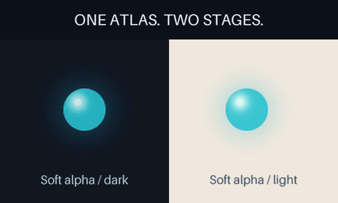

# Play PNG sprite atlases without a GIF round trip

Use reviewed PNG drawings as an animated layer alongside text, shapes, strokes,
stills and GIFs. The layer reads RGBA cells directly from the atlas, retaining
soft alpha and full PNG color in its source and lossless frame outputs. It does
not first quantize the drawings to a GIF palette or binary transparency.



[MP4](assets/sprite-layer/preview.mp4) · [Editable scene](../examples/sprite-layer/scene.json) ·
[Original RGBA atlas](../examples/sprite-layer/source/atlas.png) ·
[Verification](assets/sprite-layer/verification.json)

This **2.56-second, 480 × 288, 50 fps, silent, looping** example uses eight
original procedural light-pulse drawings, each held for 80 ms, four times.
Two independently placed layers share the same atlas. The soft glow is composed
against dark and light backgrounds before the GIF is flattened and quantized.
This is a graphic-animation/alpha demonstration, not a new character action.
Export FPS does not create additional drawings. Visual acceptance remains pending.

## Run the example

Use a checkout containing sprite-layer support, Python 3.10+, Pillow 10.1+,
FFmpeg and ffprobe. The 0.3 skill/runtime pin predates this feature; do not assume
that installed package supports the new type.

```sh
python -m gif_cinema.layers render examples/sprite-layer/scene.json --out output/atlas-scene --dry-run
python -m gif_cinema.layers render examples/sprite-layer/scene.json --out output/atlas-scene
python tools/verify_layered_scene.py output/atlas-scene
```

Plans write nothing. Rendering requires a new output directory and writes the
usual complete layered-scene bundle, including every PNG frame, source snapshots,
GIF/MP4 previews, isolated previews, an editable scene and a receipt. The verifier
requires every declared atlas, even when several layers reuse it.

`tools/make_sprite_layer_example.py --out NEW_DIRECTORY` recreates the original
artwork and recipe locally. It uses no generation model, provider or network.

## Import an existing sprite export

The existing [sprites pack/slice commands](SPRITES.md) produce a manifest with
absolute atlas rectangles, delays and pixel hashes. Import that manifest directly:

```sh
python -m gif_cinema.layers import-sprites examples/sprite-layer/source/manifest.json --out output/imported-atlas --width 320 --height 320 --repeat --dry-run
python -m gif_cinema.layers import-sprites examples/sprite-layer/source/manifest.json --out output/imported-atlas --width 320 --height 320 --repeat
python -m gif_cinema.layers render output/imported-atlas/scene.json --out output/imported-atlas-render
python tools/verify_layered_scene.py output/imported-atlas-render
```

Import needs only Python/Pillow, not FFmpeg. It verifies the exact PNG file hash,
dimensions, ordered frame records, native duration and **every selected RGBA crop
hash** before creating a fresh portable scene. It consumes only the manifest and
atlas. Missing individual frame PNGs or the lossy `animation.gif` preview do not
affect the import. Those other files are not copied or certified by this command.
Hashes check consistency, not the origin or authenticity of a supplied manifest.

The imported actor uses nearest-neighbor `pixel` sampling. Edit its `sampling` to
`smooth` for continuous artwork, or its `size`, placement and keyframes to compose
it with other layers. Shared cell dimensions preserve authored pose coordinates;
they do not repair misaligned drawings, identity drift or unwanted backgrounds.

Default import is play-once. `--repeat` explicitly loops both the actor and scene;
source preview loop metadata never overrides that choice. The default output is
512 × 512 at 50 fps; `--width`, `--height` and `--fps 25|50` are explicit options.
The import receipt records source timing and frame hashes.

A one-shot duration not aligned to the output grid rounds **up**, adding a reported
`final_hold_ms`. Very short one-pose inputs also receive enough final hold to meet
the scene's two-output-frame minimum. Exact repeat rejects a grid mismatch rather
than silently adding a loop pause. For example, 110 ms imports as 120 ms at 50 fps
for a one-shot, but cannot be repeated exactly at that FPS. The scene must still
fit the normal 40..30000 ms and 2..1500-frame limits; the importer does not split
long animations or silently omit drawings to fit them.
An aligned repeated source shorter than two output periods repeats whole cycles
to meet that minimum; `source_cycles` reports the count, and no final hold is added.

## Sprite-layer fields

```json
{
  "id": "actor",
  "type": "sprites",
  "source": "assets/atlas.png",
  "size": [160, 160],
  "sampling": "smooth",
  "playback": "once",
  "frames": [
    {"rect": [1, 1, 96, 96], "duration_ms": 80},
    {"rect": [99, 1, 96, 96], "duration_ms": 120}
  ]
}
```

- `source`: a local still PNG, resolved relative to the scene. URLs, traversal,
  escaping symlinks and animation are rejected. Optional `sha256` pins its bytes.
  Nontrivial EXIF orientation is rejected rather than changing atlas coordinates.
- `frames`: 1..256 records in authored order. Each requires only integer
  `rect: [x,y,width,height]` and `duration_ms`. Rectangles exclude padding, must
  lie inside the PNG and share one width/height. Repeated cells are valid holds.
- `duration_ms`: 20..60000, in 10 ms units; combined source duration at most 120 s.
- `size`: one aspect-preserving box applied equally to every selected cell.
  There is no per-pose trimming or recentering and no sampling across cell edges.
- `sampling`: `smooth` by default, or `pixel`. Pixel uses nearest-neighbor fitting
  and transforms; smooth uses Lanczos fitting and bicubic transforms. Rotated or
  fractional pixel-art placement can still step or shimmer. Choose suitable
  integer scale/placement and inspect the real export.
- `playback`: `once` by default, holding the final cell, or `loop` at native duration.
  The clock begins at `in_ms`; normal transform/easing/opacity/anchor and `out_ms`
  apply independently. There is no reverse, speed remap or generated tweening.
- `pose_keys`: optional [explicit drawing selection](AUTHORED-POSES.md), using stepped
  holds instead of the native clock. Cannot combine with looping playback or trims.
- `source_range_ms`: optional [native-time selection](SOURCE-TRIMS.md), keeping
  original cell indices and partial edge holds without changing atlas bytes.

Without `pose_keys`, the original delay interval selects one source cell at each output time. The
`sprite_timing` plan/receipt lists rectangles, delays, used indices and omitted
drawings. A 25 fps export may skip 20 ms cells. Selected indices do not prove that
an overlapping layer left the drawing visible, or that its action is acceptable.

## Bounds and preservation

The atlas is limited to 16 MiB encoded, 16,777,216 decoded pixels, and 16384 pixels
per side. Each selected cell is at most 4,194,304 pixels. Source cropping work
across all sprite layers is at most 33,554,432 pixel-frames, counting repeats.
Sprite and GIF resized caches share a 33,554,432-pixel upper bound, counting each
layer's requested box times its drawing count before allocation. All unique
still/GIF/atlas sources also share the existing 32 MiB encoded / 16,777,216
decoded-pixel limits. Existing scene/raster/compositing budgets remain in force.
These are workload ceilings, not a promise about total process memory.

Import reads at most 1 MiB of manifest JSON. Rectangles and relevant pixel budgets
are checked before crop allocation. Atlas bytes and every selected crop must
match the manifest, and source hashes are rechecked before saving. Original inputs
and existing output directories are never overwritten. A portable save contains
one content-addressed atlas copy even when several layers reuse it.

PNG source snapshots retain the exact original bytes. RGBA composition can resample
and round colors; this is not a promise of bit-identical transformed pixels.
Final GIF and MP4 previews are flattened against the chosen matte, and GIF palette
reduction still affects the final composite. This adds neither transparent video,
automatic character rigging, background removal, new poses nor visual approval.
