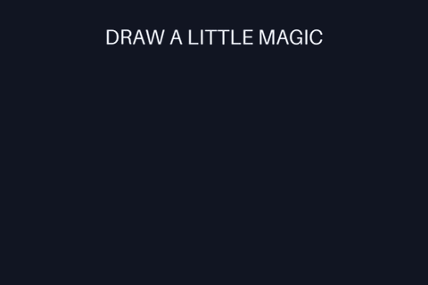

# Draw-on motion with editable strokes

Animate an authored line progressively, with a moving round tip, a deliberate
pause between strokes, a slowing finish, and a final hold. This is a local motion
primitive in the experimental [layer renderer](MULTILAYER-POC.md). It makes no
API calls and does not invent lettering, poses, or character actions.



[Watch the MP4](assets/stroke-reveal/preview.mp4) ·
[Inspect sampled frames](assets/stroke-reveal/contact-sheet.png) ·
[Edit the scene](../examples/stroke-reveal.json) ·
[Verification and hashes](assets/stroke-reveal/verification.json)

The original asset-free example is **4.00 seconds, 480 × 320, 50 fps, silent,
play-once GIF**. It draws a heart outline, a separate underline, then a sparkle.
The completed drawing holds for the last 400 ms. MP4 playback behavior belongs
to the player. Some GIF viewers repeat even a play-once file.

## Run and verify

Use the repository checkout containing this feature, Python 3.10+, Pillow 10.1+,
FFmpeg and ffprobe. Skill package 0.3.0 and its pinned runtime include the same
stroke feature, examples and verification helper. See the [installed workflow](../.agents/skills/gif-cinema/references/layers.md).
Older skill/runtime pins do not include strokes; do not replace a working installation automatically.

```sh
python -m gif_cinema.layers render examples/stroke-reveal.json --out output/strokes --dry-run
python -m gif_cinema.layers render examples/stroke-reveal.json --out output/strokes
python tools/verify_layered_scene.py output/strokes
```

The plan writes nothing. Rendering requires a new directory and never replaces
source files. The output contains GIF/MP4, every RGBA PNG, sampled frames,
isolated layer previews, a portable editable scene, and a receipt with source and
output hashes. The verifier rerenders **every** saved frame and compares exact
RGBA pixels. Technical verification leaves visual/user acceptance pending.

## A stroke layer

```json
{
  "id": "underline",
  "type": "stroke",
  "size": [260, 32],
  "points": [[12, 24], [90, 15], [175, 12], [246, 20]],
  "stroke": "#86e4f5",
  "stroke_width": 3,
  "keyframes": [
    {"at": 0, "reveal": 0, "y": 0.83},
    {"at": 0.5, "easing": "ease-out"},
    {"at": 0.8, "reveal": 1},
    {"at": 1}
  ]
}
```

- `points` is an ordered list of **2..512 local pixel pairs**. Coordinates must
  be finite, within `0..width-1` and `0..height-1`, and form a nonzero-length path.
  Repeated points are harmless. The path is a polyline, not SVG or a cubic spline.
  Use more authored points for a smoother spatial curve.
- `size` is the local raster box, subject to the existing layer limits. Leave
  room around points for half the line width and antialiasing. Points on the box
  boundary deliberately clip the cap; no hidden automatic padding shifts anchors.
- `stroke` is `#RRGGBB` or `#RRGGBBAA`, default white. `stroke_width` is an integer
  nominal local-pixel width in **1..128**, default 3. Caps and joins are round.
- `reveal` is the visible **fraction of total geometric path length**, from
  zero (completely blank) to one (complete). Unevenly spaced vertices do not
  cause speed jumps. The normal timing/easing changes how distance advances.
- `reveal` defaults to one and inherits between keyframes. It is valid only
  for stroke layers. It can decrease to erase a prefix from its endpoint.
  Use a separate layer for each pen lift or independent stroke.
- Existing `x`, `y`, `zoom`, `rotation`, `opacity`, `anchor`, `in_ms` and `out_ms`
  work normally. Easing applies to all changing properties of that segment and
  belongs to its left keyframe. It does not inherit to the next segment.

The example above stays blank for half its active interval, draws from 50% to
80% with a slowing finish, then holds. Finish before `at: 1` when the full path
must actually appear in exported playback: the closing endpoint is diagnostic,
not an extra exported frame. For a reveal loop, author an erase/reset or a fade
and inspect the last-to-first cut. A draw-on stroke is not automatically seamless.

## Edge quality and bounded work

The renderer draws each visible path prefix into one coverage mask at 3×
resolution, then downsamples. Shared coverage prevents semi-transparent joins
and self-intersections from becoming darker through repeated alpha blending.
Premultiplied transforms preserve alpha edges. GIF/MP4 flatten against the scene
matte; exported PNGs retain alpha. Inspect the encoded GIF too, since palette
quantization can still change colors and fine edges.

Complete paths reuse a cached premultiplied raster. Partial paths are rerasterized
from cached arc-length geometry, and zero reveal draws nothing. Preflight counts
all active frames conservatively, even during blank/full holds:

- At most **268,435,456 supersampled stroke pixel-frames** across all paths.
- At most **1,000,000 stroke segment-frames** across all paths.
- Existing scene, source raster, compositing, frame count and JSON limits also
  apply. Each path has at most 512 vertices and no executable expressions.

These ceilings cover rendering a bounded scene, not a claim about total process
memory or arbitrary repeated API calls to `render_at`. Reopen verification and
endpoint diagnostics perform additional bounded passes. Reduce local path box
size, active interval, duration, FPS or point count if a plan exceeds a budget.

## Scope and evidence

This feature animates authored geometry. It does **not** trace a signature image,
convert fonts into handwriting paths, import SVG/Lottie, change stroke pressure,
repair character continuity, or synthesize new action drawings. Use strokes for
graphic accents, route lines, original monoline lettering and hand-authored marks.
It does not create a legal signature or sign a document.

GIF Factory's [November 9 signature examples](https://github.com/WoYun520/gif-factory/tree/fbbb6c31f150d5cd28c04e005d1da936016daf3e/examples/dynamic-signatures)
illustrated the usefulness of independent stroke timing and a slowing finish.
This implementation and the heart/underline/sparkle example are original; no
Factory code, images, signature designs or parameters are bundled here.

Focused tests cover arc-length sampling, pauses, reverse reveal, numeric and work
budgets, alpha overlap, local timing, transforms, round trips, failure cleanup,
real GIF/MP4 encoding and all-frame verification. The checked-in example media
was rendered from its JSON and decoded, and all 200 PNG frames were reopened and
matched. Sampled frames were visually inspected; this is not user acceptance.
