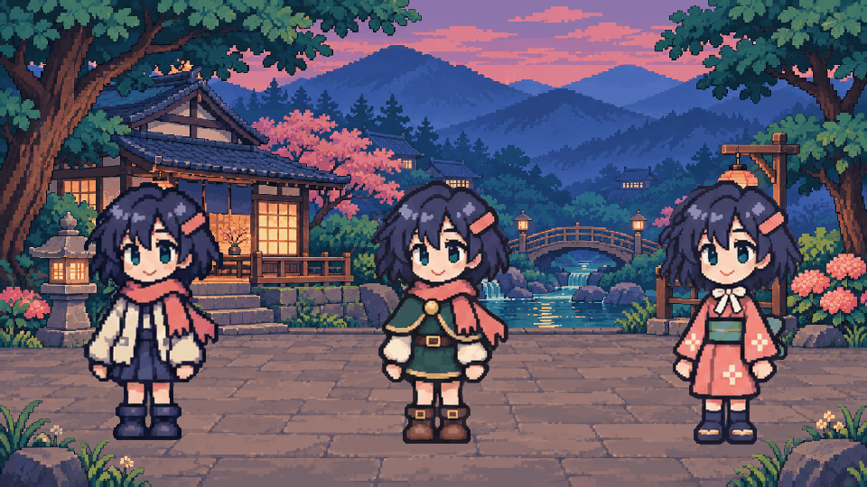
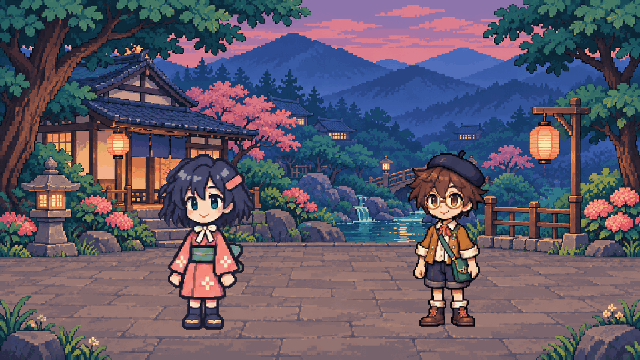
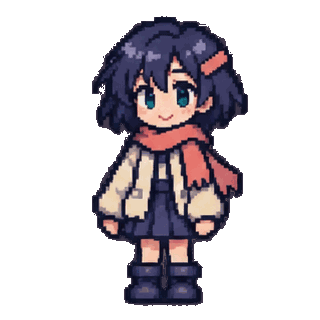
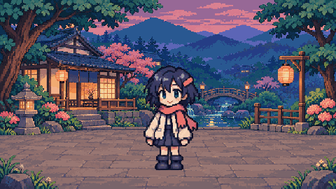

# Anime pixel-art studies

**Newer takes:** [32 separate pose frames per outfit](outfit-poses/README.md) now
lead the main gallery. Drawing shifts remain at the joins. The combined garden scenes below are earlier composition tests,
not the target format for the next outfit takes.

Short character performances made from image-generated sprite drawings, sliced and
composited locally. These are actual silent GIF files, not CSS or JavaScript demos.
The original generation used image_gen, not Higgsfield. This publication made no new
generation calls. They demonstrate imported artwork, not a new built-in character
generator in GIF Cinema.

## Three outfits

A cream jacket, jade traveler outfit and coral festival yukata share the same
greeting/knee-lift action. **960 × 540, 16 distinct decoded frames, 1.92 seconds.**
This is a wardrobe comparison, not three sequential story events.

## Two heroes

The heroine waves while the courier touches his beret and bows.
**640 × 360, 16 distinct decoded frames, 1.92 seconds.** Both characters are placed
on a single fixed background; the camera and garden do not move.

## Wave and bow

Two short phases joined in one file: greeting, then bow.
**320 × 320, 32 distinct decoded frames, 3.84 seconds.** This is the supplied v2
export. Its second-phase source atlas and assembly recipe are not in this collection;
do not mistake the garden recipe for a complete rebuild of this file.

## Sources and method

- [Original heroine atlas](sources/original.png)
- [Traveler atlas](sources/traveler.png) · [transparent GIF](traveler.gif)
- [Festival atlas](sources/festival.png) · [transparent GIF](festival.gif)
- [Courier atlas](sources/courier.png) · [transparent GIF](courier.gif)
- [Original garden](sources/garden.png) · [prepared garden](garden-960.png)
- [Garden composition recipe](recipe.json)

The provided 4 × 4 atlases are sliced in reading order. Each drawing holds for
120 ms, with a consistent cell extent, a 56% alpha threshold and nearest-neighbor
resizing. Garden scenes use a shared 256-color palette with dithering disabled.
The recipe records sprite positions and sizes; it is source documentation, not an
executable GIF Cinema scene specification. Original source files and supplied GIFs
are preserved without re-encoding. Poster PNGs are decoded first frames for viewers
that support reduced-motion pictures.

## Verification and limits

[verification.json](verification.json) records SHA-256, bytes, dimensions, frame
counts, unique decoded drawings, delays and loop metadata for the six original study GIFs.
All repeat indefinitely and have no audio. The top 140 rows in both garden scenes
are pixel-identical across decoded frames. Repeating playback is not a seamless
loop: the first and last drawings differ.

All frames of the two garden GIFs and the original wave-and-bow GIF were inspected
in contact sheets. Face/hair,
costume-pattern and pose drift remain, especially at the transition between the
two solo phases. These are pixel-art-style generated drawings, not verified
hand-authored pixel grids or production-ready character continuity. No intermediate
poses were synthesized during publication. Technical checks and contact-sheet
inspection do not establish artistic approval or clean real-time playback.

## Draft festival film

[Watch MP4](lantern-festival-15s.mp4) · [Open play-once GIF](lantern-festival-15s.gif) ·
[Measured file facts](film-verification.json)

An eight-scene **15.36-second silent montage**, with four characters, seven outfits
and two fixed backgrounds. The GIF is 480 × 270 with 128 distinct decoded frames,
each held for 120 ms; it has no loop extension (viewers may override play-once).
The MP4 is 640 × 360 at 25 fps, with 384 video frames that repeat drawings rather
than adding new poses. Both downloads are under 1 MB.

The production used image-generated 4 × 4 sprite atlases, local slicing/composition,
and zero-provider-call assembly in GIF Cinema. Its original production record counts
96 newly generated action drawings and 32 reused drawings. The final exports are
published here; the complete film source project is not bundled in this directory.

This remains a **draft montage, not continuous smooth action**: cuts change clothing,
staging and scale, supporting characters hold static poses, and small drawing drift
remains. The publication checked decoded GIF timing and the supplied storyboard;
it does not claim normal-speed playback approval. Future outfit studies need
separate, denser pose sequences rather than presenting all costumes together. The repository's [license](../../LICENSE) applies;
the presence of generated assets is not a separate commercial-rights warranty.
