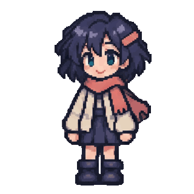
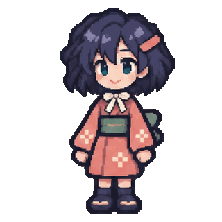

# Separate outfit pose studies

Three independent raise-and-wave animations, with **32 individual transparent PNGs
per outfit**. Each GIF is 320 × 320, has 32 distinct decoded frames, holds each frame
for 80 ms (12.5 fps), lasts 2.56 seconds and repeats indefinitely. All are silent.

## Cream jacket

[32 individual PNG frames](casual/) · [GIF](casual.gif)

## Jade traveler

[32 individual PNG frames](traveler/) · [GIF](traveler.gif)

## Coral festival yukata

[32 individual PNG frames](festival/) · [GIF](festival.gif)

## Drawings and timing

Each outfit was generated separately as two 4 × 4 pose atlases: 16 gradual
hand-raising drawings, followed by 16 wave/lower drawings. This replaces the earlier
knee-lift choreography; it does not slow down or repeat the old action. According
to the production record, no interpolated poses were used. Publication makes no
new generation requests.

Each outfit folder contains frames **00.png through 31.png** in playback order.
These are sliced, transparency-processed source drawings, not lossless GIF-decodes:
the GIF uses a shared 128-color palette, so its RGB values can differ slightly.
The PNG and GIF alpha masks match. Transparency uses the production's 56% threshold.
The casual take's second half was shifted upward by two pixels as a group to align
the feet; no per-frame warping is claimed. Original full atlases are not included
here; the separate PNG drawings are.

## What is verified, and what still needs work

[verification.json](verification.json) pins every GIF and all 96 PNGs by SHA-256.
Automated tests decode every frame and check the count, unique drawings, duration,
loop metadata, alpha masks and grounded foot baseline. Posters match first frames.
Contact sheets were visually inspected; normal-speed browser playback was not
evaluated.

The poses visibly progress through raising, waving and lowering the hand, but the
wave is subtle and drawing variation is not all intentional motion. Hair, face
proportions, sleeves and silhouette still shift at **15 → 16** and **31 → 0**.
The feet remain at a fixed vertical baseline, but that alone does not prove smooth
acting. These are denser pose studies, **not seamless loops or perfectly smooth
finished animation**. Keep each outfit separate when selecting or refining frames.

[Earlier experiments and festival montage](../README.md) ·
[Pixel-preserving export tools](../../../docs/PIXEL-PALETTES.md)
