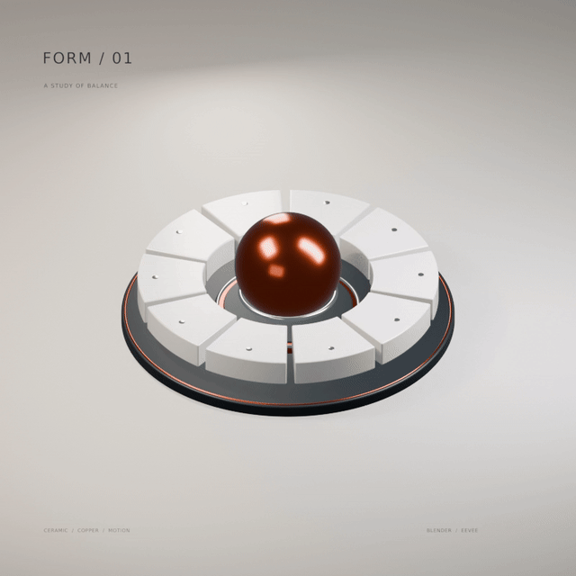

# FORM / 01 · Blender motion study



[MP4](deliverables/FORM-01.mp4) · [Editable Blender project](form_01.blend) · [Python source](form_study.py) · [Contact sheet](deliverables/contact-sheet.jpg)

An original six-second kinetic sculpture, modeled, animated, lit and rendered in Blender 4.3.2. Porcelain arcs unfold in a restrained traveling wave around a copper core. The core follows slightly behind the ceramic motion, then the arrangement returns to its starting pose.

No JavaScript animation, generative image/video models, stock assets, paid APIs or remote video generation. Geometry is deterministic and authored in the included Blender Python source. The video and GIF are encodings of actual Blender-rendered frames.

This is a standalone Blender example, not output from an AI image/video model and not a new `gif_cinema` rendering backend. The scene was authored with assistant-written Python; Blender renders the pixels. The public CLI still uses its documented generation, import and local-compositing routes.

## Open and edit

Open `form_01.blend` in Blender 4.3 or newer. The font is packed. No external textures or plugins are required. The timeline is 1–144 at 24 fps. Frame 145 is a verification-only duplicate of the initial pose and is deliberately excluded from the loop.

- `KINETIC RING | rotate`: gentle global rotation.
- `Segment 01…10 | radial hinge`: independent segment lift, radial translation and tilt. Keyframes can be edited in the Graph Editor.
- `Core | copper mirror sphere`: delayed vertical motion.
- `CAM | editorial three-quarter`: the locked orthographic camera.
- Lights are named Key, Rim, Fill and Front.
- All materials are named by finish. The ceramic material includes a very fine surface grain.
- Typography is actual Blender text, parented to the camera and editable in the scene.

## Rebuild the source

From a shell, in this folder:

    blender -b --python-exit-code 1 --python form_study.py

This creates/overwrites `form_01.blend`. The font is in `assets/` with its license.

Render all frames:

    blender -b form_01.blend -o //renders/form_ -s 1 -e 144 -a

Or rebuild and render together:

    blender -b --python-exit-code 1 --python form_study.py -- --render

Preview selected moments:

    blender -b --python-exit-code 1 --python form_study.py -- --preview --frames 1,37,73,109,145

Encode with FFmpeg:

    bash encode.sh

## Render choices

The delivered animation uses Blender EEVEE at 800 × 800, 24 samples per frame. The project also includes 128-sample Cycles settings if you prefer a path-traced rerender on a stronger machine. The installed CPU-only Blender build did not contain OpenImageDenoise, so no neural denoiser was used. The final video receives modest conventional FFmpeg denoising before encoding to reduce soft-shadow sampling noise. The source render remains editable and rerenderable.

GIF uses a palette and centisecond timing, so it cannot preserve all the gradients or exact 24 fps timing of the MP4. The MP4 is the best-quality playback version. The GIF is 640 × 640, with a six-second infinitely repeating cycle. The 800 × 800 MP4 contains one six-second cycle and no audio.

## Files

- `form_01.blend`: self-contained editable project.
- `form_study.py`: complete source scene, animation, lights and typography.
- `encode.sh`: deterministic FFmpeg export commands.
- `assets/`: typeface and license.
- `FORM-01.mp4`: full-resolution playback.
- `FORM-01.gif`: sharing-friendly looping GIF.
- `contact-sheet.jpg`: selected frames for quick inspection.
- `validation.json`: export and loop checks.

## Import into GIF Cinema with zero API calls

From the repository root:

```bash
python -m gif_cinema render examples/blender-form-01/import-film.json --dry-run --max-api-calls 0
python -m gif_cinema render examples/blender-form-01/import-film.json --execute --max-api-calls 0 --out output/blender-form-import
```

Repeat the second command to verify reuse of the existing source. This route assembles the supplied 640 × 640, 20 fps GIF into a six-second silent film. It does not rerender the 3D scene, invent frames, or equal the cleaner 800 × 800 Blender MP4 supplied above.

## Review status

All 144 source frames were decoded, both exports were checked for timing and frame counts, and the loop was checked geometrically and numerically. A separate visual pass inspected 12 key moments plus representative full-resolution GIF frames. No clipping or object intersections were noticed in those reviewed frames. This was not a full-frame, real-time playback review; user artistic acceptance remains pending. Numeric continuity is not a substitute for visual acceptance.

The MP4 has 144 rendered samples at 24 fps. The sharing GIF has 120 samples at 20 fps with 50 ms delays, not 144 unique GIF frames. Small footer text is decorative at GIF size.

## Rights and provenance

The authored scene, scripts and rendered media use the repository [source-available evaluation license](../../LICENSE); this does not change the project license. The unmodified bundled DejaVu Sans font has its separate [Bitstream Vera/DejaVu license and copyright notice](assets/DejaVu-LICENSE.txt). The font is also packed in the Blender file. No third-party photographs, models or textures are included. See [provenance.json](provenance.json) for file checksums and exact production facts.
