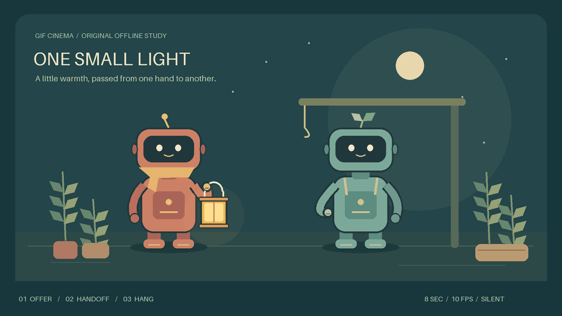

# One Small Light: preserved prototype sources

An original, local Pillow cutout animation: offer a lantern, transfer its handle,
then hang it on a hook. **Technical prototype, not final visual quality.** This
example is not a Blender scene and is not part of skill package 0.4.0.



[MP4](../../docs/assets/handoff/one-small-light.mp4) ·
[Decoded contact sheet](../../docs/assets/handoff/contact-sheet.png) ·
[Full guide](../../docs/HANDOFF-PROTOTYPE.md)

- 8.00 seconds, 960 × 540, 10 fps, silent, play-once GIF.
- One persistent lantern. Five 100 ms shared-grip ticks before release.
- Three source GIFs under `media/`, with a normal `film.json`.
- `source-frames.zip` preserves all 80 original PNG ticks and three working layers.
  `anchor-ledger.json` records every frame hash, palm, grasp and ownership state.
- `verification.json` pins the published source/export bytes and reports limits.
- No JavaScript animation, downloaded artwork, paid API, Higgsfield or new model call.

From the repository root, assemble the committed GIF sources without regenerating:

```sh
python -m gif_cinema render examples/handoff/film.json --execute --max-api-calls 0 --out output/handoff-reassembly
```

To rebuild the authored artwork and all review assets, use a new output directory:

```sh
python tools/build_handoff_prototype.py --out output/handoff-rebuild
```

The 80 PNG ticks include deliberate holds. GIF encoders consolidate identical
adjacent drawings; the delivered GIF contains 59 encoded drawings whose delays
preserve all 8 seconds. Higher drawing count is not claimed. The H.264 MP4 is a
lossy viewing copy. Character faces stay fixed and arms have deliberately stylized
flexibility. Technical checks and frame inspection do not establish user acceptance.

All artwork is authored by the included builder. No GIF Factory art or code was
copied. Its fixed-background/palm-anchor production method informed this study;
see the guide for the source reference. Existing repository licensing applies.
