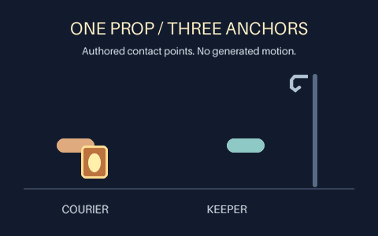

# One prop, three anchors

A six-second, 480 × 300, 25 fps, silent, play-once **schematic contact study** made
entirely by the public local layer renderer. One persistent lantern switches
between two authored hand pads and a hook. No paid request, JavaScript animation,
Higgsfield, downloaded art or new character drawing is involved.



[Guide and contract](../../docs/PROP-ANCHORS.md) · [Editable scene](scene.json) ·
[MP4](../../docs/assets/prop-anchors/preview.mp4) · [Evidence](verification.json)

From the installed repository checkout:

```sh
python -m gif_cinema.layers render examples/prop-anchors/scene.json --out output/my-anchor-study
python tools/verify_layered_scene.py output/my-anchor-study
```

All 150 original RGBA output samples can be reproduced from `scene.json`.
`verification.json` records the actual published media hashes, dimensions, timing,
source-scene hash, all-frame reopen check and the two authored transfer gaps.
The GIF combines identical adjacent holds; its stored drawing count is recorded
rather than assumed equal to output FPS. MP4 is a lossy viewing copy.

This demonstrates reusable point attachments, not a finished character scene.
The pads are schematic, hands are not anatomically drawn, and zero anchor gap
is a mathematical constraint rather than evidence of believable grip or artistic
acceptance. Visual inspection is recorded separately from technical verification.
No upstream GIF Factory assets or code are copied. Existing repository licensing
applies. The previously published prototype, pinned runtime and package version remain unchanged.
