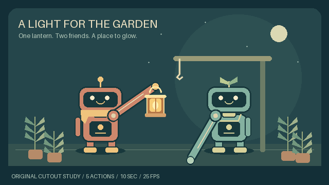

# A light for the garden

A ten-second, five-action **offline mechanical-cutout animatic**, authored on one
640 × 360 stage at 25 fps. A copper courier offers one lantern; a green keeper
reaches, receives it, lifts it to a hook, and withdraws its hand. Different actions
are visible in each scene. The camera, artwork, characters and prop stay fixed in
identity across all five scenes.



[MP4](../../docs/assets/scene-sequence/preview.mp4) ·
[Actual-frame contact sheet](../../docs/assets/scene-sequence/contact-sheet.png) ·
[Verifier result](verification.json) · [Preview provenance](preview-provenance.json)

## Verification and review

The local compiler build and a separate verification invocation succeeded:
250 source PNG frames reopened and matched, 426 export files verified, five
scenes, 10,000 ms, zero provider calls. All four joins have identical previous
last-stored, conceptual endpoint and next-first pixels because the actions have
explicit ending holds. Inspect the actual triples:
[offer → receive](../../docs/assets/scene-sequence/join-01.png),
[receive → release](../../docs/assets/scene-sequence/join-02.png),
[release → lift](../../docs/assets/scene-sequence/join-03.png),
[lift → hang](../../docs/assets/scene-sequence/join-04.png).

The exported first/middle/last samples and all four join triples were visually
inspected during authoring. This is sampled-frame QA, **not full-motion human
approval**. The technical receipt deliberately leaves visual acceptance
unestablished. The MP4 is 640 × 360, 25 fps, 250 frames and 10 seconds. The play-once
GIF coalesces repeated holds into 206 stored frames with the same total duration;
some viewers override play-once. Both are viewing copies, not source masters.

## Editable sources

- [`stage.json`](stage.json): one static seed stage with two robot bodies, two
  pivoting arm cutouts, two hands, one hook, one lantern and one garden background.
- [`sequence.json`](sequence.json): five action tracks. Omitted tracks hold their
  preceding ending pose; the shared assets are not replaced between scenes.
- [`assets/`](assets/): eight original, static RGBA PNGs.
- [`../../tools/build_scene_sequence_example.py`](../../tools/build_scene_sequence_example.py):
  reproducible asset drawing and JSON authoring source using Pillow and Python.

Rebuild the editable sources from the repository root:

```sh
python tools/build_scene_sequence_example.py
```

Render with the sequence compiler in this checkout (use a new output directory):

```sh
python -m gif_cinema.sequence build examples/scene-sequence/sequence.json --out output/garden-sequence --dry-run
python -m gif_cinema.sequence build examples/scene-sequence/sequence.json --out output/garden-sequence
python -m gif_cinema.sequence verify output/garden-sequence
python tools/build_scene_sequence_example.py --review-export output/garden-sequence
```

This runs locally with Python, Pillow, FFmpeg and ffprobe. It does not make model,
Higgsfield or other paid API calls, or require JavaScript or new dependencies.

## Authored action and support

1. **Offer, 2.0 s:** the courier lowers its raised arm forward, carrying the lantern
   from its own hand to the space between the characters.
2. **Receive, 2.0 s:** the keeper retracts and levels its arm, then extends to the same
   handle and holds contact. The
   courier still supports the prop during this scene.
3. **Release, 1.6 s:** support changes to the keeper at the shared endpoint
   `(320, 225)`; the courier's empty hand rises clear of the prop.
4. **Lift, 2.4 s:** the keeper rotates its arm upward, carrying the lantern to the
   hook at approximately `(349.2893, 154.2893)`.
5. **Hang, 2.0 s:** support changes to the hook. The keeper clears the handle upward,
   retracts its arm, lowers it, then extends to its rest position. The prop stays
   on the hook while both hands finish clear.

The arm pivot is pixel `(12,12)` in each 112 × 24 raster; its endpoint is
`(112,12)`. Hand centers follow that endpoint. Both characters briefly share the
same grasp point, so one palm partly occludes the other. The prop's top-center
anchor sits on that grasp point. The final hook point is explicit, not inferred
from the artwork. Attachment changes and arm poses are authored, not simulated.

## Provenance and limitations

All PNGs are original primitives drawn by the included Python builder for this
example. The two robot designs echo this repository's earlier original handoff
study, but no footage, source frames, backgrounds, or timing labels are reused.
No upstream GIF Factory art or external image assets are included. Lettering uses
Pillow's bundled default font. The source artwork is covered by the repository's
source-available license.

These are fixed robot cutouts, not newly generated anatomical poses. Rotation,
translation and uniform scale make the mechanical actions visible. The keeper's
retraction scales the complete arm, including its thickness; it is not a skeletal
or telescoping rig. The hands are simple round grippers without articulated
fingers. There is no facial animation, walking, natural cloth motion, simulated
weight or physically correct grip. The lantern is already lit throughout.

The five actions are not repeated clips with new captions. Nevertheless, 250 output
samples are **not 250 newly drawn poses**, and numeric anchor continuity is not
human approval. Inspect the actual joins, contact frames and full playback before
accepting this animatic for a finished film.
